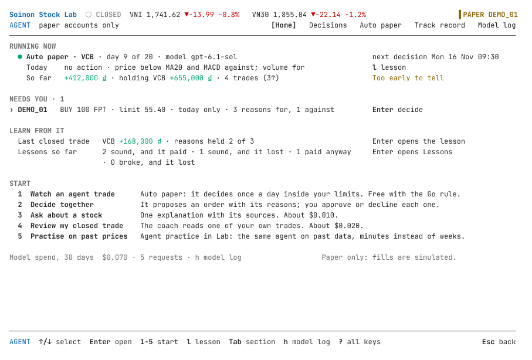
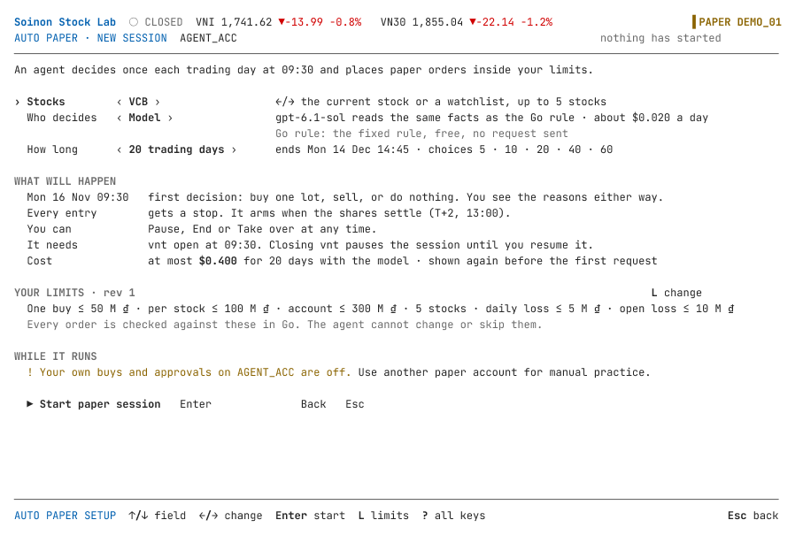
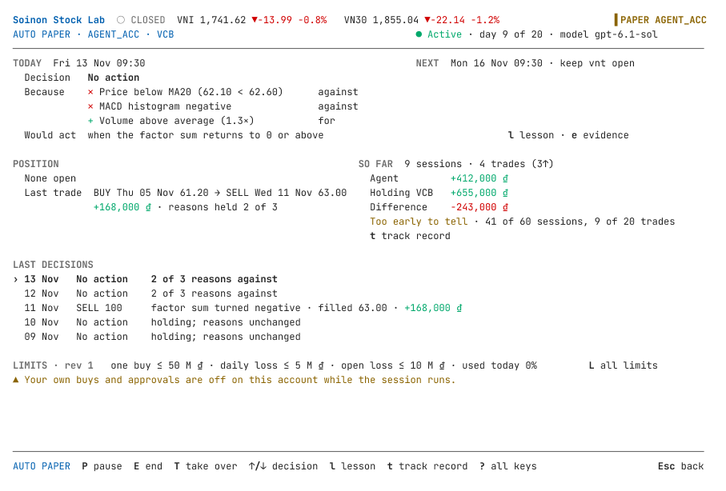
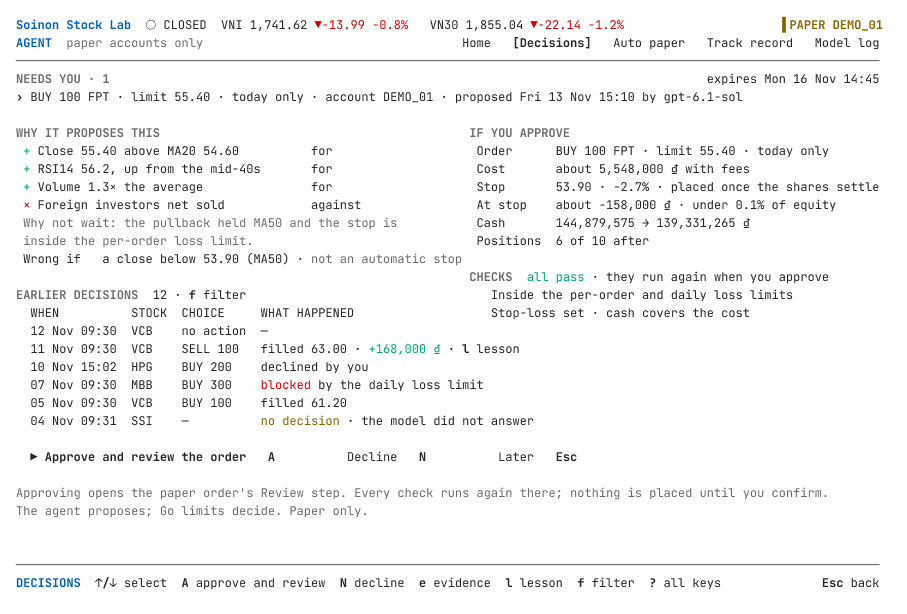
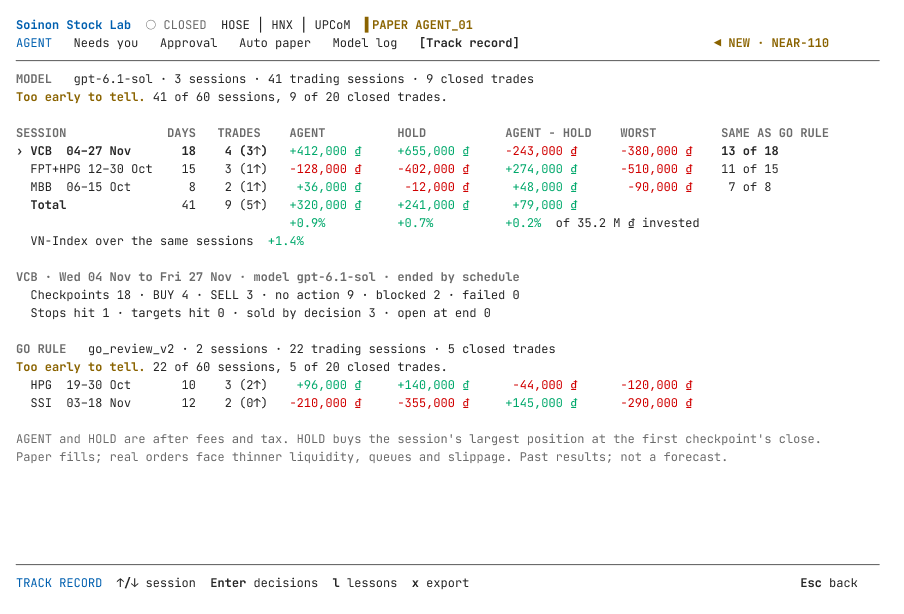
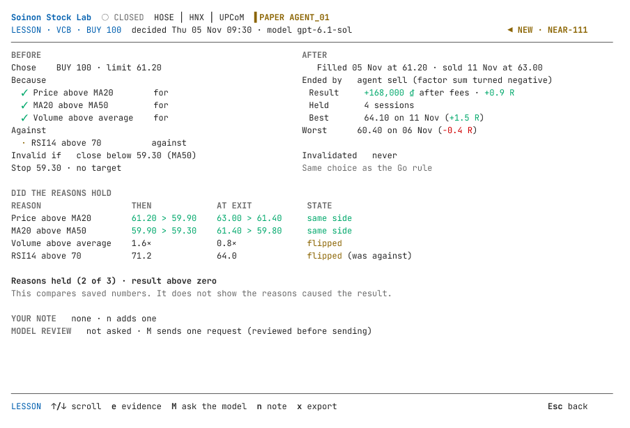

# 7 · Agent

**Purpose:** Let an automated helper either **run scheduled paper checks once a day inside strict safety limits** (**Auto paper**) or **propose paper orders for you to approve or decline** (**Decisions**), while auditing every decision afterwards through **Track record** and **Lessons**.

**How to get there:** Press `F3` then `7`, press `A` on Today, or type `:agent`.

> **Paper accounts only & deterministic safety.** Agents **only** touch paper accounts and **cannot** alter or bypass risk limits (`Daily loss limit`, `Max buy size`, `Max positions`, `Stop-loss requirements`). All protective bounds are enforced in Go code regardless of whether you run the free Go rule or a paid AI model.

## Use cases & user stories

- **Testing systematic rules without coding:** *"I want to see how a strict daily rule behaves over 20 trading days with real limits and protective stops — without paying API fees."* → Start **Auto paper** (`1`) using the free **Go rule**.
- **Human-in-the-loop co-pilot:** *"I want an AI or rule assistant to propose buys/sells with reasons and cash impact, while I make the final yes/no."* → Use **Decisions (`Needs you`)** and approve or decline every proposal yourself.
- **Auditing reasoning after the dust settles:** *"When an agent trade won or lost money, did its technical reasons actually hold up, or did it just get lucky?"* → Open **Lessons (`l`)** to compare `Before` vs `After` indicators and the `Wrong if` condition.

---

## Agent home

- **`RUNNING NOW`:** Live summary of any active **Auto paper** run (day counter, today's decision at `09:30`, session P&L, next run time).
- **`NEEDS YOU`:** Order proposals waiting for your yes/no (`Enter` opens to decide).
- **`LEARN FROM IT`:** Summary of how the agent's past reasons actually held up (`2 sound, and it paid · 1 sound, and it lost · 1 paid anyway · 0 broke, and it lost`).
- **`START` (`1`–`5`):** Launch Auto paper (`1`), review/enroll approvals (`2`), inspect a stock (`3` / `M`), review a closed trade (`4`), or run fast historical **Agent practice** in Lab (`5`).
- *(Note: Starting `vnt tui --experiment` adds experimental daily portfolio runs as option `6` / `p`.)*

---

## Go rule vs Model agent

| Mode | How it decides | Cost & key required |
|---|---|---|
| **Go rule** | Fixed rule built locally into `vnt` (demonstration baseline, not an evaluated alpha strategy) | **Free** — no key, nothing leaves your computer |
| **Model** | Configured language model reading saved chart/news/book facts | **Paid per request** — shows estimated `$` cost before confirming |

See [Safety and your data](safety-and-data.md#model-features) for API key setup.

---

## Auto paper

**Purpose:** Run a hands-off daily paper test over 5 to 60 trading days inside hard caps you approve up front.

### Setup fields
- **Stocks:** Watch one stock or a small watchlist group (up to 5 stocks; locked at start).
- **Who decides:** Go rule (free) or configured model (shows max checkpoint & call cap before starting).
- **How long:** `5`, `10`, `20`, `40`, or `60` trading days.
- **Limits (`L`):** Hard caps on largest single buy, largest holding per stock/account, max open stocks, and daily loss. Manual trades and approvals pause on that account while Auto paper runs.

Once active, keep `vnt` running around **09:30 ICT** each trading day so the session executes its daily check (closing `vnt` pauses the run cleanly until you resume).

On a running session you always see **today's reasoning (`+` for, `×` against)**, **`Wrong if`** (what price breaks the thesis), current P&L, and controls:
- **`P`:** Pause further daily checks.
- **`E`:** End Auto paper while keeping open exit orders armed.
- **`T`:** Take over manually (ends Auto paper and hands full control back to you, clearing agent-owned exits).

---

## Decisions (`Needs you`)

**Purpose:** Co-pilot mode — the agent proposes concrete limit orders with explicit reasons and impact math; **nothing happens unless you approve**.

### Example: Reviewing `BUY 100 FPT · limit 55.40`
- **Left (`WHY IT PROPOSES THIS`):** `Close above MA20`, `RSI14 56.2`, `Volume 1.3×`, weighted against `Foreign net sold`. Also states `Wrong if: a close below 53.90 (MA50)`.
- **Right (`IF YOU APPROVE` & `CHECKS`):** Exact cost (`~5,548,000 ₫`), protective stop (`53.90`, `-2.7%` placed at settlement), exact stop risk (`-158,000 ₫`), post-trade cash, and confirmation that all hard limits pass.
- **Actions:** Press **`A`** to open the Paper order Review step (all checks run fresh again before confirming), **`N`** to decline, or **`Esc`** to decide later (unanswered proposals expire automatically, e.g., `Mon 16 Nov 14:45`).

> **Setup note:** To let the agent propose on a dedicated paper account, run `:agent enroll ACCOUNT` (use a dedicated paper account since enrollment keeps agent records for that account's lifetime). Press `o` on Agent home to allow or block local MCP chat order requests.

---

## Track record & Lessons (`l`)

**Purpose:** Hold the agent accountable. Instead of just listing profits, **Track record** pairs every decision with what happened afterwards, and **Lessons (`l`)** checks whether the agent's reasons actually came true.

Press **`l`** on any closed decision to open its **Lesson** card:

Notice how **`DID THE REASONS HOLD?`** puts each original indicator number (`Then`) side-by-side with `5/20 sessions later` (`Now`) and checks if the **`Wrong if`** condition triggered — separating luck from sound reasoning objectively.

---

## Model log (`h`)

**Purpose:** Full transparency and cost control. Lists every model call made anywhere in `vnt` (score explanations, Find queries, Research briefs, Trade coach, Agent decisions) with timestamps and exact dollar cost (`c` summarizes 30-day spend; `Tab` filters by feature; `/` searches).

