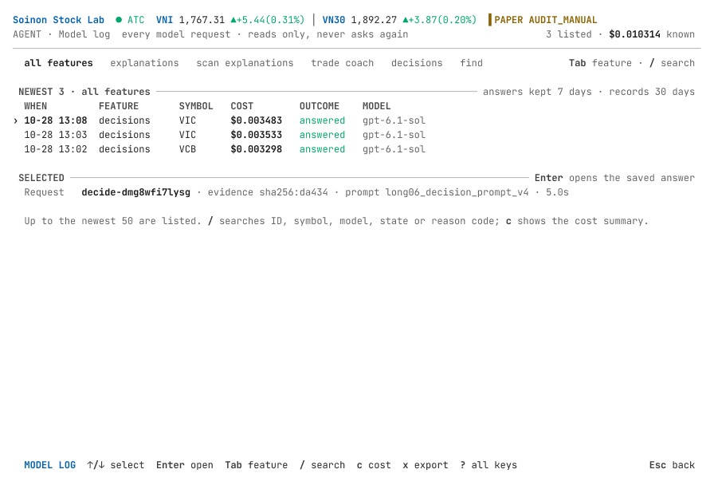

# 7 · Agent

**Purpose:** Observe or co-pilot an automated trading assistant inside **paper accounts only** — running daily check-ins inside strict risk caps (**Auto paper**) or proposing trades for your explicit approval (**Decisions**), while auditing afterwards whether its reasoning actually held up (**Track record**, **Lessons**, and **Model log**).

> **Deterministic safety:** Whether powered by the **free local Go rule** or an optional **paid AI model**, agents can never place real orders and **cannot** relax or bypass Go-enforced limits (`Daily loss limit`, `Max buy size`, `Max positions`, `Stop-loss requirements`).
>
> *(Want to understand how `vnt` prevents AI hallucinations, checks citations with exact rational math, handles `ABSTAIN` vs `HOLD`, and audits AI decisions? Read [How `vnt`'s LLM AI Agent works](ai-agents.md).)*

---

## Use cases & user stories (Benefits)

- **Observing a rules-based bot safely:** *"I want to see how a mechanical daily rule manages 100-share lots, stops, and limits over 20 trading days without risking money or spending API credits."* → Start **Auto paper** with the free **Go rule**.
- **Human-approved trade proposals (`Needs you`):** *"Let an assistant propose trades with clear pros/cons and stop math, while I make every final yes/no decision."* → Use **Decisions**, approving proposals into Paper Review or declining them.
- **Separating luck from sound reasoning:** *"When an agent trade made or lost money, did its technical reasons hold 5–20 sessions later, or did it just get lucky?"* → Open **Lessons** to compare `Then` vs `Now` numbers side-by-side.

---

## 1. Agent Home

- **`RUNNING NOW`:** Shows active Auto paper progress (`Day 9 of 20`), latest `09:30` reasoning, and live session P&L.
- **`NEEDS YOU`:** Proposals awaiting your yes/no decision.
- **`LEARN FROM IT`:** Tracks how often the agent's closed trades had **sound reasons** (`2 sound, and it paid · 1 sound, and it lost · 1 paid anyway · 0 broke, and it lost`).
- **`START` (`1`–`5`):** Launch Auto paper, review pending proposals, ask about a stock, coach a closed trade, or test fast historical **Agent practice** in Lab. *(Launching with `vnt tui --experiment` adds option `6` experimental daily portfolios.)*

### Go rule vs Model agent
- **Go rule (`free`):** Fixed, deterministic rule built into `vnt`. Calls no external API and spends nothing (meant as a transparent baseline, not a money-making promise).
- **Model (`paid per request`):** Reads saved evidence using your configured OpenAI model key (`OPENAI_API_KEY`), always showing estimated dollar cost before confirming.

---

## 2. Auto paper

**Purpose:** Run a scheduled once-per-day (`09:30 ICT`) paper experiment across up to 5 stocks for `5` to `60` trading days inside strict user-approved risk caps.

Before starting, setup prints exact maximum checkpoints, model calls, and action limits (manual trading on that account pauses while Auto paper owns it; closing `vnt` pauses cleanly until resumed).

While running, you can inspect today's **reasons for (`+`)**, **reasons against (`×`)**, invalidation rule (**`Wrong if`**), and decide anytime to **Pause**, **End (keeping exits)**, or **Take over manually**:

---

## 3. Decisions (`Needs you`)

**Purpose:** Co-pilot approval workflow where every proposal expires automatically (**60 seconds** after publication, with frozen evidence expiring permanently after **5 minutes** or after `14:30 ICT`) and **nothing is placed until you confirm** in the Paper order Review step. Validated agent runs can explicitly output **`HOLD`** (complete evidence favors waiting) or **`ABSTAIN`** (insufficient/conflicting evidence — never guessing), and expired proposals within the 5-minute window can be **Revalidated** locally in Go with zero extra AI spend.

Look at the `BUY 100 FPT · limit 55.40` example:
- **`WHY IT PROPOSES THIS`:** Balanced list (`Close above MA20`, `RSI14 56.2`, `Volume 1.3×` vs `Foreign net sold`) + explicit invalidation **`Wrong if: a close below 53.90 (MA50)`**.
- **`IF YOU APPROVE` & `CHECKS`:** Total cost (`~5,548,000 ₫`), stop distance (`53.90`, `-2.7%` at settlement), exact stop risk (`-158,000 ₫`), remaining cash (`139,331,265 ₫`), and full engine limit check before opening Review.

*(Enroll a dedicated paper account with `:agent enroll ACCOUNT`; toggle MCP chat order requests cleanly on Agent home.)*

---

## 4. Track record & Lessons

**Purpose:** Keep full historical accountability across every Auto paper and approval session — then drill into individual **Lessons** comparing **`Before`** (the original thesis, factors, and `Wrong if` condition) against **`After`** (5/20-day return vs `VN-Index` and **`DID THE REASONS HOLD?`**):

---

## 5. Model log

**Purpose:** Audit every single AI model call made anywhere in `vnt` (score explanations, Find queries, Research briefs, Trade coach, Agent proposals) with timestamps, feature filters, and 30-day dollar spend:

---

## How to open and use Agent (Controls)

Open **Agent** via `F3` → `7`, `:agent`, or `A` from Today. Navigate tabs with `Tab` / `Shift+Tab`.

- **Agent Home:** `1`–`5` start/open workflow · `Enter` open selected running/waiting item · `l` open Lesson · `h` Model log · `o` allow/block MCP chat order requests.
- **Auto paper:** `L` configure hard limits · `P` pause · `E` end (keeps armed exits) · `T` take over (cancels agent exits) · `e` view decision evidence.
- **Decisions:** `A` approve into Paper order Review (re-runs all checks) · `N` decline · `e` evidence · `l` lesson · `f` filter history · `Esc` decide later.
- **Track record & Model log:** `Enter` open decisions/answer · `l` lessons · `/` search · `c` 30-day model cost · `x` export.
