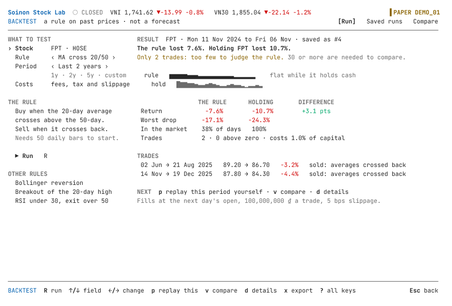
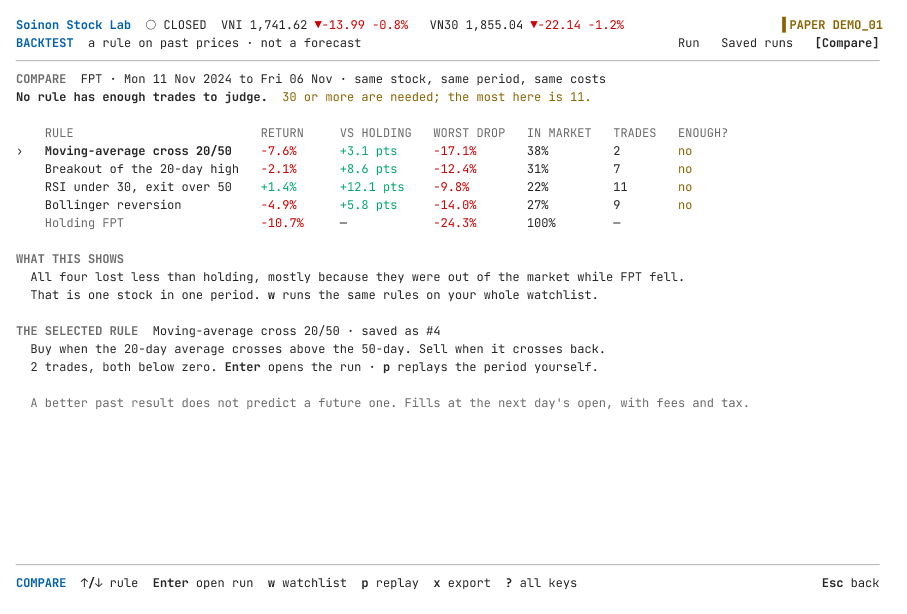

# Backtesting theory & how `vnt` tests rules

Before committing paper cash — let alone real money — to any indicator rule, a trader asks an objective question: **"If I had followed this exact rule mechanically over saved history, with Vietnam's real market friction turned on, what would actually have happened?"**

This guide explains **the theory behind honest backtesting**, **why naive backtests mislead beginners**, **how `vnt`'s engine simulates Vietnam trades step by step**, and **how to read every metric without fooling yourself**.

*(To launch runs interactively inside the app, see [6 · Lab — Backtest](lab.md#2-backtest-would-a-rule-have-worked) and [3 · Stock — Backtest preview](stock.md#6-backtest-preview).)*

---

## 1. Use cases & why beginners need backtesting

- **Testing textbook rules against reality:** *"Everyone says buy when `RSI < 30` or when `MA20` crosses `MA50`. Does that actually beat simply holding the stock on Vietnamese equities?"* → Run all four built-in rules side-by-side against **Holding** over 1–5 years.
- **Separating cash preservation from real edge:** *"A rule says `+3.1 pts` vs Holding — is that because it picked great entries, or simply because the stock crashed while the rule sat in cash?"* → Check **In the market %**, **Win rate**, **Trades**, and **Worst drop** together.
- **Exposing fragile "lucky break" rules:** *"Total return is `+40%`, should I follow it?"* → Check **Trades (`>= 30`?)**, **Top winner share**, and **Return ex-best** before trusting any average.

---

## 2. Backtesting theory: why naive backtests lie

Most retail backtests fail in live trading not because indicators stopped working overnight, but because the simulation ignored real-world constraints:

| Trap | Why naive backtests lie | How `vnt` protects you |
|---|---|---|
| **Look-ahead bias** | Pretending you saw *today's closing price* at 14:45 and somehow traded at that same close (impossible in continuous trading without slippage/ATC uncertainty, and fatal if a script peeks at next bars). | Every signal evaluated on bar `T`'s close executes strictly at bar **`T+1`'s Open** (`daily_fills_v1`). An automated check runs each strategy twice with altered placeholder future bars (`EvaluateClose`) to prove today's signal never peeks ahead. |
| **Ignoring settlement locks (`T+2`)** | Many generic platforms assume you can buy today and sell tomorrow morning whenever a stop hits. In Vietnam, shares settle at **`T+2 13:00`**. | If an exit or stop fires before your shares have settled, `vnt` defers the simulated sell until the **first eligible open on or after the settlement date** — exposing gap risk during the lock window. |
| **Zero-cost illusions** | Ignoring broker fees, sell tax, and spread/slippage makes rapid bounce strategies appear profitable even when edge per trade is `0.3%`. | Applies realistic round-trip friction by default (**`vnt_default`**: `0.15%` commission per side with `50,000 ₫` minimum, `0.10%` sell tax, and `5 bps` (`0.05%`) slippage per side on a `100,000,000 ₫` trade size). |
| **Too few trades (small sample size)** | Judging a rule from 2, 5, or 10 trades is flipping a coin a few times and calling heads "a proven edge." | Requires at least **`30` completed trades** before marking **Enough? = yes**, displaying an explicit amber warning whenever sample size is below 30. |
| **Outlier dependency ("one lucky trade")** | A strategy might lose money on 11 trades and survive only because 1 lucky rally delivered 80% of all profit. | Computes **Return ex-best**, **Return ex-worst**, and **Top 1 / 3 / 5 winner contribution %**, raising a warning if **1 single trade drives `> 30%`** of total profits. |
| **Unfillable ceiling/floor & illiquid fills** | Assuming instant fills when a stock opens locked at ceiling/floor, or buying more shares than the market traded that morning. | Flags **Degraded fills** whenever a buy fills within `0.25%` of daily **ceiling**, a sell fills within `0.25%` of **floor**, or order size exceeds **`10%` of that day's volume**. |
| **Curve-fitting / Hindsight bias** | Tweaking moving-average lengths (say `17/43`) until past curves look gorgeous overfits historical noise rather than market behavior. | `vnt` locks fixed, transparent rules (no parameter optimizer sliders) and pairs backtests with **Replay** / **Chart study** so you test out-of-sample human execution. |

> **Core rule of backtesting:** A backtest is **descriptive, not predictive**. It measures how a mechanical rule behaved on saved historical bars — it never guarantees the next 6 months will behave the same way.

---

## 3. How `vnt`'s backtest engine works step by step

When you run a rule on a stock's saved daily bars, `vnt` executes this deterministic pipeline locally on your machine:

1. **Validate & snap bars (`tick_snap_v1`):** Checks bars are strictly chronological, one bar per calendar day, positive valid OHLCV, and snaps prices to legal **HOSE / HNX / UPCoM** tick increments.
2. **Enforce a fair shared warm-up (`51` bars, starting bar `52`):** Trend rules like `MA20/50` need 50 prior days before computing a single reading. When comparing all four presets in `Lab → Compare` or `Stock → Backtest`, `vnt` starts **every rule AND Buy-and-Hold** on the exact same post-warmup open (bar `52`) over identical fees/tax/slippage so nothing gets an unfair head start.
3. **Evaluate signals after each close → Queue for next eligible open:**
   - All-in single position (`100,000,000 ₫` benchmark capital per trade; never pyramiding overlapping entries).
   - Once sold, re-entry is blocked until after that exit fills cleanly.
4. **Deduct Vietnam fees, taxes, and slippage on both trades and Hold:**
   - **Buy side:** `0.15%` commission (min `50,000 ₫`) + `0.05%` (`5 bps`) slippage.
   - **Sell side:** `0.15%` commission (min `50,000 ₫`) + `0.10%` Vietnam sell tax + `0.05%` slippage.
   *(Or load your own paper account's exact fee profile, or test cost sensitivity via CLI profiles.)*
5. **Mark-to-market daily & track 3 drawdowns:** Even while holding a position (including any trade still open on the final day), `vnt` marks equity daily after estimated exit costs so equity curves and drawdowns reflect what holding felt like every day.
6. **Audit fill quality & outliers:** Checks every fill for limit-band proximity and liquidity participation, computes `Return without best trade`, and records an immutable manifest (`tick_snap_v1`, `daily_fills_v1`, settlement policy, bar hash) alongside saved runs.

*(Note: `vnt` public daily bars from Entrade appear price-adjusted for dividends/splits, though no formal provider contract guarantees historical adjustment completeness.)*

---

## 4. The four built-in strategies & market regimes

No single indicator works in every market condition. Knowing **when each rule thrives vs suffers** is half of backtesting wisdom:

| Rule | Exact entry & exit (`vnt` engine) | Thrives when | Struggles / whipsaws when |
|---|---|---|---|
| **Moving-average cross 20/50** (`ma-cross v1`) | **Buy** when `MA20` crosses above `MA50`. **Sell** when `MA20` crosses back below `MA50`. | Long, sustained uptrends lasting months (captures multi-week leadership and avoids deep multi-month bear slides). | Sideways, choppy markets — buys near the top of a mini-bounce and exits after a pullback (**whipsaw**). Slow to react at sudden tops. |
| **20-day breakout** (`breakout v2`) | **Buy** when Close breaks above prior 20-day high **with** volume `> 1.5×` prior 20-day average. **Sell** when Close breaks below prior 20-day low **or** closes `>= 5%` below entry (optional `2× ATR14` stop via CLI config). | Strong accumulation breakouts backed by institutional volume that follow through immediately. | Range-bound markets full of **false breakouts / bull traps**, causing repeated `-5%` stop-outs. |
| **RSI under 30, exit over 70** (`rsi-reversal v1`) | **Buy** when `RSI14` closes below `30` (oversold). **Sell** when `RSI14` closes above `70` (overbought). *(Note: sample screenshots from an earlier design label this row `exit over 50`; current builds use `> 70`.)* | Stable oscillating ranges where quality stocks bounce repeatedly between panic dips and rallies. | **Falling knives** — buying `RSI < 30` early in a crash where a stock stays oversold (`RSI 20 → 18 → 15`) all the way down. |
| **Bollinger reversion** (`bb-reversion v1`) | **Buy** when Close drops below the lower 20-day Bollinger Band (`-2 SD`). **Sell** when Close rises above the upper band (`+2 SD`). | Mean-reverting sideways markets where sharp emotional selloffs snap back to the 20-day mean and beyond. | Strong downtrends **"walking the lower band"** down week after week without touching the upper band. |

---

## 5. How to read every backtest metric (with examples)

### Core summary table metrics
- **Return (`Total return MTM` vs `Realized Net`):** Net `%` profit/loss after fees, sell tax, and slippage. **MTM** marks any open position at the final bar's close; **Realized** counts only closed trades.
- **Holding (`Buy & hold`) & Difference (`Alpha`):** Return of buying the stock once at the first tradable post-warmup open and holding until the end, minus the rule's return (**percentage points**, `pts`).
  - *Example from the `FPT` screenshot above:* `MA cross 20/50` lost **`-7.6%`** while Holding `FPT` lost **`-10.7%`**, giving **`+3.1 pts`** difference — **but** both completed trades lost money (`0 above zero`), and it held cash 62% of the time during a downtrend! That `+3.1 pts` is capital preservation, not a winning bull signal.
  - *Example from `GEX` in `Stock → Backtest`:* Holding `GEX` made **`+24.6%`** in an uptrend while `MA cross 20/50` made **`+18.4%`** (`-6.2 pts`), `Breakout` made `+21.0%` (`-3.6 pts`), and `RSI` made only `+6.3%` (`-18.3 pts`) — because trendless pullbacks weren't deep enough and exiting on strength sat out part of the trend!

- **Worst drop (`Max drawdown`):** Largest peak-to-valley decline (`%`) along the equity curve. Lower drawdown means smoother survival! In `vnt`'s full report (`d details` or CLI), three drawdowns are measured:
  1. **MaxDD daily:** Peak-to-trough measured across daily closes (shown in the summary table).
  2. **MaxDD intrabar:** Deepest drop including **intraday lows** while holding (shows hidden pain during volatile days).
  3. **MaxDD trade-seq:** Peak-to-trough across completed closed-trade equity only.
- **In the market (`% of days`):** Share of tradable days holding shares vs sitting safely in cash. Lower time in market reduces exposure to market-wide crashes.
- **Trades & `Enough?`:** Total completed trades, how many ended above zero (`wins`), and whether `>= 30` trades occurred (`no` means treat all metrics as anecdotal).

### Detailed statistical & robustness diagnostics (Full report / CLI / HTML export)
- **Profit factor:** `Sum of winning returns ÷ |Sum of losing returns|`.
  - `< 1.0` = loses money overall; `1.0` = breakeven; `1.5–2.0+` = healthy profit cushion relative to losses. *(Needs high trade count to trust!)*
- **Win rate vs Average return per trade (`Avg/trade`):** A high win rate (`75%`) can still lose money if winners average `+2%` while 25% losers average `-10%`. Always read both together alongside **Best trade** and **Worst trade**.
- **Annualized return, Volatility & Sharpe ratio:** Converts results onto a yearly (`252` trading days) scale. **Sharpe ratio** (zero risk-free rate in `vnt`) divides average daily equity return by daily volatility (`× √252`) — higher means more return per unit of daily roller-coaster swing.
- **Holding days (`min / avg / max`):** Confirms whether a strategy matches your patience and lifestyle (e.g., 5-day swing vs 45-day trend hold).
- **Return ex-best / ex-worst & Top 1/3/5 winner %:** Reveals fragility. If dropping the best trade flips `+18%` to `-4%`, the rule relies on catching one rare outlier.
- **Degraded fills (`limit-band` / `liquidity`):** Counts entries/exits that occurred near ceiling/floor locks or exceeded 10% of daily traded shares — a reality check on whether real brokerage execution was realistic.

---

## 6. Recommended beginner workflow

Never judge any idea from a single number on a single stock:

1. **Quick glance in Stock (`Backtest` tab):** Check all 4 presets on the stock you are researching alongside any trade you already hold on that name (`YOUR OWN TRADE`).
2. **Check robustness in Lab (`Compare` & `Watchlist`):** Switch across `1y`, `2y`, `5y` and run across your entire **watchlist** (`VN30` / `VN100`) so one lucky stock cannot fool you. Inspect `d details` (full report) for **Profit factor**, **Return ex-best**, and **Degraded fills**.
3. **Verify your own execution with Replay:** Once you find an interesting period, use **Replay same period (`p`)** in Lab to step through those exact dates **blindly day by day**, seeing whether *you* actually have the discipline to take every signal, respect `T+2`, and survive the drawdowns in real time!
