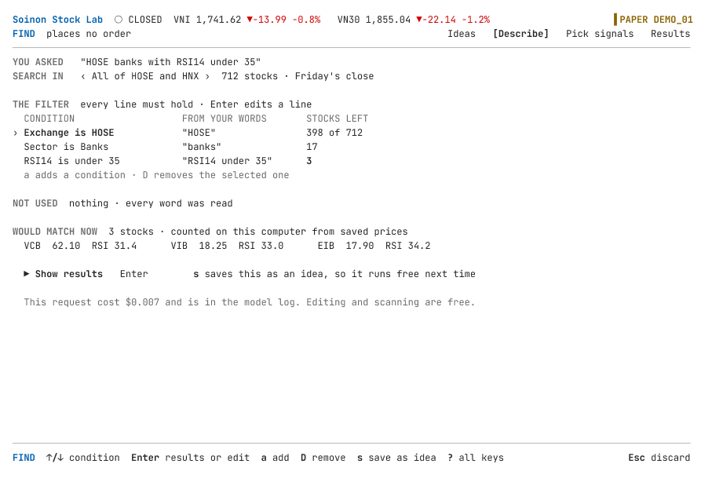
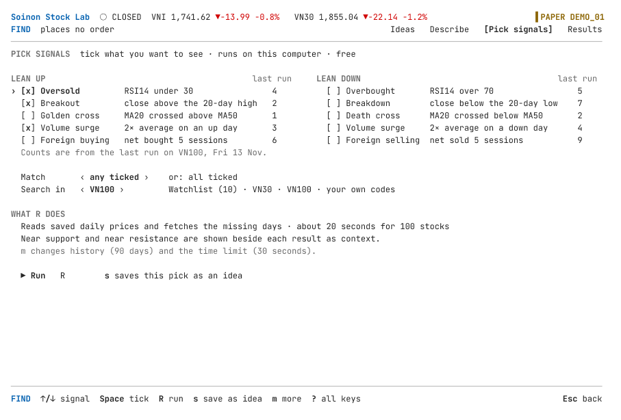
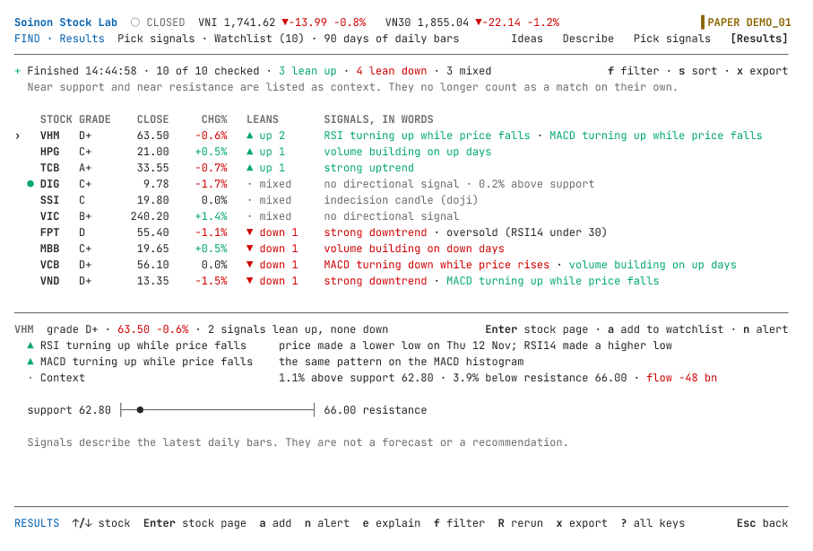
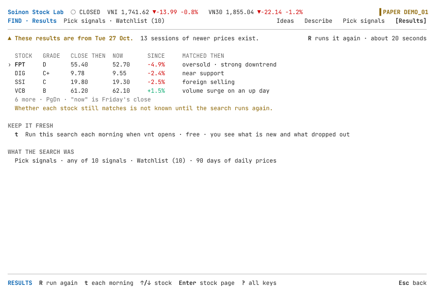

# 4 · Find

**Purpose:** Scan local saved daily bars across `VN30`, `VN100`, your watchlists, or custom ticker lists to discover stocks worth studying — using **6 free built-in quantitative Ideas**, custom **Pick signals**, or an optional plain-English **Describe** translator that always shows its exact rules before scanning.

> Find runs **locally** on saved daily bars and **never** places orders or edits your watchlists unless you ask.

---

## Use cases & user stories (Benefits)

- **Finding bounce candidates fast without memorizing formulas:** *"I'm new to indicators and want to find liquid `VN100` stocks that have pulled back sharply right above historical support."* → Use **Idea 1** (*Oversold near support*).
- **Combining multiple confirmations cleanly:** *"I only want stocks breaking above a 20-day high **with** 5 straight days of foreign investor buying."* → Combine **Breakout** + **Foreign buying** under **Pick signals** using *All ticked*.
- **Plain-English search without hidden AI magic:** *"Let me type what I'm looking for in words, but prove to me exactly how my words became numeric filters — and keep my portfolio private."* → **Describe** asks first, shows a 1-to-1 translation table, and runs the filter purely locally.

---

## 1. Ready-made Ideas (Best place for beginners, 100% free)

### The 6 built-in ideas

| Idea | Exact filter rule | What kind of setup it finds |
|---|---|---|
| **1 · Oversold near support** | `RSI14 < 30` and close within `2%` above support | Stretched pullbacks resting close to buyers' prior floor |
| **2 · Grade moved up this week** | Daily grade today higher than 5 sessions ago | Stocks shifting out of weakness into improving factors |
| **3 · Foreign buying, 5 days** | Positive foreign net buying on each of the past 5 days | Steady multi-session institutional accumulation |
| **4 · Breaking a 20-day high** | Close above prior 20-day high on volume `> 1.5×` average | Fresh breakout backed by above-average participation |
| **5 · Strong trend, pulling back** | `ADX14 > 25` and close within `2%` of `MA20` | Healthy pullbacks inside established trends |
| **6 · My stocks with a warning** | Held or watched stocks showing a bearish signal today | Quick risk check across your own symbols |

### Example: finding `VN100` bounce setups
In the screenshot above, searching **`VN100`** with **`Oversold near support`** returns 4 matches (`FPT`, `VHM`, `KDH`, `VIX`), showing each stock's **Grade**, **Close**, **5-day foreign flow**, **why it matched in plain words** (`RSI14 19.0 · 0.4% above support 52.50`), and whether you already watch or hold it (`held 500`).

---

## 2. Describe (Optional plain-English translator, asks first)

Type a plain-English request such as *"HOSE banks with RSI14 under 35"*.

### Privacy consent & numeric verification
On your very first Describe request (when an API key is configured), `vnt` pauses to show **exactly what goes out** (your text, field names, sector names) vs **what never leaves your computer** (holdings, notes, prices, keys):

Once approved, the model proposes rules — and **`CHECK THE FILTER`** displays your words beside the exact translated conditions so you can verify everything before running locally:

*(No model key? Describe politely steps aside while **Ideas** and **Pick signals** run 100% free.)*

---

## 3. Pick signals (Custom scanner, 100% free)

Tick any combination of **Lean up** (bullish) and **Lean down** (bearish) signals, choose whether stocks must satisfy **any ticked** or **all ticked** rules, and optionally save frequent setups as reusable custom Ideas:

| Lean up signals | Lean down signals |
|---|---|
| **Oversold:** `RSI14 < 30` | **Overbought:** `RSI14 > 70` |
| **Breakout:** close > prior 20D high, volume `> 1.5×` | **Breakdown:** close < prior 20D low, volume `> 1.5×` |
| **Golden cross:** `MA20` crossed above `MA50` | **Death cross:** `MA20` crossed below `MA50` |
| **Volume surge:** `2×` 20D avg on an up day | **Volume surge:** `2×` 20D avg on a down day |
| **Foreign buying:** net bought 5 sessions | **Foreign selling:** net sold 5 sessions |

---

## 4. Results & Freshness checks

**Results** shows every matching stock with **directional lean counts** (`▲ up 1`), a word explanation of why it matched, and a visual **`support ├──────●──┤ resistance`** gauge underneath:

If you change the universe or settings after a scan finishes, Find clearly flags results as **out of date** so you never mistake old matches for current rules:

---

## How to open and run Find (Controls)

Open **Find** via `F3` → `4` or `:find` (CLI equivalent: `vnt scan`).

| Key | Action |
|---|---|
| `1`–`6` (on Ideas) | Select/run a ready-made Idea |
| `←` `→` | Change **`Search in`** (`VN100`, `VN30`, watchlist group, or `u` typed codes) or **`Match`** |
| `Tab` / `Shift+Tab` | Move into the `OR SAY IT` box / cycle across `Ideas`, `Describe`, `Pick signals`, `Results` |
| `Space` (on Pick signals) | Tick / untick a signal |
| `R` | Run (or rerun) scan locally on saved daily bars |
| `s` (on Pick signals) | Save checked signals as a custom Idea |
| `m` (on Pick signals) | Configure lookback window (default `90` days) & time limit (`30s`) |
| `Enter` (on a match) | Open that stock's full **Stock** page |
| `a` / `n` / `e` | Add match to watchlist / set price alert / inspect full signal details |
| `f` / `s` (on Results) | Filter / sort results |
| `x` | Export results to `~/vnt-exports` |
| `y` / `:find off` | Confirm first-request Describe consent / withdraw consent |
