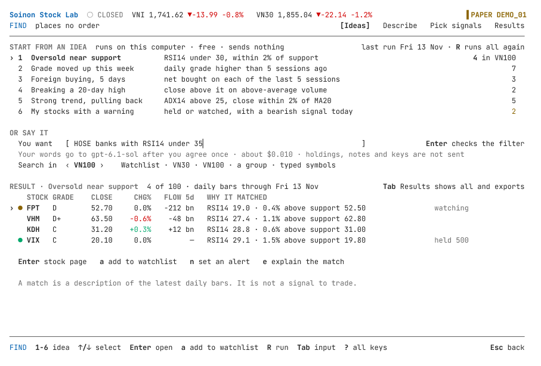
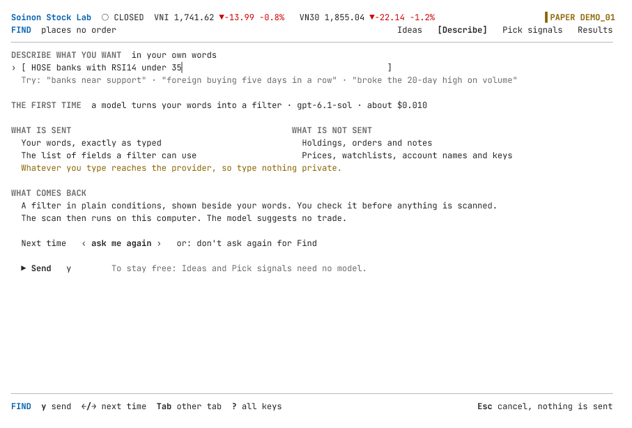

# 4 · Find

**Purpose:** Discover stocks worth studying — either using **free, built-in quantitative Ideas**, picking your own **technical signals**, or (optionally) typing what you want in **plain English** and checking the exact rule before running.

**How to get there:** Press `F3` then `4`, or type `:find`.

Find has four tabs: **`Ideas`**, **`Describe`**, **`Pick signals`**, and **`Results`**. Find scans **saved daily bars locally** on your computer and never places orders or modifies watchlists unless you ask.

## Use cases & user stories

- **Finding bounce setups in 10 seconds:** *"I don't know technical formulas yet, but I want VN100 stocks that recently pulled back close to historical support."* → Open **Ideas** and press `1` (*Oversold near support*).
- **Catching institutional accumulation & breakouts:** *"I want stocks breaking above their 20-day high **and** seeing 5 consecutive days of foreign buying."* → Tick **Breakout** + **Foreign buying** in **Pick signals**, choose `< all ticked >`, and press `R`.
- **Describing a scan safely:** *"I want to ask in plain English without leaking my holdings or running mysterious filters."* → Type your phrase, read the **First-request consent**, verify the exact numeric mapping in **Check the filter**, and scan locally.

---

## 1. Ideas (free, best place for beginners)

**Purpose:** Run proven, transparent filters with one keystroke — zero setup and zero cost.

### The 6 ready-made ideas

| Key | Idea | Exact filter rule | Typical use |
|---|---|---|---|
| `1` | Oversold near support | `RSI14 < 30` and within `2%` above support | Look for stretched pullbacks near buyers' memory levels |
| `2` | Grade moved up this week | Daily grade today > grade 5 sessions ago | Catch stocks shifting from weak to improving |
| `3` | Foreign buying, 5 days | Net foreign buying on every one of the last 5 sessions | Spot steady institutional accumulation |
| `4` | Breaking a 20-day high | Close > prior 20-day high on volume `> 1.5×` average | Spot fresh breakouts with volume backing |
| `5` | Strong trend, pulling back | `ADX14 > 25` and close within `2%` of `MA20` | Spot healthy pullbacks inside established uptrends |
| `6` | My stocks with a warning | Watched/held stocks with a bearish signal today | Risk check across your own stocks |

### Example: scanning VN100 for oversold stocks near support
1. Open Find (`F3` → `4`).
2. Press `←` `→` on **`Search in`** to pick **`VN100`** (or `VN30`, a watchlist group, or custom symbols).
3. Press **`1`** (*Oversold near support*).
4. Instantly, the lower table lists matching stocks (for example `FPT`: `RSI14 19.0 · 0.4% above support 52.50`, `VHM`, `KDH`, `VIX`) with 5-day foreign flow and a tag telling you if you already watch or hold each stock.
5. Press `Enter` to open `FPT`'s Stock page, `a` to add it to a watchlist, `n` to set an alert, or `e` to read why it matched.

---

## 2. Describe (plain-English query, optional paid model)

**Purpose:** Translate an English question into a clean, verifiable local filter — while **showing you the exact translation** before running anything.

Type a request into the **`OR SAY IT`** box on Ideas (or switch to **Describe**), for example:
> `HOSE banks with RSI14 under 35`

On your **very first request**, `vnt` pauses with a **First-request consent screen** listing exactly what leaves your computer (your text, available field names, sector list) and what **never** leaves (your holdings, notes, prices, API keys). You must press `y` to proceed (`:find off` revokes consent anytime).

Before scanning a single bar, **`CHECK THE FILTER`** lays out your words on the left against the exact numeric conditions on the right (`EXCHANGE = HOSE`, `SECTOR = Banks`, `RSI14 < 35`), plus any warnings. Press **`Enter`** to execute the scan **locally on your computer** (`d` views raw rule details, `Esc` edits your wording).

If no API key is configured, Describe stays harmlessly unavailable while **Ideas** and **Pick signals** work 100% free.

---

## 3. Pick signals (free custom signal builder)

**Purpose:** Combine classic bullish ("Lean up") and bearish ("Lean down") signals yourself without writing code or calling a model.

| Lean up signals | Lean down signals |
|---|---|
| **Oversold:** `RSI14` under `30` | **Overbought:** `RSI14` over `70` |
| **Breakout:** close above prior 20D high, volume `> 1.5×` | **Breakdown:** close below prior 20D low, volume `> 1.5×` |
| **Golden cross:** `MA20` crossed above `MA50` | **Death cross:** `MA20` crossed below `MA50` |
| **Volume surge:** `2×` 20D average on an up day | **Volume surge:** `2×` 20D average on a down day |
| **Foreign buying:** net bought 5 consecutive sessions | **Foreign selling:** net sold 5 consecutive sessions |

### How to run a combo scan
1. Use `↑` `↓` to move and **`Space`** to tick signals (for instance tick **Breakout** + **Foreign buying**).
2. Choose **`Match`**: `< all ticked >` (strict: both must trigger) or `< any ticked >` (broad: either triggers).
3. Choose **`Search in`** (`VN100`, `VN30`, watchlist group, or typed codes).
4. Press **`R`** to run locally, or **`s`** to save your combination as a custom reusable Idea!
5. Press **`m`** to adjust the history lookback (default `90` days) or scan time limit (default `30` seconds).

---

## 4. Results (`Tab` / `Shift+Tab`)

**Purpose:** Inspect, filter, sort, and export every match with its **support/resistance context** shown right under the selected row.

### Reading a Result row
Look at `ABC` highlighted in the screenshot:
- **Header:** `+ Finished · 1 of 1 checked · 1 lean up · 0 lean down · 0 mixed` plus the **bar date** used (`as of ...`) so you never mistake old saved bars for today's live market.
- **`LEANS` (`▲ up 1`):** Counts how many bullish vs bearish signals triggered.
- **`SIGNALS, IN WORDS`:** Explains *why* it matched (`Close 21.50 above prior 20-day high 20.26 · volume 3.5×`).
- **`Context` gauge:** `support 21.00 ├──────────────●──┤ 21.60 resistance` places price visually between nearest support and resistance.

If you change parameters or update bars after a run, Find clearly warns when results are **out of date** and lets you press `R` to rerun cleanly:

### Keys on Results

| Key | Action |
|---|---|
| `Enter` | Open the selected stock's **Stock** page |
| `a` | Add the stock to a watchlist |
| `n` | Set a price alert on the stock |
| `e` | Read full signal details / score context |
| `f` / `s` | Filter / sort matched rows |
| `R` | Run the scan again |
| `x` | Export the results to `~/vnt-exports` (CSV/JSON) |
