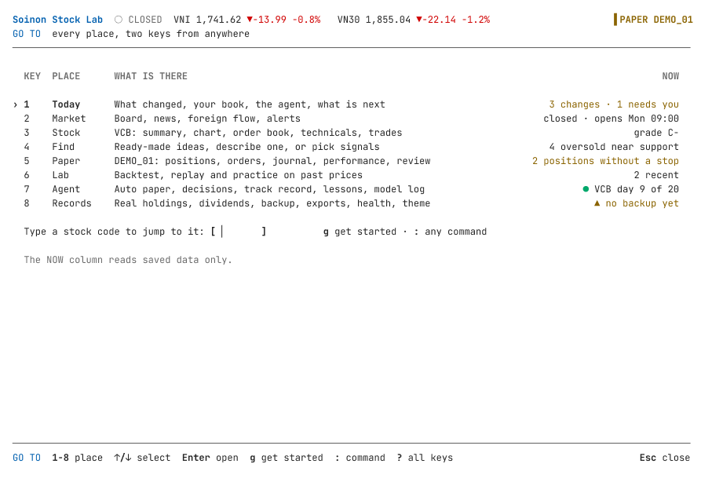
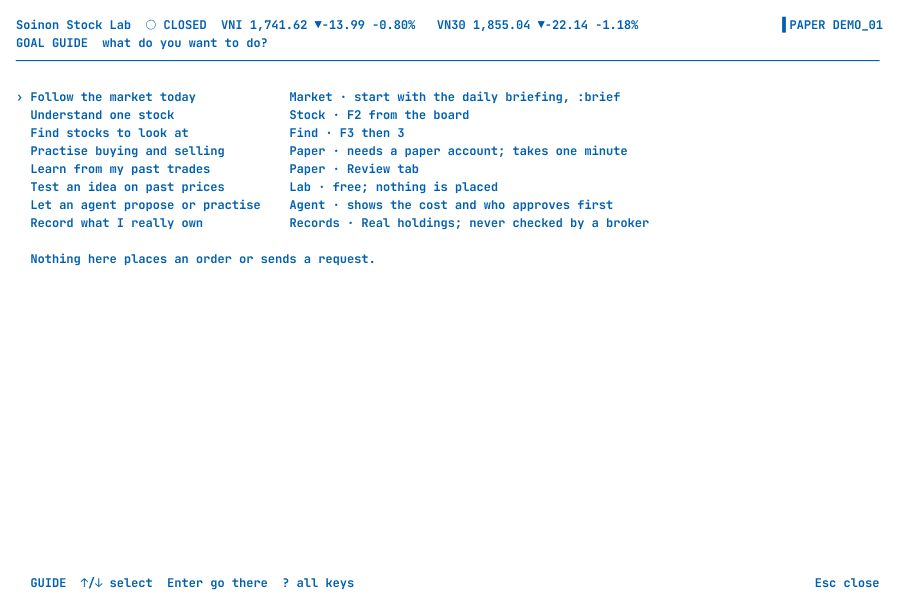
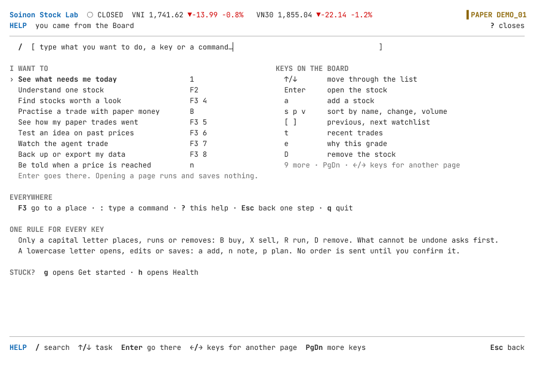

# Getting started

This chapter walks you through installing Soinon Stock Lab (`vnt`), reading its 3-part screen layout, moving between the eight places, searching Help, running typed commands, and choosing colours.

## Use cases & user stories

- **No-stress onboarding (Newbie):** *"I just opened `vnt` for the first time and don't want to break anything or accidentally send data out."* → Press `F3` then **`g`** to open **Get started**, which lists 5 safe goals with exact privacy and cost labels before opening anything.
- **Fast switching while watching quotes:** *"I'm looking at `VCB` on the board and want to jump straight to `FPT`'s chart, then my Paper orders, without clicking through menus."* → Press `F3`, type `FPT` + `Enter`, then `F3` + `5`.
- **Safe command typos:** *"I forgot the exact syntax to set a price alert on `FPT`."* → Type `:alrt fpt 54` — the command bar suggests `:alert FPT above 54.00` and waits for your confirmation.

## What you need

- A terminal with 256 colours: macOS Terminal, iTerm2, WezTerm, Ghostty, Alacritty, or Windows Terminal.
- A window of at least **80 columns × 24 rows**. Every page adapts cleanly between **80×24** (compact) and **120×32** (wide). Wider windows reveal extra columns and longer hints.
- An internet connection when you want **live quotes**, fresh daily bars, intraday trades, or news. Everything reading already-saved data works offline.

## Install and first launch

Download the archive for your computer from the [download page](https://vyndinh.github.io/soinon-stock-lab-releases/), verify its SHA-256 checksum, extract it, and open a terminal inside that folder.

```text
./vnt version     prints the installed version
./vnt doctor      checks your local database and the public market feeds
./vnt             opens the app on Today (or Get started on first launch)
```

On Windows use `.\vnt.exe`. Current prerelease binaries are unsigned; if your OS blocks launch, do not disable security protection — report it via the support link under **Records → About**.

The first launch creates a SQLite database file in your system's application-data folder. Pass `--db PATH` to use a separate database file (handy if you want a clean sandbox for testing).

## How every page is laid out

Every screen in `vnt` uses the same three zones:

1. **Top status line (Header)** — App name, market session state (`● CONTINUOUS 10:42:06` while open, `○ PRE-OPEN`, `ATO`, `LUNCH`, `ATC`, or `○ CLOSED` after hours) in Vietnam time (ICT), major indices (`VNI`, `VN30`), and on the right your active paper account (`▌PAPER DEMO_01`).
2. **Place bar & tabs** — Shows which of the eight places you are in (`TODAY`, `STOCK · FPT`, `FIND`, etc.), tabs when the page has multiple views (the open tab sits in `[brackets]`), and one horizontal divider rule.
3. **Bottom footer** — Mode badge on the left, the most useful keys for **this exact screen** (`key` first, action second), `? all keys` for full help, and the exit/back key (`Esc back`, `Esc/q close`, or `q quit`) pinned to the right edge.

> **Newbie tip on reading prices and numbers:** Stock prices are always shown in **thousand dong (kVND)** — so `62.30` means **62,300 ₫** per share. Cash totals use commas and end with `₫` (`144,879,575 ₫`). Share volumes use `K` (thousands) and `M` (millions), so `4.6M` means 4.6 million shares.

## Moving between the 8 places (`Go to`)

Press **`F3`** (or backtick `` ` ``) from almost anywhere to open **Go to**.



Press a number `1`–`8` to jump straight there:

| Key | Place | What you use it for |
|---|---|---|
| `1` | Today | Morning dashboard: stocks near key levels, your paper book, agent alerts, suggested next actions |
| `2` | Market | Live watchlist board, groups, news, foreign flow, screener, sector heat map, alerts, daily briefing |
| `3` | Stock | Deep dive on one stock: Summary, Chart, Order book, Technicals, Trades, local Backtest |
| `4` | Find | Scan for stocks using ready-made Ideas, plain-English Describe queries, or picked technical signals |
| `5` | Paper | Practice portfolio: Overview, Positions, Orders & drafts, Journal, Performance, Review, Risk guards |
| `6` | Lab | Historical testing & practice: Backtest 4 rules, blind Replay, blind Chart study, Guided practice, Grade check |
| `7` | Agent | Watch an automated rule/model trade a paper account inside strict limits, approve proposals, review lessons |
| `8` | Records | Local data & settings: real holdings CSV import, dividends, SQLite backups, exports, feed Health, Sectors, Theme |

**Shortcut trick:** In **Go to**, you can also type any stock code (such as `FPT` or `VCB`) and press `Enter` to jump straight to that stock's page! *(Note: lowercase `g` opens **Get started**, so start a ticker like `GEX` with a capital `G` or type `GE`.)*

If you are mid-edit inside a form or order ticket, pressing `F3` displays `Finish or Esc first` so you never lose unsaved input.

### Universal navigation keys

| Key | Action |
|---|---|
| `↑` `↓` | Move selection up / down a list |
| `Tab` / `Shift+Tab` | Move to the next / previous tab or panel |
| `Enter` | Open the selected item or confirm an action |
| `Esc` | Go back one screen (or clear an active filter / crosshair) |
| `F2` | Open the selected stock's page from almost anywhere, or return |
| `?` or `F1` | Open Help for the current screen |
| `:` | Open the command bar |
| `q` | Quit (from Today or Market board; asks first if you hold unsaved drafts) |

## Get started (`g`)

Press `F3` then **`g`** (or type `:guide`) to open **Get started** — five guided first steps showing what each workflow gives you, what data it uses, whether anything leaves your computer, and whether it costs money.



Press `1`–`5` and `Enter` to open any goal. As you complete tasks in the app (such as opening a stock, viewing a briefing, or running Find), rows tick off automatically. Nothing on **Get started** places orders or calls paid models.

## Help (`?` or `F1`)

Press **`?`** (or `F1`) over any page to open **Help**. It automatically highlights the section matching where you came from.



- Use `←` `→` to browse sections (`Board`, `Chart`, `Find`, `Paper`, etc.) and `↓` to scroll into full shortcut tables.
- Press `/` to search across every key, command, and task (`every word must match`).
- Press `Tab` to move through **Tasks** (plain-English how-tos like *Understand one stock* or *Back up my data*), then `Enter` to jump straight to that feature.
- The **Support** section prints exact `vnt doctor`, `vnt backup verify`, and `vnt backup restore` commands pre-filled with your open database path.

## The command bar (`:`)

Press **`:`** from any screen to open the command bar at the top/bottom prompt. It shows matching commands and parameters as you type, and recalls history with `↑` `↓`.


Useful commands to try:

```text
:brief            open the Daily briefing
:history FPT      view saved daily OHLCV bars and notes for FPT
:alert FPT above 54   set a price alert (accepts natural typos!)
:backtest         open the Lab backtest workbench
:replay new       start a new blind Replay practice session
:portfolio real   open Records → Real holdings
:backup           save a verified SQLite backup copy
```

**Beginner-friendly safety:** If you mistype a command (for example `:alrt fpt 54` as shown in the screenshot), `vnt` suggests the clean command (*`:alert FPT above 54.00`*), explains why it chose "above" relative to the last quote, lets you press `Tab` to tweak it, and waits for `Enter` before executing.

## Themes and accessibility

Open **Records → Theme** (`F3` → `8`, select `Theme`) to pick:
- **Background:** `Light`, `Dark`, or `Auto-detect` (follows your terminal background).
- **Up/down colours:** Standard (green up / red down), **Vietnam board** (adds purple for ceiling, cyan for floor, amber for reference price), or **Colour-blind safe** (blue up / orange down).

Every directional number also renders `▲` or `▼` arrows, so meaning never depends on colour alone.
