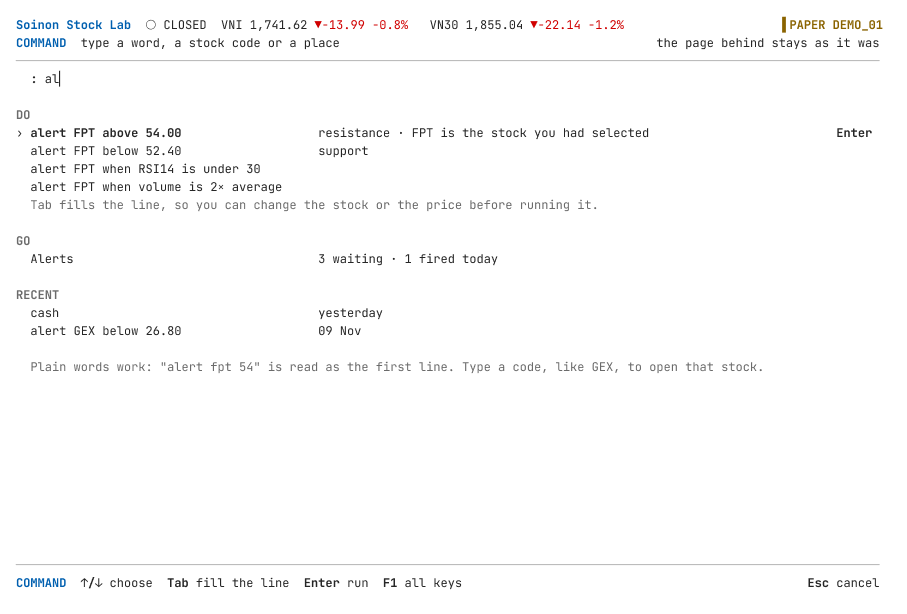

# Getting started

This chapter introduces Soinon Stock Lab (`vnt`): how every screen is organized, how Vietnamese prices and volumes are written, how the eight workspaces fit together, and how the app helps newcomers safely explore without accidentally placing orders or spending money.

*(If you want to launch right away, skip to [How to install, open, and navigate](#how-to-install-open-and-navigate-keys) at the bottom after skimming the screens.)*

---

## Use cases & user stories

- **Safe zero-risk first look (Newcomer):** *"I just installed `vnt` and don't want to make a mistake, spend model credits, or accidentally submit anything."* → Open **Get started**, which shows 5 beginner goals along with exactly what data each uses, whether anything leaves your computer, and whether it costs `$0`.
- **Clean consistent layout across every screen:** *"Every financial app feels overwhelming because every page hides buttons in different places."* → Every screen in `vnt` follows one predictable **header → title/tabs → body → footer** structure.
- **Forgiving commands:** *"What if I want a quick shortcut later but misspell a stock action?"* → The **Command bar** suggests exact corrections and previews why before running anything.

---

## How every screen is organized

Every screen in `vnt` shares the same three zones:

1. **Top status bar (Market & Account Header):**
   - App name (`Soinon Stock Lab`)
   - Exchange status and Vietnam clock (`● CONTINUOUS 10:42:06` while trading, or `○ CLOSED`, `○ PRE-OPEN`, `ATO`, `LUNCH`, `ATC`)
   - Broad market indices (`VNI`, `VN30`)
   - Active paper account badge on the right (`▌PAPER DEMO_01` or `STUDY · no orders`)
2. **Place bar & Tabs:** Names the workspace you are in (`TODAY`, `STOCK · VCB`, `PORTFOLIO · DEMO_01`), shows sibling tabs with the open tab inside `[brackets]`, and draws one clean horizontal rule underneath.
3. **Bottom footer bar:** Names the active mode on the left, lists only actions available right now on this screen, keeps full help one keypress away (`? all keys`), and pins the exit/back control to the right edge.

> **Reading Vietnamese prices and numbers in `vnt`:**
> - **Stock prices use thousand dong (`kVND`):** `62.30` means **62,300 ₫** per share.
> - **Cash & profit/loss use full dong with commas:** `144,879,575 ₫`.
> - **Share volumes use `K` and `M`:** `4.6M` means 4.6 million shares.
> - **Accessibility:** Directional moves always show arrows (`▲` up, `▼` down), so meaning never relies on colour alone.

---

## Core onboarding & navigation screens

### 1. The 8 Workspaces (`Go to` menu)
**Purpose:** Group the entire app cleanly into eight distinct places so you always know where to go — whether watching live prices, inspecting one stock, testing ideas on past data, or managing private backups.


| Workspace | Purpose |
|---|---|
| **1 · Today** | Calm daily starting screen: highlights holdings near stops/resistance, your paper book, agent alerts, upcoming ex-dates, and suggested next actions. |
| **2 · Market** | Live multi-panel watchlist board, sector heat map, compact screener, news, foreign flow, alerts, and daily review briefing. |
| **3 · Stock** | Full single-stock workbench: Summary, interactive Chart, Order book, Technicals & Grade breakdown, Trades tape, and local Backtest preview. |
| **4 · Find** | Stock scanner with 6 free ready-made quantitative Ideas, custom signal picker, and optional plain-English Describe scans. |
| **5 · Paper** | Simulated portfolio workbench: Overview, Positions, Orders & Drafts, Trade Journal, Performance & Trade review, Risk guards, and Accounts. |
| **6 · Lab** | Historical learning sandbox: Backtest 4 rules, blind day-by-day Replay, blind Chart study, Guided practice, Agent practice, and Grade check. |
| **7 · Agent** | Optional automated assistant: run rule-based or AI Auto paper sessions inside strict limits, approve/decline proposals, and review Lessons. |
| **8 · Records** | Local private records: Real holdings CSV tracker, Dividends, SQLite Backups, CSV/JSON/HTML Exports, Feed Health, Sectors, Themes, About. |

---

### 2. Guided onboarding (`Get started`)
**Purpose:** Give beginners five safe starting workflows with plain-English privacy and cost disclosures before doing anything.


Notice each row clearly states **what you get**, **what local data it reads**, **whether anything leaves your machine**, and **cost** (`free` vs `model asks first`), and automatically ticks off goals as you try them.

---

### 3. Contextual reference (`Help`)
**Purpose:** Instant built-in reference scoped automatically to whichever screen you currently have open, plus searchable **Tasks** and exact recovery commands for your open database.


---

### 4. Quick actions (`Command bar`)
**Purpose:** Run direct jumps, set alerts, or run exports by typing — with smart typo correction and explanation before executing anything.



For example, typing `:alrt fpt 54` suggests `:alert FPT above 54.00`, explains why it chose `above` relative to the current quote, and waits cleanly until you confirm.

---

## Themes & visual comfort

Under **Records → Theme**, `vnt` adapts to both **Light** and **Dark** terminals (or auto-detects your terminal background), and lets you choose between:
- **Standard** (green up, red down)
- **Vietnam board** (adds **purple** for ceiling lock, **cyan** for floor lock, **amber** for reference price — familiar to Vietnamese exchange boards)
- **Colour-blind safe** (blue up, orange down)

---

## Your first week with Soinon (Step-by-step path)

| Day | What to do | What you learn |
|---|---|---|
| **Day 1** | Explore **Get started**, inspect 2–3 leaders (`FPT`, `VCB`) in **Stock**, and try **Lab → Chart study** in blind mode (`Stock A`). | How to read candlesticks, support/resistance, `ATR14`, and scores without hindsight bias. |
| **Day 2** | Run **Lab → Backtest** on a watchlist stock (`2y` + **Compare**), and scan `VN100` with **Find → Ideas**. | Why simple indicator rules win or fail across regimes (`>= 30` trades rule) and how Ideas filter candidates locally. |
| **Day 3** | Open **Paper**, set up `DEMO_01`, and place a small simulated buy using **`Size it from risk`** (`0.5%`) and a bracket stop/target. | `100`-share lots, exchange ticks, `kVND` prices, fees, and `◐ pending` settlement until `T+2 13:00`. |
| **Day 4–5** | Start each day on **Today**, check **Market → Daily briefing** after `15:00 ICT`, and review any closed trade under **Paper → Trade review**. | Calm 5-minute review habits, ex-dividend awareness, and backing up SQLite in **Records → Backup**. |

---

## Common beginner questions (FAQ)

- **Why couldn't I sell shares I bought earlier this morning or yesterday?**
  Vietnam stocks settle at **`T+2 13:00`** (two trading sessions after buying). Until then, shares show as `◐ pending` and stay locked from selling — even in Paper trading.
- **Why did a stop-loss trigger on a stock's dividend ex-date?**
  On ex-dividend morning, the exchange drops the reference price by roughly the cash/stock payout. Check **Today (`COMING UP`)** or **Records → Dividends** ahead of time so you can adjust tight stops consciously.
- **Why does the TUI show `62.30` while Codex/Claude MCP shows `62300`?**
  TUI tables display compact **`kVND`** (`62.30` = `62,300 ₫`) to fit clean 80–120 column screens, while MCP order tools and full dong totals use exact **`VND`** (`62300`).
- **Do stops or Auto paper keep running after I close `vnt`?**
  No. All Paper quotes, bracket triggers, alerts, and scheduled Auto paper decisions evaluate **only while `vnt` is open**; closing `vnt` pauses Auto paper cleanly until you resume.
- **Why can `vnt score FPT` on the command line differ slightly from the TUI grade?**
  The standalone CLI `vnt score` computes daily TA factors with foreign flow counted as `0`, whereas the live TUI includes recent 5-day foreign flow (`±0.5` weight).

---

## How to install, open, and navigate (Keys)

Once you are ready to run `vnt`, download the archive for your OS from the [download page](https://vyndinh.github.io/soinon-stock-lab-releases/), verify its SHA-256 checksum, extract it, and run from a terminal at least **80×24** (or **120×32** for wide two-column views):

```text
./vnt version     prints the installed version
./vnt doctor      checks your local database and public market feeds
./vnt             opens the app on Today (or Get started on first run)
```

*(On Windows use `.\vnt.exe`. Pass `--db PATH` to open a separate database for experiments.)*

### Essential navigation controls

| Key | Action |
|---|---|
| `F3` or `` ` `` | Open **Go to** (then press `1`–`8` for a workspace, `g` for **Get started**, or type a stock code like `FPT` + `Enter`) |
| `↑` `↓` | Move selection up / down a list |
| `Tab` / `Shift+Tab` | Move between tabs or panels |
| `Enter` | Open the highlighted item or confirm |
| `Esc` | Step back (or cancel crosshair / filter without saving) |
| `F2` | Open the highlighted stock's full **Stock** page (or go back) |
| `?` or `F1` | Open **Help** (`←` `→` switch sections, `/` searches words, `Tab` selects tasks) |
| `:` | Open the **Command bar** (`Tab` edits a suggestion, `↑` recalls history, `Enter` runs) |
| `q` | Quit from Today or Market board (asks first if an unsaved draft exists) |

*Note: Letter keys are case-sensitive (`a` adds a stock, `A` opens Alerts), and `F3` safely asks you to finish or `Esc` if you have unsaved edits in a form or order ticket.*
