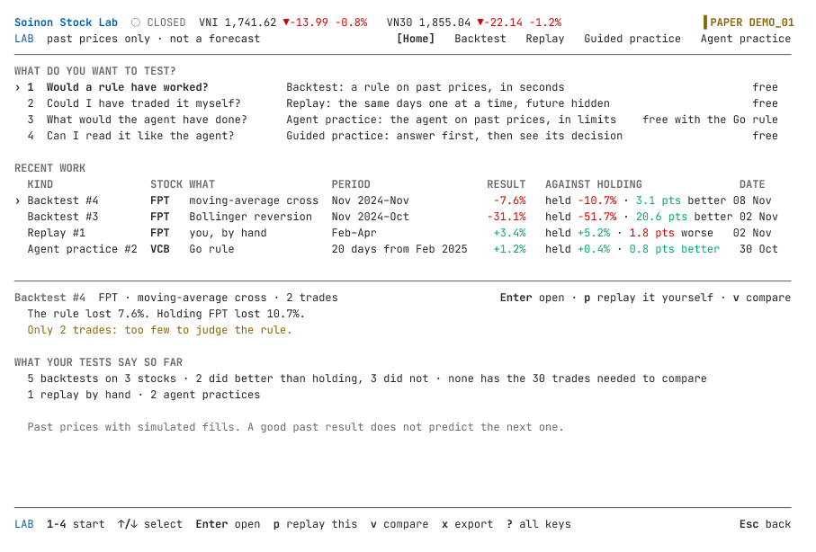
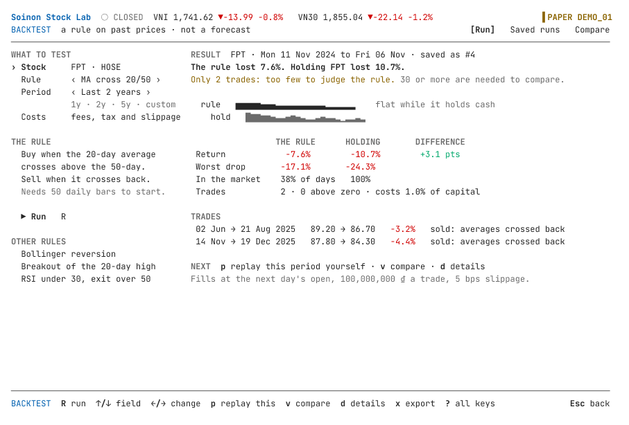
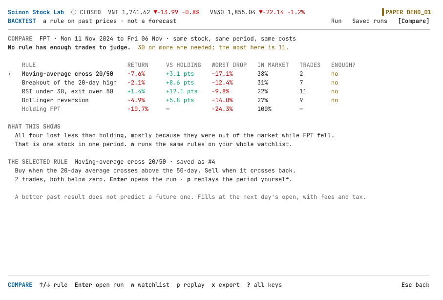
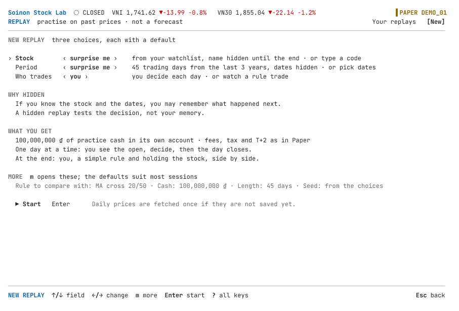
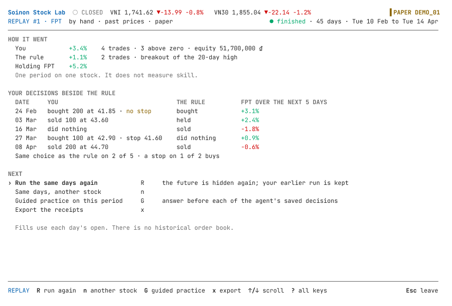
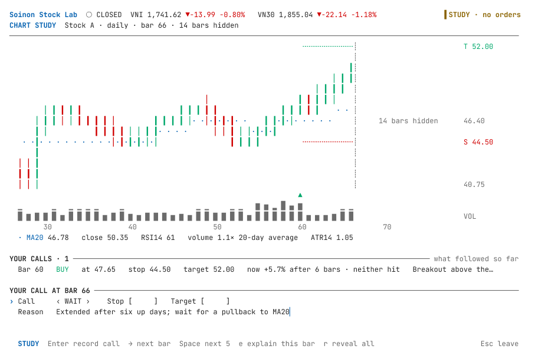
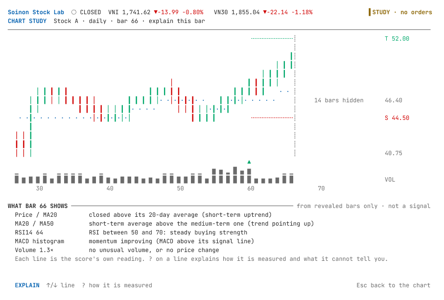
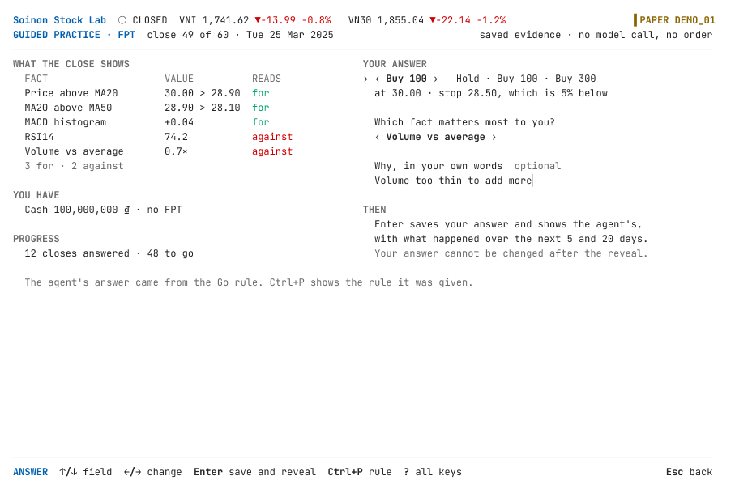
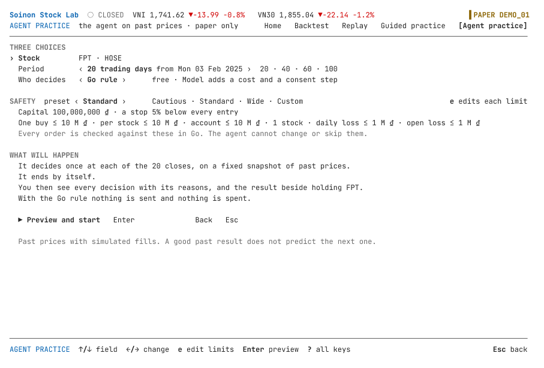
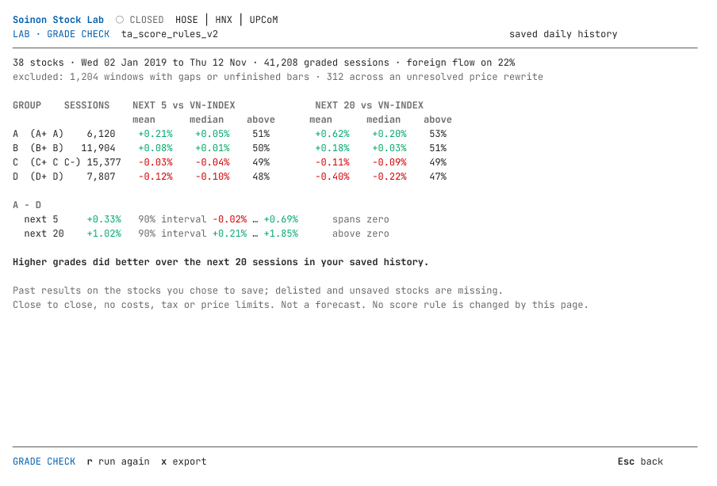

# 6 · Lab

**Purpose:** Practise reading charts and testing systematic ideas on **saved historical prices** with zero risk to your paper or real money. Every workflow in Lab is descriptive (counts and returns over past bars — never a forecast) and free unless you explicitly request an optional paid AI run in Agent practice.

---

## Use cases & user stories (Benefits)

- **Validating popular rules before trusting them:** *"Does buying `RSI < 30` or `MA20/MA50` golden crosses actually beat holding `FPT` over two years?"* → Run **Backtest** and verify across at least **30 trades**.
- **Breaking hindsight bias bar-by-bar:** *"Static charts make every past bottom look obvious. Let me hide the right half of the chart, commit a call (`BUY`, `SELL`, or `WAIT`) with a stop and target, and see what unfolds."* → Use **Chart study** in blind mode (`Stock A`) or **Replay**.
- **Testing `vnt`'s technical grades statistically:** *"Do `A`-graded days really outperform `D`-graded days over the next 5 and 20 sessions on my saved history?"* → Run **Grade check**.

---

## 1. Lab Home

Lab welcomes you with four plain-English testing questions, **Grade check**, a **Recent work** log, and an honest summary of whether your tested rules actually beat buy-and-hold (highlighting samples with too few trades):

---

## 2. Backtest (`Would a rule have worked?`)

**Purpose:** Simulate fixed trading rules over saved daily bars cleanly — filling strictly at **next-day opens** (`daily_fills_v1`, zero look-ahead), deducting Vietnam commission/sell tax/slippage (`0.15%` + `0.10%` tax + `5 bps`), snapping exchange ticks, and enforcing **`T+2` settlement** before any sell or re-entry.

*(New to backtesting? Read [Backtesting theory & how `vnt` tests rules](backtesting.md) for how look-ahead bias, `T+2`, costs, drawdowns, Profit Factor, Sharpe, and outlier checks work.)*

### The four built-in strategies

| Rule | Buys when (signal at close → fills next open) | Sells when |
|---|---|---|
| **Moving-average cross 20/50** | `MA20` crosses above `MA50` | `MA20` crosses below `MA50` |
| **20-day breakout** | Close > prior 20D high on volume `> 1.5×` 20D avg | Close < prior 20D low, or `>= 5%` below entry (uses closes) |
| **RSI under 30, exit over 70** | `RSI14` closes below `30` | `RSI14` closes above `70` *(older mockup screenshots show `exit over 50`)* |
| **Bollinger reversion** | Close below lower 20-day Bollinger band (`-2 SD`) | Close above upper Bollinger band (`+2 SD`) |

From **Run**, you can inspect **d details** (full statistical report including **Profit factor**, **Return ex-best**, **MaxDD intrabar/trade**, **Sharpe ratio**, and **Degraded fills**), switch to **Saved runs** to reopen past results without recalculating, or switch to **Compare**:

The **Compare** tab benchmarks all four rules side-by-side from the exact same post-warmup bar (`bar 52`) against **Holding**, highlighting **Worst drop (max drawdown)**, **In market %**, and **Enough?** (`>= 30` trades required before drawing conclusions — 2 lucky trades prove nothing!). You can also test across every stock in your **Watchlist** (`w`) or jump straight into **Replay** on that exact period (`p`):

---

## 3. Replay (`Could I have traded it myself?`)

**Purpose:** Practise daily buying, selling, stop placement, and `T+2` cash management one day at a time while future bars stay hidden (`today`'s high/low/close stay locked until you close the day).

### Recommended setup: Blind `Surprise me`
Leaving Stock and Period on **`< surprise me >`** picks a random watchlist symbol and random 45-day window from the past 3 years with **stock name & dates hidden**, testing your genuine skill rather than your memory (`100,000,000 ₫` isolated replay cash):

During the session, you see today's opening price (`43.10`), make a decision (`Buy`, `Sell`, `Save stop`, or `Advance day`), and watch indicators recalculate strictly from revealed bars:

When finished, Replay reveals the stock and dates and compares **You vs Simple Rule vs Holding** return and worst drawdown side-by-side:

---

## 4. Chart study (Blind bar-by-bar chart reading)

**Purpose:** Focus purely on **reading price, volume, and indicators** — no cash, no orders, faster to repeat than Replay.

### Step 1: Set up a study
Choose a specific stock or let `vnt` pick blindly (`Hide dates: yes` shows **`Stock A`** and numbered bars), select overlays (`MA20`, `MA20 + MA50`, or `Bollinger`), choose a lower pane (`Volume`, `RSI14`, `MACD`, `Stochastic`, `RS vs VN-Index`, or `Foreign flow`), and leave **Limit days** on (`60` bars required before start + `20` hidden bars ahead; check data coverage in the **History library**):

### Step 2: Study bar 60 & commit a call (future hidden)
Notice **`20 bars hidden`** hides the future completely. Read `MA20 45.86`, `RSI14 62`, `volume 1.5×`, and `ATR14 1.05`, then record a call (`BUY`, `SELL`, or `WAIT`) with optional **Stop** (`44.50`), **Target** (`52.00`), and **Reason**:

### Step 3: Step forward & see `explain this bar` carefully
Reveal 1 or 5 bars at a time and watch candles unfold against your entry marker and dashed stop/target levels:

If you need a breakdown of current indicators at any bar, **`explain this bar`** summarizes Trend, Momentum, Volume, and Levels — and `vnt` transparently logs whether Explain was open before you made a call:

### Step 4: Review & Compare against the market baseline
Once revealed, **Review** shows 5/10/20-bar follow-through, highest/lowest excursion, whether target or stop hit first, and net `R` result (plus room for your closing reflection):

In **Your studies**, `vnt` aggregates across all studies — comparing your `BUY` win rate after 10 bars directly beside **the market's own 10-bar up/down base rate** across all days in those studies!

---

## 5. Guided practice & Agent practice

- **Guided practice:** Examine saved indicator readings from one of the agent's historical decision points, commit *your* action (`Hold`, `Buy 100`, `Buy 300`), choose the top reason, and type why **before** revealing what the agent picked and how price moved over the next 5 and 20 sessions:

- **Agent practice:** Watch the free **Go rule** (or optional paid **Model**) run across a past period inside strict capital limits (`Pause` or `Take over` anytime):

---

## 6. Grade check

**Purpose:** Audit statistically whether `A`-graded setups actually beat `D`-graded setups in **your own saved database** over the next 5 and 20 sessions vs `VN-Index` (minimum `100` graded sessions; displays **`A − D` spread** and a **90% confidence interval** flagging *"spans zero"* when the gap could be chance):

---

## How to open and use Lab (Controls)

Open **Lab** via `F3` → `6` or `:lab` (`C` opens **Chart study** from Market/Stock/Lab; `:replay` lists saved replays).

- **Lab Home:** `1`–`4` start workflow · `g` Grade check · `C` / `S` New Chart study / Your studies · `Enter` open work · `p` replay same period · `v` compare · `x` export.
- **Backtest:** `↑` `↓` select rule · `Enter` open run · `w` run across watchlist (`Ctrl+X` cancels) · `p` replay period · `x` export.
- **Replay session:** `→` close day & advance · `B`/`X` buy/sell at open · `p` save stop · `Space` pause/resume · `f` fast-forward · `q` end now · `R` restart · `x` export.
- **Chart study:** `Enter` record call · `→` next bar · `Space` next 5 · `e` explain this bar · `r` reveal all · `Ctrl+L` history library · `Esc` pause & save.
- **Guided practice & Grade check:** `Enter` lock & reveal answer · `Ctrl+P` view Go rule · `r` rerun Grade check · `x` export.
