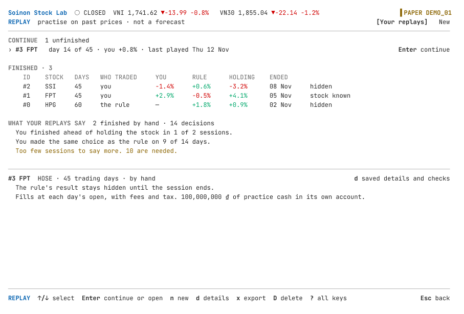
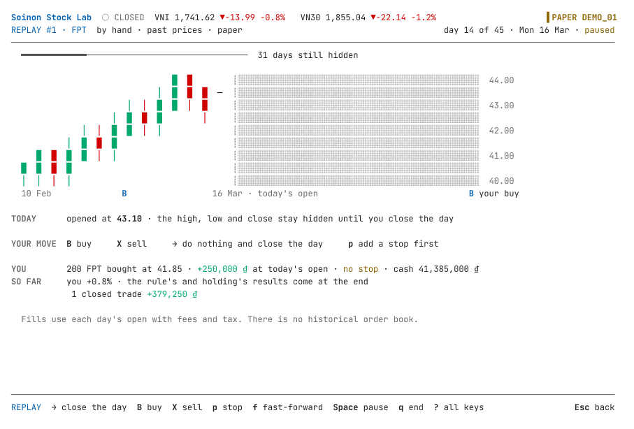
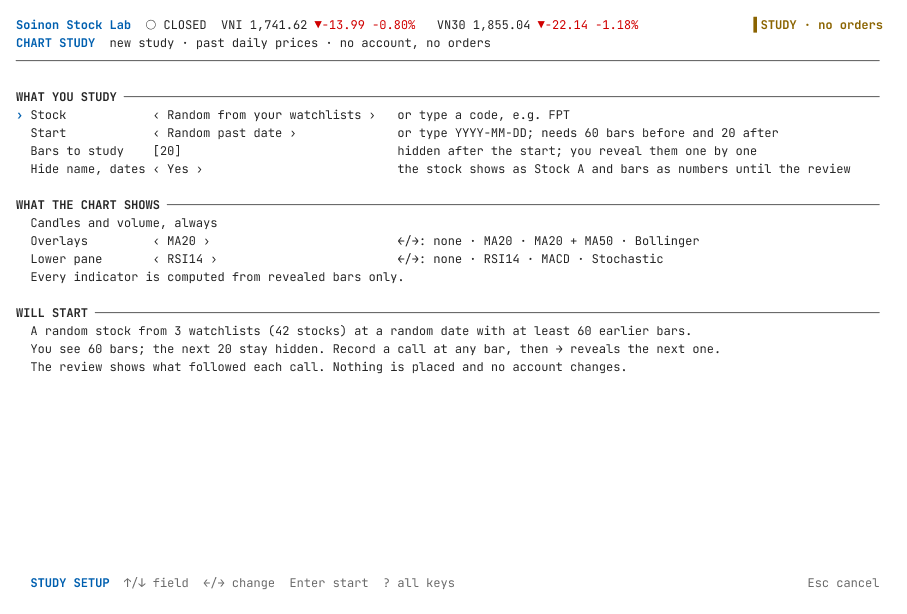
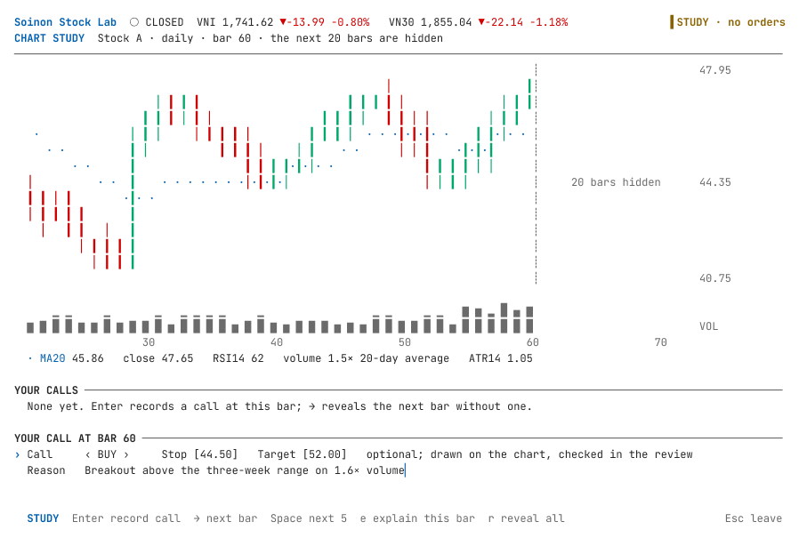
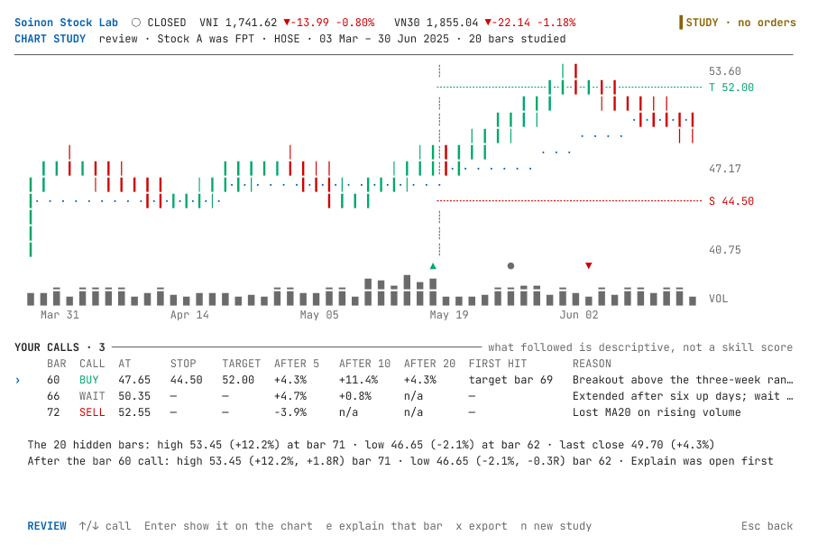
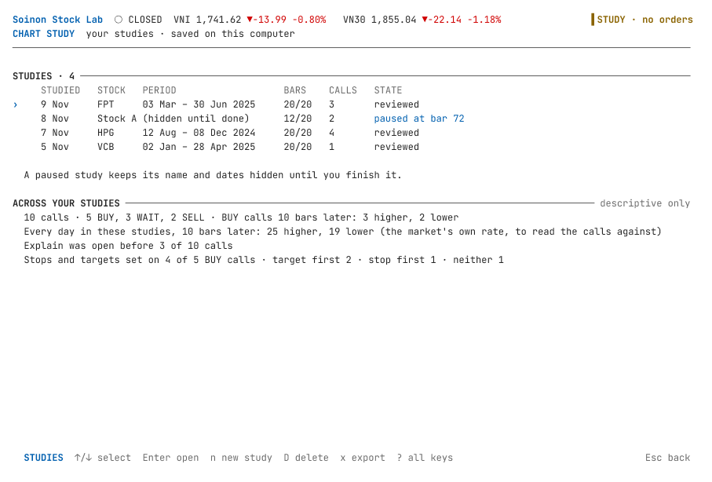
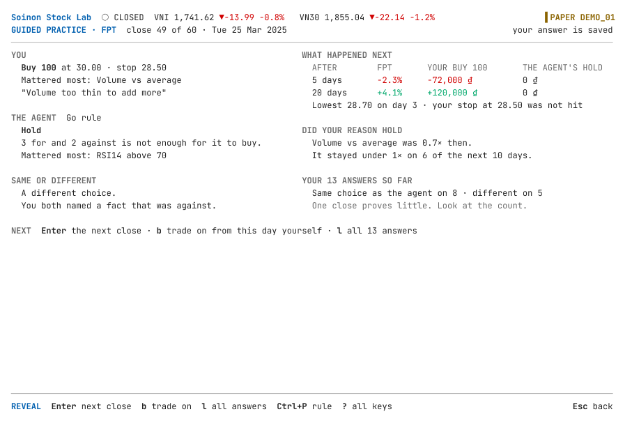
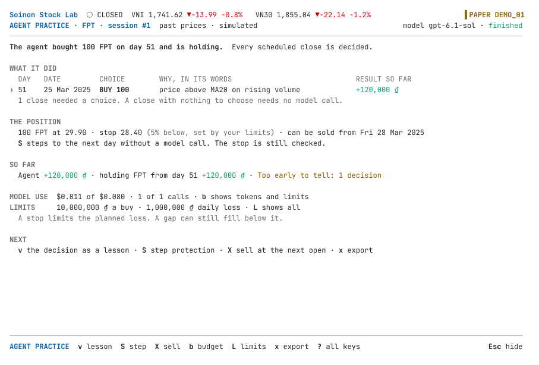

# 6 · Lab

**Purpose:** Practise reading charts and testing strategies on **past saved prices** without risking real judgment or even paper account capital first. Everything in Lab is descriptive and free (unless you explicitly ask a paid model in Agent practice).

**How to get there:** Press `F3` then `6`, or type `:lab`. (`C` from Market or Stock Chart launches **Chart study** directly.)

## Use cases & user stories

- **Testing whether simple indicator rules work on Vietnamese stocks:** *"Everyone talks about `MA20/MA50` golden crosses or buying `RSI < 30`. Did those rules actually beat simply holding `FPT` over the past 2 years?"* → Run **Backtest** (`1`) and compare against buy-and-hold (`Compare` tab).
- **Training chart intuition without peeking ahead:** *"When I look at a past chart, my eyes jump straight to the right side so every setup looks obvious. I want to hide future candles and commit my call honestly."* → Use **Chart study** (`C`) or blind **Replay** (`2`).
- **Checking if technical grades actually separate winners:** *"Does buying an `A+` stock in `vnt` really lead to better 5-day and 20-day returns than a `D` stock?"* → Open **Grade check** (`g`) and measure your own database with 90% confidence intervals.

## Lab home overview

Lab organizes learning into clear questions:
- **`1` Backtest:** *Would a rule have worked?* — Test 4 classic rules in seconds (`free`).
- **`2` Replay:** *Could I have traded it myself?* — Trade a past window day-by-day with the future hidden (`free`).
- **`3` Agent practice:** *What would the agent have done?* — Watch the Go-rule (free) or model (paid) agent trade past days inside your limits.
- **`4` Guided practice:** *Can I read it like the agent?* — Make your call first, then reveal the agent's choice and what happened (`free`).
- **`g` Grade check:** Test whether higher TA grades actually beat lower grades in your saved database (`free`).
- **`C` / `S`:** Start a new **Chart study** or browse saved studies (`S`).

---

## Backtest

**Get there:** Press `1` on Lab home, type `:backtest`, or press `Enter` on Stock → Backtest.

**Purpose:** Check objectively whether a simple trading rule beat buying-and-holding on saved daily bars — simulating next-day open fills, fees, sell tax, and T+2 settlement cleanly without lookahead bias.

### The four built-in rules

| Rule | Buy condition | Exit condition |
|---|---|---|
| **Moving-average cross 20/50** | `MA20` crosses above `MA50` | `MA20` crosses below `MA50` |
| **Breakout of 20-day high** | Close above prior 20D high on volume `> 1.5×` average | Close below prior 20D low, or `>= 5%` loss below entry |
| **RSI under 30, exit over 70** | `RSI14` closes below `30` | `RSI14` closes above `70` |
| **Bollinger reversion** | Close below lower 20-day Bollinger band | Close above upper band |

Press `Tab` to switch to **`Compare`** to benchmark all four rules side-by-side (`w` runs across your entire watchlist; **`p`** launches a blind Replay on the exact same period so you can try trading it better by hand!).

> **Beginner rule of thumb (`ENOUGH?`):** A rule with fewer than **30 trades** (`no` in the `ENOUGH?` column) is too small a sample to trust — 2 lucky trades prove nothing.

---

## Replay

**Get there:** Press `2` on Lab home, type `:replay new`, or press `p` on a Backtest (`:replay` lists saved sessions).

**Purpose:** Practise real buying, selling, stop placement, and T+2 cash management on past days **without hindsight** (`today`'s high/low/close remain hidden until you end the day).

### Setup & running a session
- Choose **`Surprise me`** (recommended!) to pick a random watchlist stock and random 45-day window from the last 3 years with **ticker & dates hidden**, so memory cannot cheat.
- Each session gets a fresh `100,000,000 ₫` replay cash account (`m` customizes comparison rule, cash, and seed).

- **`→`:** Close the day and step to tomorrow's open (`Space` pauses/resumes; `f` fast-forwards).
- **`B` / `X`:** Buy or sell at today's open.
- **`p`:** Save/adjust a protective stop.
- **`q`:** End session early (asks first).

When the session ends, **`Replay finished`** reveals the real stock and dates, compares **You vs Rule vs Holding**, lists every day you acted beside what happened 5 days later, and lets you press **`G`** for Guided practice on the same window (`x` exports receipts).

---

## Chart study

**Get there:** Press `C` on Market board, Stock Chart, or Lab home (`S` opens Saved studies).

**Purpose:** Isolate pure chart reading skill — **no cash, no fees, no paper orders**. Study a hidden historical daily chart bar-by-bar, commit `BUY`, `SELL`, or `WAIT` with optional stop/target and reason, then see honestly what happened over the next 5, 10, and 20 bars.

### Step 1: Configure a blind study (`New study`)

- Pick a stock or leave blank for a random watchlist stock (`Start` needs at least 60 bars before and 20 hidden bars after; press `Ctrl+L` for the **History library** to check data coverage or fetch older history).
- Keep **`Hide dates: yes`** (shows **`Stock A`** and numbered bars so you can't recognize the stock or date!).
- Pick overlays (`MA20`, `MA20 + MA50`, or `Bollinger`), lower pane (`VOL`, `RSI14`, `MACD`, `Stochastic`, `RS vs VN-Index`, or `Foreign flow`), and keep **`Limit days`** on to spot ceiling/floor locks.

### Step 2: Read bar 60 & record your call (future hidden)

Notice how **`20 bars hidden`** hides everything to the right of bar 60! Every indicator (`MA20 45.86`, `RSI14 62`, `ATR14 1.05`) is computed **only from revealed bars**.
- Pick `< BUY >`, `< SELL >`, or `< WAIT >`, enter optional **Stop** (`44.50`) and **Target** (`52.00`), type a short **Reason** (*"Breakout above the three-week range on 1.6× volume"*), and press **`Enter`** to lock your call in SQLite.

### Step 3: Step forward bar-by-bar & use `e` carefully

- Press **`→`** to reveal one bar at a time (or **`Space`** for 5 bars) and watch your dashed stop and target levels against unfolding candles (`r` reveals all remaining bars).
- Need a reminder of the indicator numbers at a bar? Press **`e`** (`explain this bar`):

*(Note: `vnt` tracks whether you had Explain open before making a call so your final review stays honest!)*

### Step 4: Review & compare across all your studies (`S`)

Once revealed, **`Review`** unmasks the real ticker/dates and shows for each call: **follow-up after 5, 10, and 20 bars**, highest/lowest excursion, whether **target or stop hit first**, and net **`R`** outcome — purely descriptive counts, never a "good/bad" judgment score. You can also record a closing reflection (`n` / edit reflection) and track all finished or paused studies under **`Your studies` (`S`)**:

Notice **`ACROSS YOUR STUDIES`**: `vnt` compares your `BUY` calls (`10 bars later: 3 higher, 2 lower`) right beside **all bars in those studies** (`25 higher, 19 lower`) — helping you see if your reads beat a blind coin flip over time!

---

## Guided practice

**Get there:** Press `4` on Lab home.

**Purpose:** Read the exact indicator evidence from one of the agent's past trading checkpoints, lock in *your* decision and reason **before** seeing the agent's choice, then compare both against the next 5 and 20 sessions.

Pick `Hold`, `Buy 100`, or `Buy 300`, pick the single factor that mattered most to you, type a brief optional explanation, and press **`Enter`** (`Ctrl+P` shows the Go rule).

Once saved, your answer is locked and revealed beside the agent's choice and actual subsequent return.

---

## Agent practice

**Get there:** Press `3` on Lab home.

**Purpose:** Watch how the Go-rule (free) or model agent (paid) behaves across historical dates inside capital limits you define — taking weeks of live observation down to a few minutes.

While the replay runs, you watch the agent's live balance, protection status, and each daily decision — and can pause or take over manually anytime (`P` / `T`):

---

## Grade check

**Get there:** Press `g` on Lab home or on Stock → Why this grade.

**Purpose:** Ask the hardest, most honest question about `vnt`'s technical grade: *In my own saved price history, did `A`-graded days actually perform better afterward than `D`-graded days?*

Requires at least `100` graded sessions in your local database. Reports **Next 5** and **Next 20 sessions vs VN-Index** (mean, median, share beating the index) plus the **`A − D` spread** and **90% confidence interval** (*"spans zero"* warns when the difference could simply be chance). Zero lookahead, zero fees/slippage assumed (`r` reruns, `x` exports).
