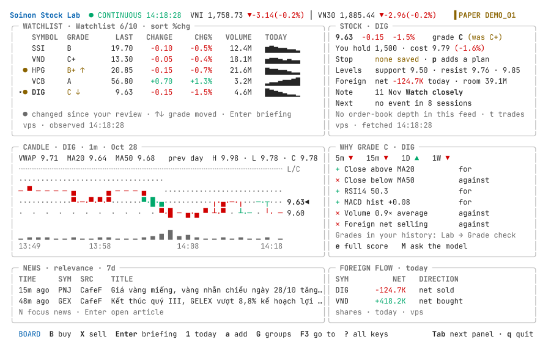
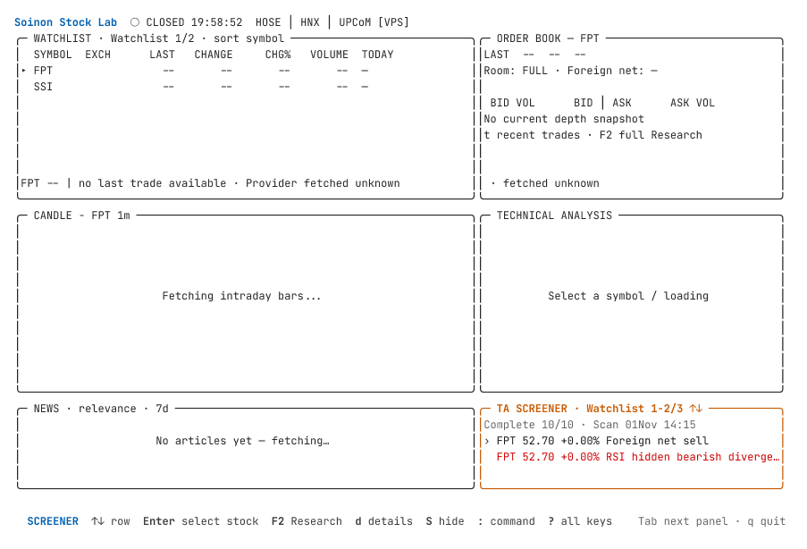
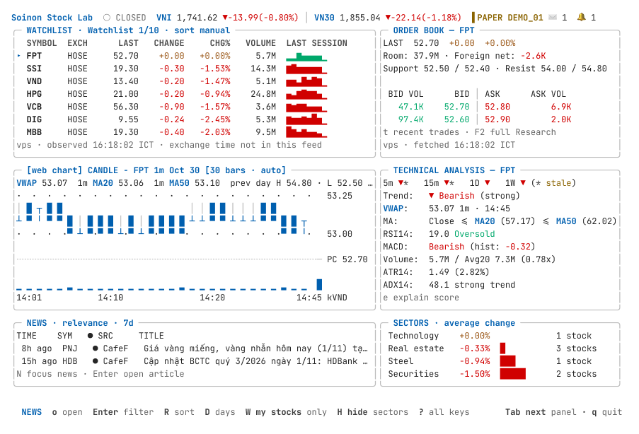
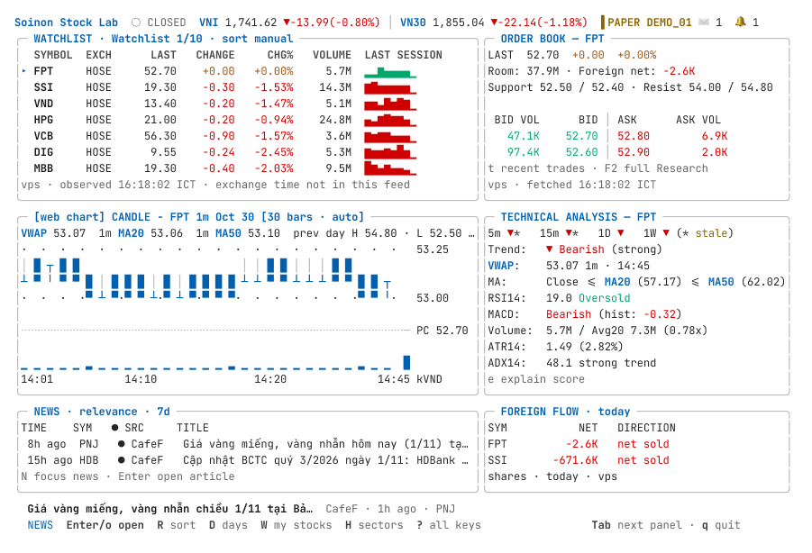
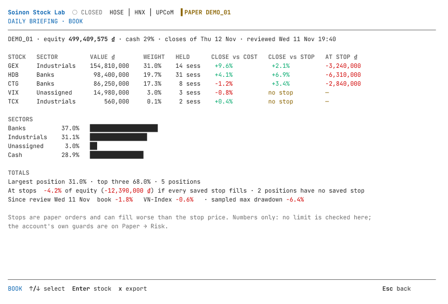
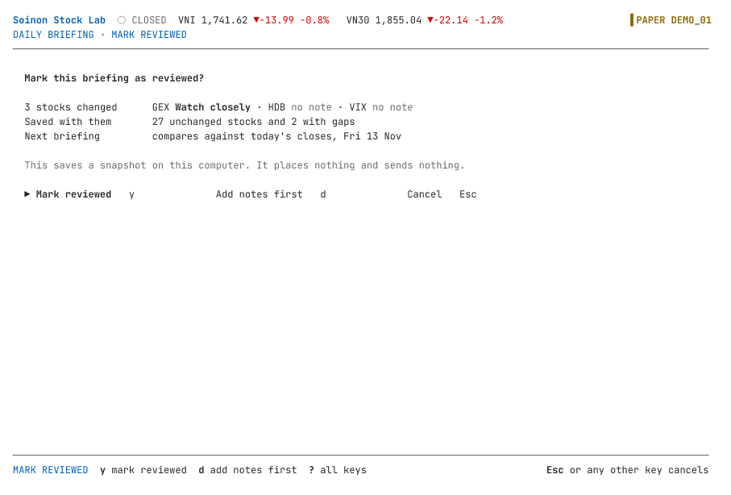
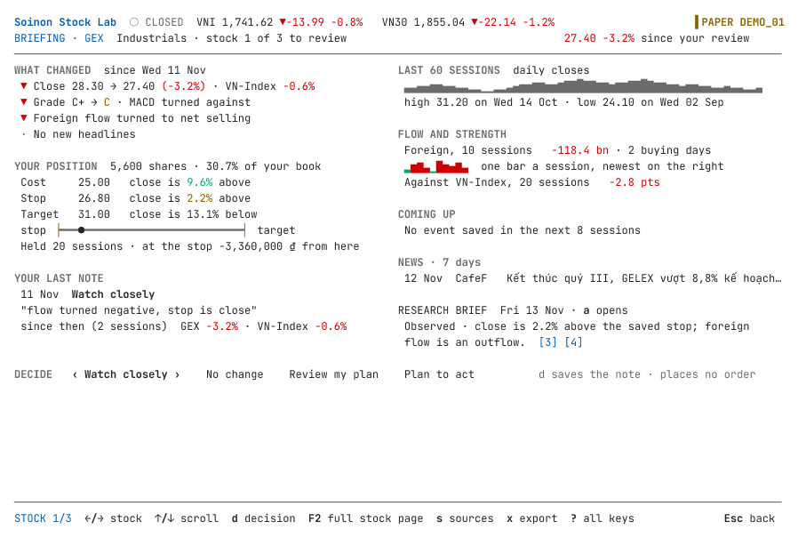
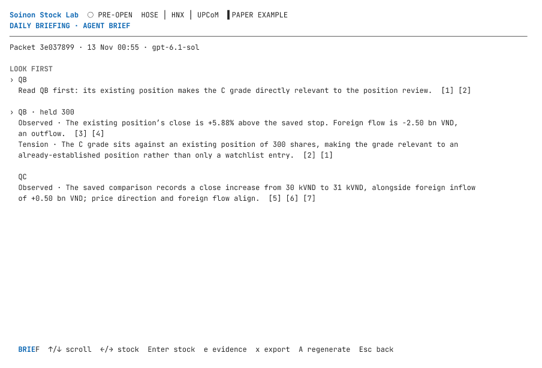

# 2 · Market

**Purpose:** Monitor live prices across your watchlists, track headlines and foreign investor flow, filter for technical signals or sector moves, manage price alerts, and run a 2-minute daily review of what changed since yesterday.

**How to get there:** Press `F3` then `2`, type `:market`, or press `2` / `Esc` from **Today**.

## Use cases & user stories

- **Comparing stocks live without switching windows:** *"I watch 10 bank and tech stocks and want to glance at live quotes, intraday candles, 7-factor grades, and foreign buying on one screen."* → Use `↑` `↓` in **Watchlist**; every companion panel updates immediately.
- **Spotting broad market rotation fast:** *"Red index days look scary — I want to see which sectors are actually holding up and which stocks triggered real technical signals."* → Toggle **Sector heat map** (`H`) and **Screener** (`S`).
- **Two-minute evening review (Busy worker):** *"I only check the market after 15:00 ICT. Show me only what changed since I last reviewed."* → Run **Daily briefing** (`:brief`), check movers, inspect a holding (`Enter`), and mark reviewed (`m`) so tomorrow compares cleanly against today.

## The Market board

The Market board puts six coordinated panels on one screen. As you move up and down the **Watchlist** (`↑` `↓`), the **Stock**, **Candle chart**, and **Why grade** panels update together for the highlighted stock.

### What each panel shows

- **`WATCHLIST` (top-left):** Your watched stocks, showing:
  - `●` gold dot = changed since your last reviewed briefing
  - `GRADE` + `↑`/`↓` = daily TA grade (`A+` down to `D`), plus whether the grade just moved up or down
  - `LAST`, `CHANGE`, `CHG%`, `VOLUME`, and `TODAY` (a compact sparkline of today's price movement)
  - The footer stamps the exact quote feed and observation time (`vps · observed 14:18:28`).
- **`STOCK` (top-right):** Summary of the selected stock — last price, grade change (`grade C (was C+)`), your paper position (`You hold 1,500 · cost 9.79 (-1.6%)`), stop status (`none saved · p adds a plan`), nearest `support` / `resist.`, today's foreign net flow & remaining foreign room, and your last decision note.
- **`CANDLE` (middle-left):** Intraday candlestick chart (`1m` by default; switch `1`/`5`/`F`/`4` between 1m, 5m, 15m, and daily) with `VWAP`, `MA20`, `MA50`, and previous-day High/Low/Close (`prev day H/L/C`).
- **`WHY GRADE` (middle-right):** A quick 5m / 15m / 1D / 1W timeframe direction strip (`▲`/`▼`) above the 7 factors (`+` for, `×` against). Press **`e`** for the full scoring math, or **`M`** to ask a configured model to explain it.
- **`NEWS` (bottom-left):** Matched CafeF headlines ranked by relevance or recency (`N` focuses news, `Enter` opens the article link).
- **`FOREIGN FLOW` (bottom-right):** Net shares bought (`+`) or sold (`-`) by foreign investors today.

> **Outside market hours:** After 14:45 or on weekends, the board displays your last saved quotes and notes their age instead of showing fake live ticks. On an **80×24** terminal, panel borders and the `TODAY` sparkline hide automatically so more stocks fit cleanly.

### Example: organising watchlists and inspecting a mover
1. Suppose you want a separate list just for bank stocks. Press **`G`** to open Watchlist groups, press `n` to create `Banks`, then press **`a`** and type `VCB, ACB, HDB, MBB` to add them. Switch groups anytime with `[` and `]`.
2. Notice `DIG` has `C ↓` (`-1.5%`). With `DIG` highlighted, press **`t`** to check recent trade prints, **`n`** to set a price alert near its `9.50` support, or **`Enter`** to open the full `Stock` page.

### Essential board keys

| Key | Action |
|---|---|
| `↑` `↓` | Select a stock in the Watchlist |
| `Tab` | Cycle focus between panels (focused panel gets the orange border) |
| `Enter` | Open the selected stock's full Stock page |
| `1` `5` `F` `4` | Switch Candle panel timeframe: 1m, 5m, 15m, daily |
| `'` | Cycle lower pane (Volume / RSI14 / MACD / Stochastic) |
| `L` / `V` / `M` | Toggle prev-day H/L/C lines, VWAP, and pivots/Fibonacci on the board chart |
| `a` / `D` | Add or delete a stock in the current watchlist group |
| `K` / `J` | Reorder a stock up or down manually |
| `s` `p` `v` `m` | Sort list by code, % change, volume, or manual order |
| `G`, `[` `]` | Open Watchlist groups manager; switch previous / next group |
| `S` | Toggle the compact **Screener** panel (finds live/saved signals across this group; `d` explains a signal) |
| `H` | Toggle the **Sector heat map** (average % change and stock count per sector) |
| `N` | Focus **News** (`D` changes 1/3/7/30 days, `R` sorts, `W` filters to watchlist only) |
| `e` / `t` | Open full Grade breakdown / recent Trade prints for the selected stock |
| `n` / `A` | Create a new alert / open **Alert inbox** |
| `C` | Open **Lab → Chart study** on the selected stock's past daily bars |
| `B` / `X` | Open Paper BUY / SELL order ticket |
| `P` / `1` | Open Paper portfolio / jump to Today |

### Screener (`S`)
Pressing **`S`** opens a compact **TA Screener** panel in the bottom-right corner listing stocks in the active watchlist group that match live or daily technical signals (such as RSI divergences or foreign net flow). Use `↑` `↓` to select, `d` to read why a signal triggered, `Enter` to highlight that stock on the board, or `S` again to hide it. For broader scans across VN30/VN100 use [4 · Find](find.md).

### Sector heat map (`H`)
Pressing **`H`** replaces the bottom panels with a **Sector heat map**, showing each industry's average daily `%` change, horizontal breadth bar, and number of stocks. Sector tags come from **Records → Sectors**.

## News (`N`)
Press **`N`** to focus the **News** panel (`Tab` returns). Headlines come from CafeF RSS and match stock codes and sectors automatically, showing the full selected headline's source and age at the bottom (`Enter` opens the article; `D` toggles 1/3/7/30-day lookback; `R` sorts by relevance vs time; `W` filters to your watchlist; `:news export` writes CSV).

---

## Alerts (`A` or `:alerts`)

**Purpose:** Set rule-based watchers on price levels or indicators so you don't have to stare at quotes all day. Alerts notify you in the terminal — they **never** place orders.

### Supported triggers
Press **`n`** on a stock (or type e.g. `:alert FPT below 41.50` in the command bar):

- **Price above / below:** Live price crosses a target level (checked against valid ticks).
- **Cross MA20:** Daily close crosses the 20-day moving average.
- **RSI above / below:** 14-session RSI crosses a threshold (1–99).
- **Volume spike:** Volume reaches a chosen multiple of the 20-day average.

### Reading the inbox
- **`FIRED`** sits at the top so triggered events are impossible to miss (`●` marks unread), showing when it fired, at what price, and what the price is now.
- **`WAITING`** shows every armed alert along with **`DISTANCE`** (for example `+1.9% to level`) so you immediately know how close each rule is to triggering.
- Press `u` to mark read, `R` to re-arm a fired alert (asks confirmation), `D` to delete, or `f` to filter (`waiting`, `fired`, `all`).

> **Important boundary:** Alerts evaluate against live quotes **only while `vnt` is open**. Price moves while the app is closed are not back-filled as fired alerts.

---

## Daily briefing

**Get there:** Type `:brief`, press `v` on Today, or pick Get started goal 1.

**Purpose:** Run a structured **2-minute end-of-day or pre-market check**. Instead of chasing noisy headlines, the briefing compares today's saved close against the exact close from the **last time you marked a briefing reviewed** — surfacing only real changes.

### 1. Summary table
- **Top book strip:** Shows paper equity (`514.15M ₫`), change since your reviewed baseline (`▲ +14.15M ₫`), and **Needs you** stop/settlement warnings (`ACB` has a plan without an armed order; `VIX` has neither).
- **Stock table:** Lists stocks in scope with `CLOSE`, `SINCE` (% move since your last reviewed briefing), `GRADE`, `FLOW 10d` (10-day foreign net in billion dong), `YOUR POSITION` (distance above stop), and `WHAT CHANGED` (such as a `>= 2%` price move, grade change, approaching stop, or upcoming event). Unchanged stocks fold neatly underneath so you focus on movers.
- **Keys:** Press **`f`** to fetch fresh daily bars for all stocks in scope, **`Enter`** to drill into one stock's review, **`b`** for the whole-book risk view, **`d`** to save a decision note, **`m`** (then `y`) to mark reviewed and advance your baseline, **`a`** for an AI research brief (optional, paid), or **`x`** to export JSON.

### Whole-book check (`b`) & Marking reviewed (`m`)

Press **`b`** in the briefing to inspect whole-account risk before marking done — showing account equity, biggest holdings, sector weights, and stocks without stops:

When finished reviewing, press **`m`** to compare coverage (`how many stocks have fresh closes`), type `y`, and lock today's close as tomorrow's baseline:

### 2. Per-stock Briefing review (`Enter`)

Pressing `Enter` on any stock in the briefing opens a focused one-screen review:
- **`WHAT CHANGED`** since your baseline date (`Close 28.30 → 27.40 (-3.2%)`, grade drop `C+ → C`, foreign flow flip).
- **`YOUR POSITION`** with a visual **`stop ──●─────── target`** slider showing how close price sits to your protective stop (`2.2% above`) vs your profit target (`13.1% below`).
- **`LAST 60 SESSIONS`** daily close sparkline + **10-session foreign flow bar** + **20-session strength vs VN-Index**.
- **`YOUR LAST NOTE`** recalls what you wrote last time (`"flow turned negative, stop is close"`) and tracks how price moved **since that note** (`2 sessions: GEX -3.2%`).
- **`DECIDE`** at the bottom lets you record your judgment (`Watch closely`, `No change`, `Review my plan`, `Plan to act`) — saving a timestamped note in your database **without placing any order**.

### 3. Research brief (`a` in briefing, optional paid model)

If an OpenAI API key is configured, pressing **`a`** lets you ask a language model to synthesize changes across up to 5 stocks using the briefing's frozen facts.
- First, `vnt` shows **exactly which stocks, facts, and estimated dollar cost** will be sent and requires typing `send` to proceed.
- Saved briefs separate **Facts (checked against saved data)** (`●`, green) from **Interpretation** and remain readable offline anytime without spending another cent (`e` inspects exact cited fields).
