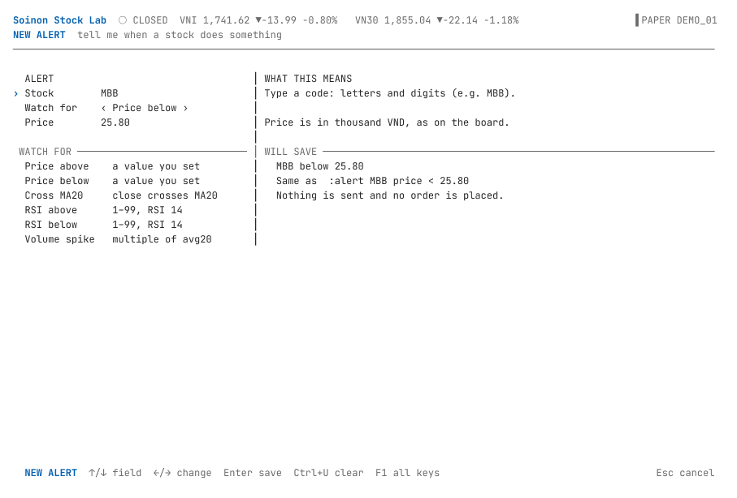
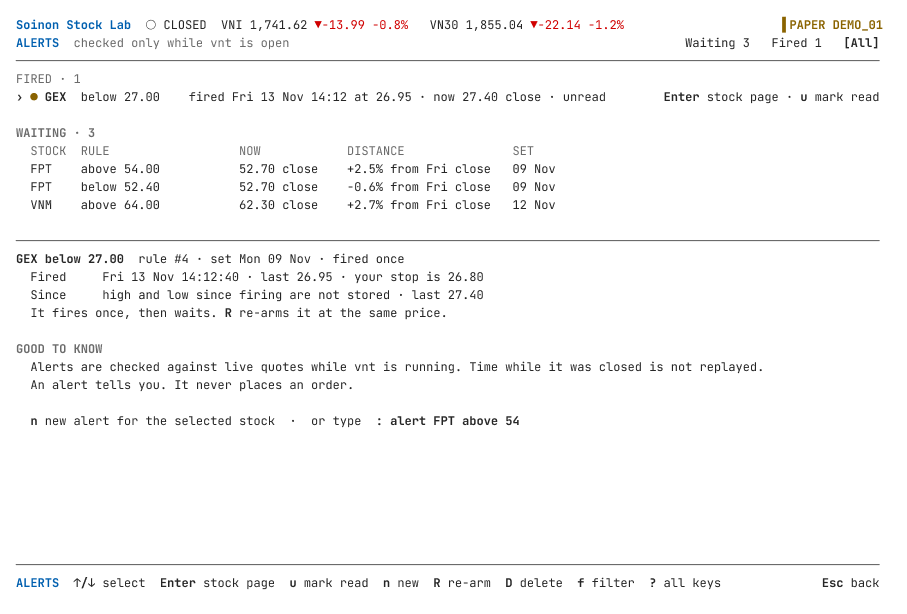
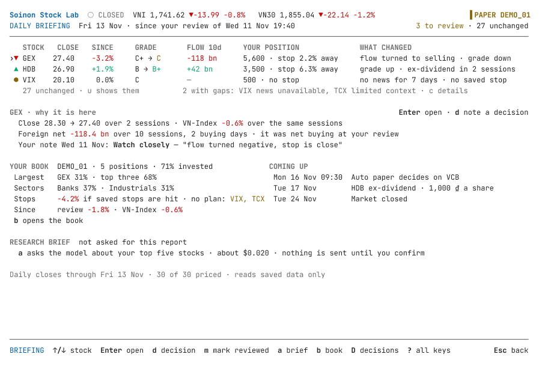

# 2 · Market

**Purpose:** Follow live Vietnamese market prices across your watchlists, organize stocks into groups, read matched financial news and foreign investor flows, spot technical signals or sector moves, manage price alerts, and run a calm 2-minute Daily briefing after the close.

---

## Use cases & user stories (Benefits)

- **Watching live movers without juggling windows:** *"I follow 10 bank and tech stocks and want live quotes, intraday candles, 7-factor grades, headlines, and foreign flow all updating together in one place."* → The **Market board** links all six panels cleanly as you step down your watchlist.
- **Seeing the market mood at a glance:** *"When VN-Index drops, I want to tell whether selling is hitting every industry or only one sector — and which watched stocks actually fired technical signals."* → **Sector heat map** and **TA Screener** show industry breadth and live signals side-by-side.
- **Stepping away from the screen safely:** *"I can't stare at quotes all day. Tell me when FPT drops near support or crosses MA20."* → Set rule-based **Alerts** with clear distance readouts in **Alert inbox**.
- **Two-minute end-of-day review:** *"Show me only what moved, changed grade, or approached a stop since my last check."* → Run the **Daily briefing** and advance your baseline only when you finish reviewing.

---

## 1. The Market board

The Market board arranges six coordinated panels around your Watchlist. Highlighting any stock updates its **Stock card**, **Candle chart**, and **Why grade** panels simultaneously.

### What each panel means (worked example: `DIG`)
- **`WATCHLIST` (top-left):** Lists your stocks with daily TA **GRADE** (`↑`/`↓` marks recent grade moves), **LAST**, **CHANGE**, **CHG%**, **VOLUME**, and a **TODAY** intraday sparkline. A gold dot (`●`) flags stocks that changed meaningfully since your last reviewed briefing, and the footer timestamps the exact feed (`vps · observed 14:18:28`).
- **`STOCK` (top-right):** Snapshot for the selected stock (`DIG 9.63 -1.5%`, `grade C (was C+)`), your paper holdings (`1,500 · cost 9.79`), stop status (`none saved`), nearest `support 9.50` / `resist. 9.76`, today's foreign net flow (`-124.7K`) and remaining foreign room (`39.1M`), plus your latest briefing note.
- **`CANDLE` (middle-left):** Intraday candlestick chart (`1m`, `5m`, `15m`, or daily) with `VWAP`, `MA20`, `MA50`, and yesterday's High/Low/Close reference lines.
- **`WHY GRADE` (middle-right):** Shows a multi-timeframe direction strip (`5m ▼ · 15m ▼ · 1D ▲ · 1W ▼`) above the 7 factors (`+` for, `×` against).
- **`NEWS` (bottom-left) & `FOREIGN FLOW` (bottom-right):** Matched CafeF headlines ranked by relevance/age, beside today's foreign investor net share flow (`DIG -124.7K net sold`, `VND +418.2K net bought`).

> **After hours & compact screens:** Outside trading hours (`○ CLOSED`), the board displays saved closing quotes with clear timestamps rather than stale blanks. On compact **80×24** terminals, decorative borders and `TODAY` sparklines drop automatically so more stocks fit cleanly.

### Live TA Screener & Sector Heat Map
- **TA Screener:** Surfaces live or daily technical signals across the current watchlist group (such as *RSI hidden bearish divergence* or *Foreign net sell*) with plain-English signal explanations when inspected:

- **Sector heat map:** Summarizes average daily percentage return and stock count per industry (sectors come from **Records → Sectors**) so you spot sector rotation immediately:

### Focused News reader
Focusing News lets you inspect the full selected headline, publisher source, and exact article age, open stories in your browser, filter strictly to watchlist tickers, or adjust the 1/3/7/30-day window:

---

## 2. Alerts (New alert & Alert inbox)

**Purpose:** Watch price levels or technical thresholds automatically while `vnt` is open so you never chase moves late. **Alerts only notify you — they never place orders.**

### Setting an alert with price context
When creating a new alert on a stock, `vnt` displays the stock's current price and nearby support/resistance levels so you can place triggers cleanly on valid ticks:

Supported triggers:
- **Price above / below:** Live price crosses a chosen price level.
- **Cross MA20:** Daily close crosses above or below the 20-day moving average.
- **RSI above / below:** 14-session RSI crosses a chosen level (`1–99`).
- **Volume spike:** Trading volume exceeds a chosen multiple of the 20-day average.

### Managing triggered & waiting alerts (`Alert inbox`)

- **`FIRED`** sits at the top (`●` marks unread) showing when it fired, the trigger price, and current price.
- **`WAITING`** tracks every active rule alongside **`DISTANCE`** (e.g., `+1.9% to level`) so you know immediately which watches are getting close. *(Alerts only check live quotes while `vnt` is open; moves while closed are not replayed.)*

---

## 3. Daily briefing

**Purpose:** Replace chaotic scrolling with a calm **2-minute daily check**. Unlike live quotes, the Daily briefing compares today's saved daily closes against your **last reviewed baseline** — folding unchanged stocks out of the way.

### Example evening briefing flow
1. **Summary table:** Check the top equity strip (`514.15M ₫`, `▲ +14.15M ₫ since start`), **`NEEDS YOU`** warnings (e.g., holdings lacking an armed stop order), and stocks flagged under **`WHAT CHANGED`** (a `>= 2%` price swing, grade change, approaching stop, or upcoming event).
2. **Stock review:** Open any mover to inspect **60 sessions of closes**, **10-session foreign flow**, **20-session relative strength vs VN-Index**, a visual **`stop ──●─────── target`** gauge, your last decision note with how price moved since then, and record a new judgment note (**Watch closely**, **No change**, **Review my plan**, **Plan to act**) without placing any order:

3. **Whole-book exposure check:** Check overall portfolio weight, biggest holdings/sectors, and stop protection across your entire book in one view:

4. **Mark reviewed:** Lock today's close as tomorrow's baseline only when you explicitly confirm (`view-only` browsing never resets your baseline):

### Optional AI Research brief (`a`, paid per request)
If an AI model key is configured, you can ask for a read-only synthesis across up to 5 stocks in the briefing. `vnt` previews exact data sent and dollar cost first (`send` confirms), clearly separates verified **Facts (`●`)** from **Interpretation**, and keeps saved briefs readable offline for free:

---

## How to open and use Market (Controls)

Open **Market** via `F3` → `2`, `:market`, or `2`/`Esc` from Today. Open **Alert inbox** with `:alerts` (or `A` on the board) and **Daily briefing** with `:brief` (or `v` on Today).

### Market board keys

| Key | Action |
|---|---|
| `↑` `↓` | Select a stock in the Watchlist |
| `Tab` | Cycle focus across panels (focused panel shows orange border) |
| `Enter` | Open the selected stock's full **Stock** page (or article link in News) |
| `1` `5` `F` `4` | Switch Candle chart between `1m`, `5m`, `15m`, and daily (`4`) |
| `'` | Cycle Candle lower pane (`Volume`, `RSI14`, `MACD`, `Stochastic`) |
| `L` / `V` / `M` | Toggle prev-day H/L/C lines, VWAP, and pivots/Fibonacci on the board chart |
| `a` / `D` | Add / remove a stock in the active watchlist group |
| `K` / `J` | Reorder stocks manually up / down |
| `s` `p` `v` `m` | Sort by code, % change, volume, or manual order |
| `G`, `[` `]` | Manage watchlist groups (`n` new, `r` rename, `D` delete); switch prev/next group |
| `S` / `H` | Toggle compact **TA Screener** (`d` explains signal) / **Sector heat map** |
| `N` | Focus **News** (`D` 1/3/7/30 days, `R` relevance/time, `W` watchlist filter, `:news export`) |
| `e` / `t` | Open full **Why this grade** breakdown / recent **Trades** prints |
| `n` / `A` | New alert on selected stock / open **Alert inbox** |
| `C` | Start a blind **Chart study** on this stock |
| `B` / `X` | Open Paper BUY / SELL order ticket |
| `P` / `1` | Open Paper portfolio / jump back to Today |

### Alert inbox & Daily briefing keys

- **Alert inbox:** `Enter` open stock · `u` mark read · `n` new alert · `R` re-arm (asks first) · `D` delete (asks first) · `f` filter (`waiting` / `fired` / `all`).
- **Daily briefing:** `f` fetch fresh daily bars · `Enter` stock review · `b` whole-book summary · `d` decision note · `D` decision log · `m` mark reviewed (`y` confirms) · `a` AI research brief · `x` export JSON.
