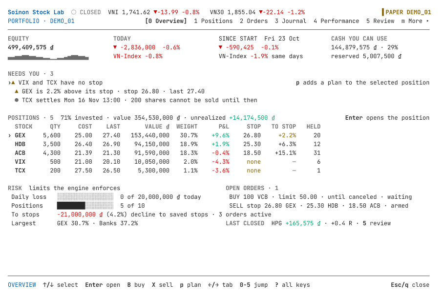
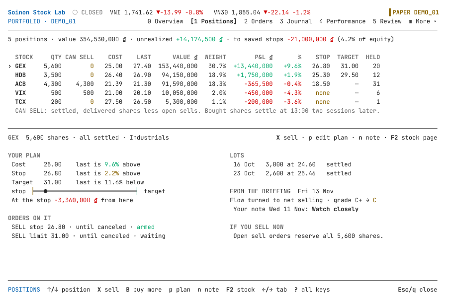
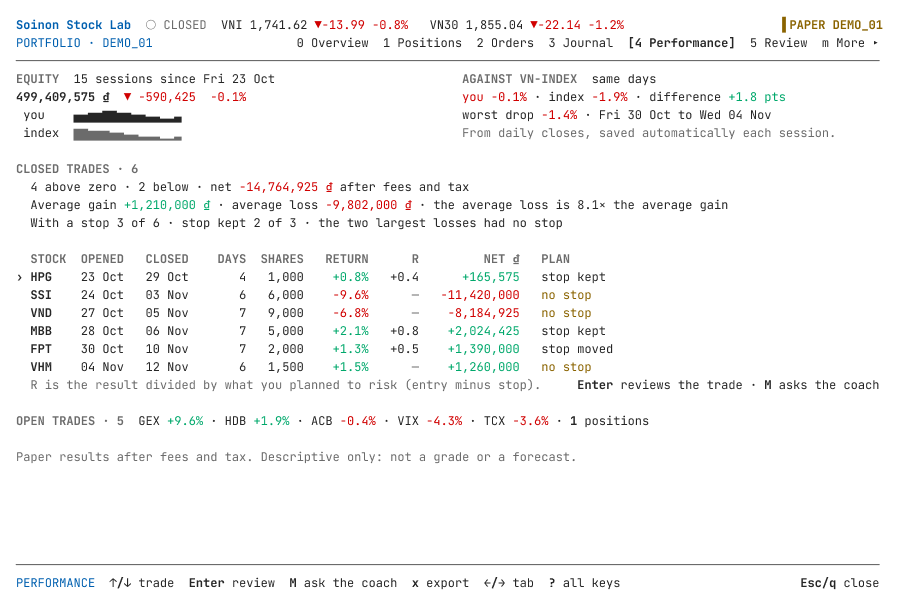
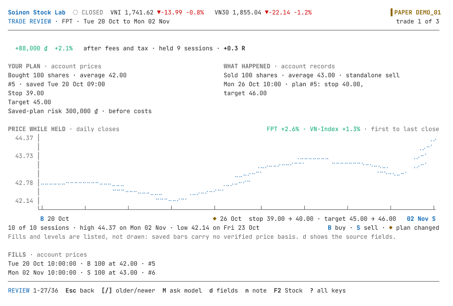
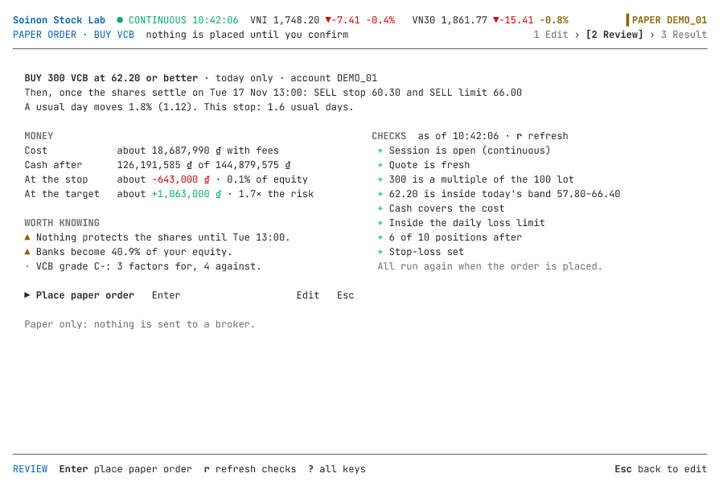

# 5 · Paper

**Purpose:** Practise trading with pretend money under real Vietnamese exchange mechanics — **100-share lots, exchange ticks, ±7%/10%/15% price bands, T+2 settlement at 13:00, fees, and sell tax** — plan your stop-loss and target on every order, track *why* you traded, and review closed trades without guesswork.

**How to get there:** Press `F3` then `5`, press `P` from the Market board, or type `:portfolio`. Press **`B`** (Buy) or **`X`** (Sell) on any stock across the app to open a paper order ticket directly.

> **Paper only.** No order ever leaves your computer. Live paper orders, stops, and targets are evaluated **only while `vnt` is open**; moves while the app is closed are not replayed.

## Use cases & user stories

- **Practising real Vietnam market rules risk-free:** *"As a first-time Vietnamese stock investor, I want to experience 100-share lots, HOSE price ticks, broker fees, and T+2 `13:00` settlement rules with pretend money first."* → Every Paper order enforces exchange ticks, lots, bands, and settlement locks identically to live rules.
- **Building risk-first habits:** *"I want to decide how much money I can lose (0.5% of account) BEFORE choosing how many shares to buy."* → Use **`Size it from risk` (`r`)** and check **`STOP AGAINST A USUAL DAY`** directly on the buy ticket.
- **Finding out which entry reasons actually work for you:** *"Do my breakout buys make money, or am I just chasing?"* → Pick a reason on entry, then audit closed outcomes in **Performance**, **Trade review**, and **Your reasons (`w`)**.

---

## Your first account & tabs

On your first visit, Paper helps you create a dedicated account with starting cash (for example `500,000,000 ₫`), broker fee, sell tax, and safe default limits.

You can keep multiple paper accounts; one is **active** (`▌PAPER DEMO_01` at top-right). Lab practice replays keep separate accounts. Use `←` `→` or `0`–`5` to switch tabs, or press **`m`** for **More → Accounts / Risk**.

---

## `0 Overview`

**Purpose:** See your portfolio's health in seconds — total equity, cash still available, **Needs you** stop/settlement alerts, all open positions, and hard engine limits.

### Key things to watch on Overview
- **`NEEDS YOU`:** Flags holdings that lack a stop-loss (`VIX and TCX have no stop`), positions near their stop (`GEX is 2.2% above its stop`), or newly bought shares still settling (`TCX settles Mon 16 Nov 13:00`). Press `p` to plan or adjust a stop.
- **`POSITIONS` & `TO STOP`:** Lists quantity, average cost, current value, portfolio weight `%`, unrealized P&L `%`, and exact distance above your stop.
- **`RISK` & `OPEN ORDERS`:** Live progress bars for enforced **Daily loss** and **Open positions** caps, plus **Decline to saved stops** (`To stops -21,000,000 ₫`) showing what you lose if every active stop triggers cleanly.

---

## `1 Positions`

**Purpose:** Drill into individual holdings — inspect **Can sell** (settled shares not already reserved by open sell orders), entry lots, linked orders, and briefing notes.

**Keys:** `X` / `B` sell or buy more · `p` edit stop/target plan · `n` write a journal note · `F2` open the stock's full Stock page.

---

## `2 Orders` (and Drafts)

**Purpose:** Inspect every waiting, filled, cancelled, or rejected order with plain English explanations of **`IT FILLS WHEN`** and **`GOOD UNTIL`**, plus **saved order drafts (`d`)**.

- **Protection states explained:**
  - `● order active` — a live stop order is armed and ready to trigger while `vnt` runs.
  - `◐ pending` — shares haven't settled (`T+2 13:00`); bracket protection arms automatically at settlement.
  - `○ plan only` — a target/stop exists in your notes, **not** as an order.
  - `▲ no plan` — neither plan nor stop order exists.
- **Drafts (`d`):** Save a limit order you aren't ready to submit, or queue it for the next continuous session's opening minutes (every risk limit is re-checked right before sending).
- **Keys:** `Enter` details · `A` amend price or reduce size · `C` cancel open order (asks first) · `f` filter · `d` drafts.

---

## `3 Journal`

**Purpose:** Maintain an honest trading log pairing **why you bought**, your **plan at entry**, and **what happened**, with automatic audit trails on every order and fill.

Orders and fills are immutable account facts; your personal notes can be added (`n`), edited (`A` / `Enter`), reviewed for earlier revisions (`r`), or exported (`x`). Press `v` to toggle *by trade* vs *by event*.

---

## `4 Performance` & Trade Review

**Purpose:** Measure real trading skill over **closed trades** after fees and tax — not just lucky open swings.

- **`DAILY EQUITY`** plots saved daily account equity beside `VN-Index` (gaps stay honest; press `s` to record today's valuation now).
- **Closed trades** track win/loss averages, **how many trades used a stop**, **how many actually kept their stop**, and net **`R` multiple** (`Net result ÷ Original planned risk`).

### Reviewing a closed trade (`Enter` on Performance)

Press **`Enter`** on any closed trade to see **Your plan** beside **What happened**, an enlarged price chart marking entry **`B`**, exit **`S`**, and any plan changes (`◆ 26 Oct stop 39.00 → 40.00`), plus exact fill receipts. Press **`M`** to ask the optional AI Trade Coach (reads objective facts, never your private notes, and confirms cost first).

---

## `5 Review` & `Your reasons` (`w`)

**Purpose:** Audit your weekly trading process — did you honour stops and write reasons before buying? — compared beside the agent and VN-Index, rather than chasing P&L noise.

Press **`w`** inside **Review** to open **Your reasons**:

When you pick a structured entry reason on the order ticket (e.g., *Volume confirmation*, *Price above MA20*, *A level you named*) or record a *"Wrong if"* rule, **`Your reasons`** counts how often that fact still held 5 and 20 sessions later and shows the outcomes (`blind replays` stay separate so practice never pollutes your paper book).

---

## `m More` → `Accounts` & `Risk`

### Accounts
Manage multiple accounts (active switching with `Enter`, creating `n`, resetting `R` with automatic safety backup, editing fees/limits `e` cleanly for future orders without rewriting past fills).

### Risk limits & guards

- **Hard limits (cannot be skipped):**
  - **Daily loss limit:** Automatically pauses new buys once daily loss hits your cap (`sells` and cancels still work).
  - **Max open positions:** Blocks opening an 11th holding if your limit is 10.
- **Guards (toggle with `g`):**
  - **Stop-loss on every buy:** Refuses buys without a protective stop plan.
  - **Cap per stock:** Prevents oversized concentration (e.g., `35%` max equity per ticker).
  - **Pause after a drawdown:** Freezes new buys after a sharp account decline until you resume explicitly.

---

## The Paper order ticket (`B` or `X`): Step-by-step example

Every buy or sell follows a safe three-step funnel: **`1 Edit` → `2 Review` → `3 Result`**.

### Example: Planning a disciplined buy on `VCB`
1. Press **`B`** on `VCB` (last `62.10`, ask `62.20`).
2. **Choose size & price (`THE ORDER`):** Enter `Limit` `62.20` for `300` shares (`lot 100` enforced automatically). Cost with fees: `~18,687,990 ₫`.
3. **Set protection (`PROTECT IT`):** Set Stop-loss **`60.30`** (`-3.1%`, tucked just under `support 61.20`) and Target **`66.00`** (`+6.1%`). Keep *After it settles* active so `vnt` automatically arms your `SELL stop 60.30` and `SELL limit 66.00` bracket once shares settle on **`Tue 17 Nov 13:00`**.
4. **Sanity-check the stop (`STOP AGAINST A USUAL DAY`):** Notice `VCB` normally moves `1.8%` (`1.12`) a day. Your stop sits `1.6 usual days` away (past lows went that far down only `4 days in 60`). Warning in amber reminds you: *until `Tue 13:00` shares are unsettled and unprotected*.
5. **Size safely (`SIZE IT FROM RISK`):** Risking `0.5%` of equity (`2,497,000 ₫`) at stop `60.30` allows up to `1,300` shares — pressing **`r`** fills that size automatically, or stay smaller at `300` shares (`-643,000 ₫` risk = `0.1%` of equity, **`1.7×`** reward-to-risk).
6. **Review & submit (`Enter`):**

Read **`CHECKS`** (`all pass`), inspect **`WHAT HAPPENS`** one last time, and press **`Enter`** to submit (`r` refreshes stale quotes/account state if needed).

Once filled, **`3 Result`** lists exact cost, remaining cash, settlement date, and an optional **`WHY YOU BOUGHT`** box (saved straight to your Journal so you can compare your original thesis when the trade closes!).

### When an order cannot go through (`Not accepted`)

If an order hits an exchange or risk rule — for example, trying to sell shares bought yesterday before `T+2 13:00` settlement — `vnt` refuses safely, explains the timeline visually, and offers concrete next steps (`n` set a settlement reminder, `p` pre-save a stop once settled, or `A` adjust the ticket):

