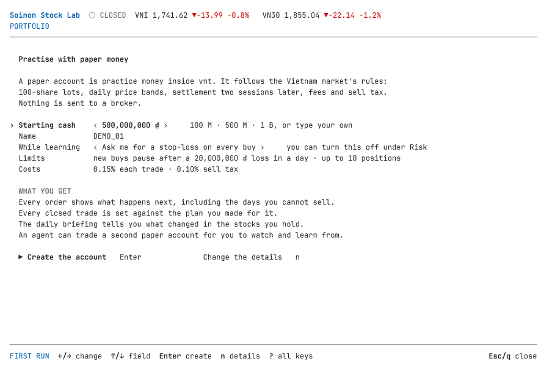
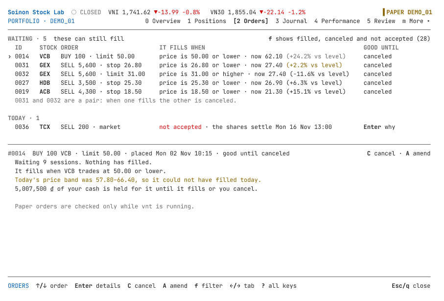
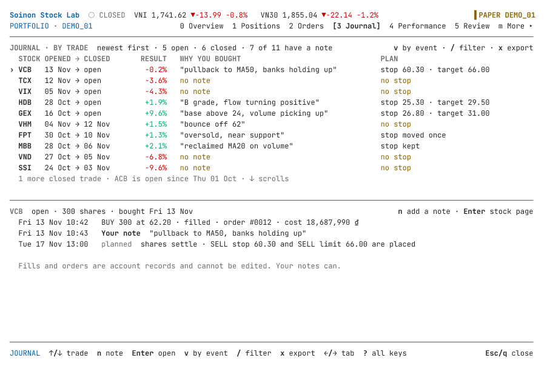
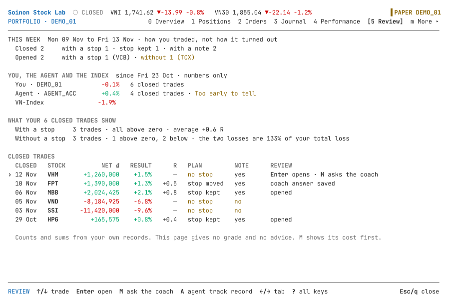
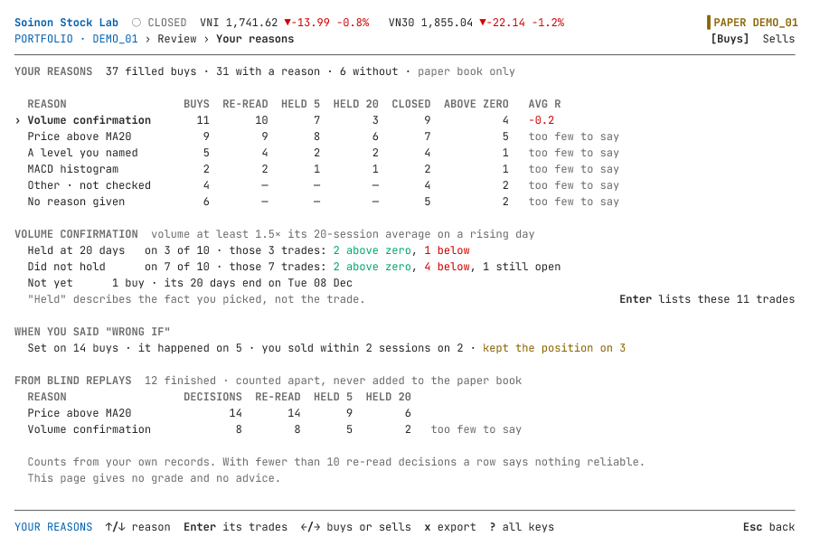
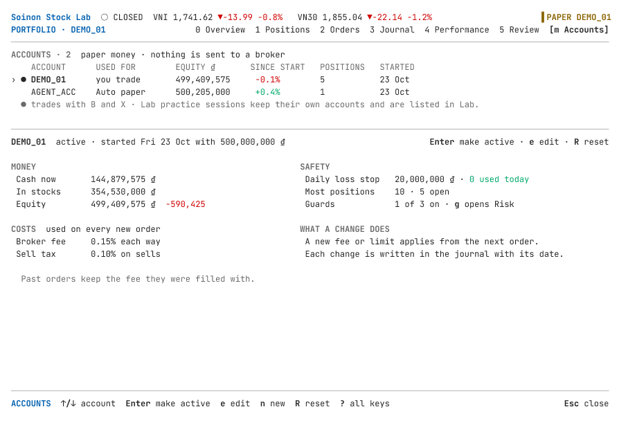
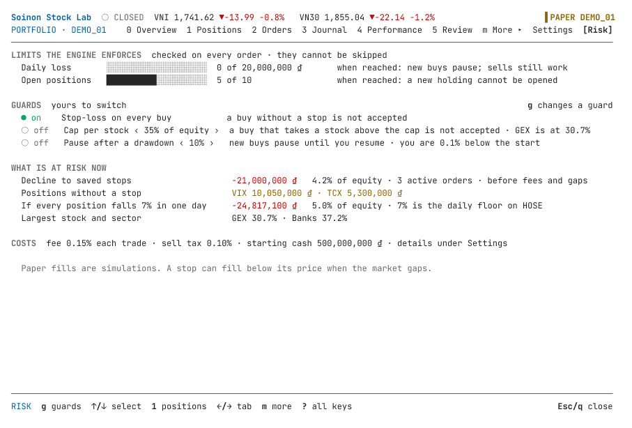
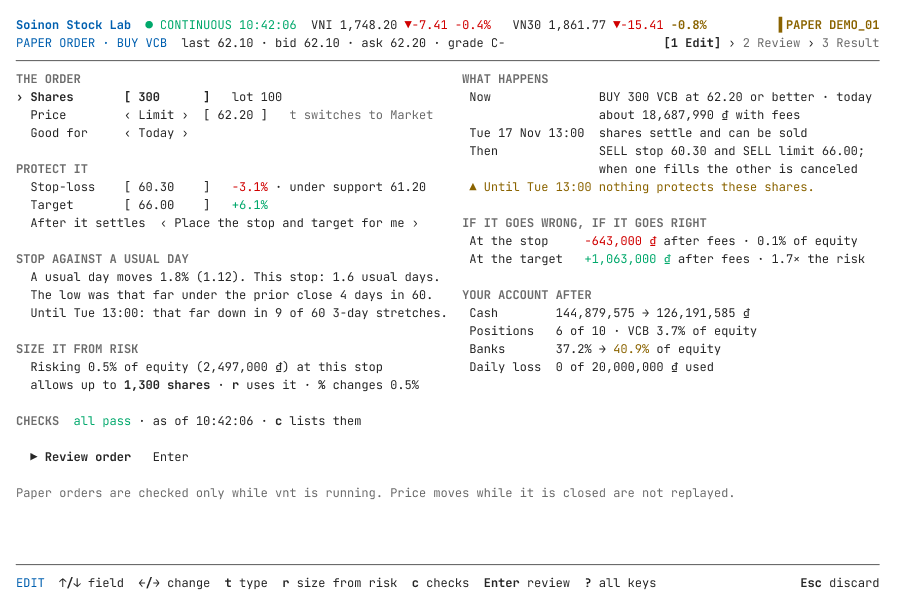
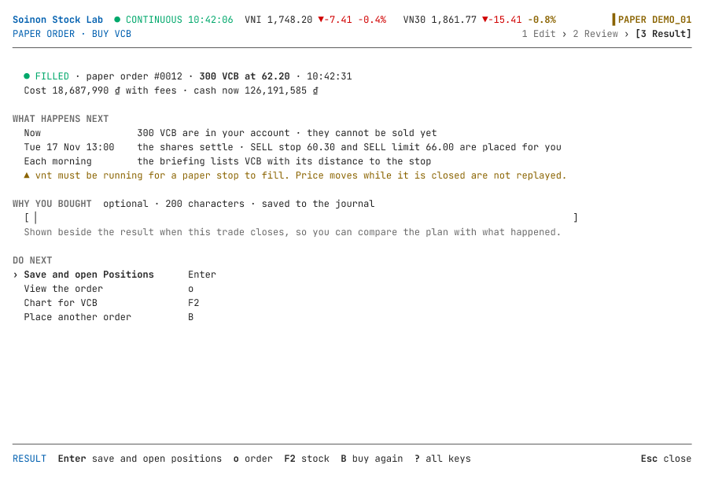
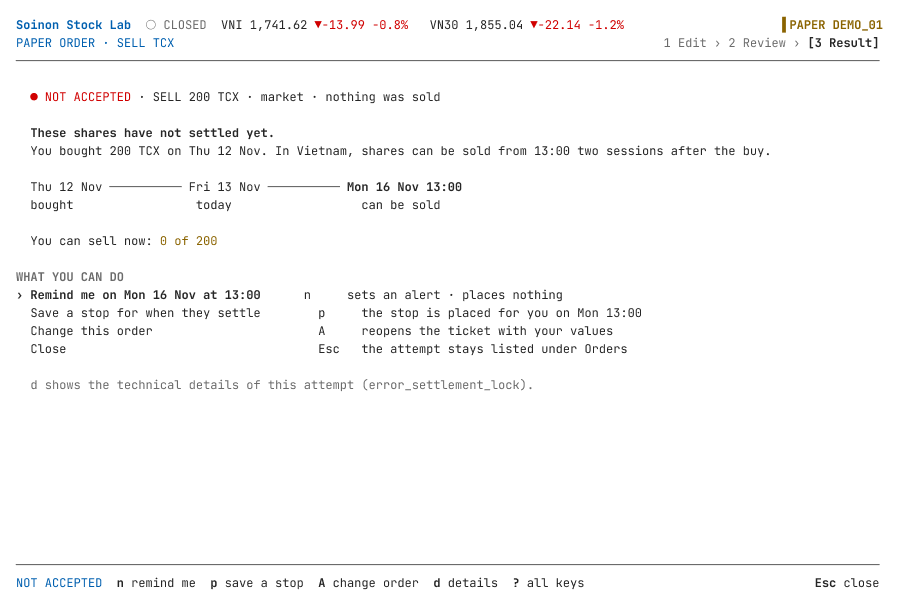

# 5 · Paper

**Purpose:** Practise trading stocks with simulated cash under authentic Vietnamese market mechanics — **100-share lots, exchange ticks, `±7%/10%/15%` daily bands, T+2 settlement at `13:00`, broker fees, and sell tax** — plan your stop-loss and target before entering, keep hard risk guards on, and audit your decisions honestly when trades close.

> **Paper only.** Simulated orders never reach a real broker. Live paper orders, stops, and targets are evaluated **only while `vnt` is open**; moves while the app is closed are not replayed.

---

## Use cases & user stories (Benefits)

- **Learning Vietnam trading mechanics safely:** *"As a newcomer, I keep mixing up round lots, tick sizes, and when newly bought shares actually settle. Let me make mistakes with pretend money first."* → Paper enforces exact exchange rules and shows clear settlement timelines whenever an order cannot fill yet.
- **Building risk-first sizing habits:** *"I want to cap every trade loss at 0.5% of my account and verify my stop isn't tighter than normal daily volatility (`ATR14`)."* → Every buy ticket calculates **`Size it from risk`** and **`Stop against a usual day`** before you confirm.
- **Fixing repeated emotional mistakes:** *"I want to know whether I actually follow my stops and which entry reasons (`Price above MA20`, `Volume confirmation`) make money over time."* → **Review**, **Your reasons**, and **Trade review** track your discipline and outcomes objectively.

---

## 1. Your first paper account

On your first visit, Paper offers a simple guided setup (`500,000,000 ₫` or custom starting cash, broker fees, sell tax, and safe default limits). You can run multiple paper accounts (`DEMO_01`, strategy sandboxes, etc.); one account stays **active** in the top-right header badge. *(Lab practice replays keep separate isolated cash.)*

---

## 2. Portfolio workspace (`0 Overview` – `5 Review` + `More`)

### `0 Overview` — Portfolio health & `NEEDS YOU`
**Purpose:** Check total equity, available cash, urgent stop/settlement warnings, all positions, and hard engine caps on one screen.

Notice how **`NEEDS YOU`** puts risk gaps right up front (`VIX and TCX have no stop`, `GEX is 2.2% above its stop`, `TCX settles Mon 16 Nov 13:00`), while **`RISK`** displays live bars for hard **Daily loss** and **Open positions** limits plus **Decline to saved stops** (`To stops -21,000,000 ₫`).

### `1 Positions` — Detailed holdings & `Can sell`
**Purpose:** Check **Can sell** (settled shares not already reserved by open sell orders), individual entry lots, linked orders, and briefing notes per holding.

### `2 Orders` & Protection states
**Purpose:** Follow every resting, queued, filled, cancelled, or rejected order with plain-English triggers (**`IT FILLS WHEN`** and **`GOOD UNTIL`**) and saved **Drafts**.

**Understanding stop protection states:**
- `● order active` — Live stop order armed and watching quotes while `vnt` runs.
- `◐ pending` — Bought shares haven't settled (`T+2 13:00`); bracket stop activates automatically upon settlement.
- `○ plan only` — You saved a planned stop price, **but no actual order is armed**.
- `▲ no plan` — Neither stop plan nor order exists.

**Drafts:** Save limit orders you are not ready to submit yet, or queue them for the next continuous open (all risk limits are re-checked before execution).

### `3 Journal` — Immutable facts + your notes
**Purpose:** Pair permanent account execution receipts (`Orders` and `Fills`) with your editable trading thoughts, tags, and revision history.

### `4 Performance` & `Trade review`
**Purpose:** Judge closed trades after fees and sell tax — tracking equity against `VN-Index`, win/loss averages, stop discipline (*With a stop* vs *Stop kept*), and **`R` multiples**.

Selecting any closed trade opens **Trade review**, putting **Your plan** beside **What happened** over an enlarged price chart marking entry (`B`), exit (`S`), plan edits (`◆`), and fill receipts (plus an optional paid AI Trade coach reading objective facts only):

### `5 Review` & `Your reasons`
**Purpose:** Evaluate your *process* each week (stop usage, written reasons, benchmark vs agent & `VN-Index`), never grading or lecturing you:

Opening **Your reasons** groups closed trades by the structured entry reasons you chose on buy tickets (*Volume confirmation*, *Price above MA20*, *A level you named*) and checks how often each condition still held 5 and 20 sessions later (*blind replays are counted separately so practice stays clean*):

### `More` → `Accounts` & `Risk`
- **Accounts:** Switch active accounts, create new sandboxes, edit fees/limits for future orders cleanly (never rewriting past fills), or reset an account with an automatic backup first:

- **Risk:** Review **hard limits enforced by the engine on every order** (`Daily loss` pauses new buys; `Open positions` blocks excess slots), toggle optional **Guards** (*Stop-loss on every buy*, *Cap per stock*, *Pause after a drawdown*), and measure current portfolio stop exposure:

---

## 3. Placing a planned order (`1 Edit` → `2 Review` → `3 Result`)

### Worked beginner example: buying `300 VCB` with a full risk plan

1. **`THE ORDER`:** Choose `Limit 62.20` for `300` shares (`lot 100` enforced, costing `~18,687,990 ₫` with fees).
2. **`PROTECT IT`:** Set Stop-loss **`60.30`** (`-3.1%`, just under `support 61.20`) and Target **`66.00`** (`+6.1%`). Keep *After it settles* active so your protective bracket arms automatically on **`Tue 17 Nov 13:00`** when shares settle.
3. **`STOP AGAINST A USUAL DAY`:** `vnt` checks `ATR14` (`1.8%` / `1.12`) and confirms your stop sits **`1.6 usual days`** away (hit on only `4 of 60` past days) — and warns clearly that unsettled shares are unprotected until `Tue 13:00`.
4. **`SIZE IT FROM RISK`:** Risking `0.5%` of equity (`2,497,000 ₫`) allows up to `1,300` shares, so buying `300` shares (`-643,000 ₫`, `0.1%` risk) stays well within budget with `1.7×` reward-to-risk.
5. **`2 Review`:** Confirm all engine checks (`all pass`) and the dated settlement timeline:

6. **`3 Result`:** Once filled, see order confirmation, remaining cash, settlement timing, and an optional **`WHY YOU BOUGHT`** note saved to your Journal:

### What happens when an order violates a rule (`Not accepted`)
If you attempt something disallowed — such as selling shares bought yesterday before `T+2 13:00` settlement — `vnt` refuses cleanly, illustrates the timeline, and offers immediate next actions (set a reminder when settled, schedule a post-settlement stop, or edit the order):

---

## How to open and use Paper (Controls)

Open **Paper** via `F3` → `5`, `:portfolio`, or `P` on the Market board. Switch tabs with `←` `→` or `0`–`5`, and open **Accounts / Risk** with `m` (`Esc`/`q` closes Paper).

### Quick reference keys
- **Order ticket (`B` buy / `X` sell anywhere):** `↑` `↓` field · `←` `→` choice · `t` order type · `r` size from risk · `c` list checks · `Enter` Review → submit (`r` refreshes stale quotes) · `Esc` discard.
- **Positions:** `B` / `X` buy/sell · `p` edit stop/target plan · `n` note · `F2` open Stock page.
- **Orders:** `Enter` details · `A` amend price/size · `C` cancel (asks first) · `f` filter · `d` drafts & queued orders.
- **Journal:** `n` new note · `A`/`Enter` edit/annotate · `D` delete (asks first) · `v` by trade/event · `/` filter · `r` note history · `x` export CSV.
- **Performance & Review:** `Enter` open Trade review (`M` coach) · `s` save equity now · `w` open **Your reasons** · `A` Agent track record · `i` valuation details · `x` export.
- **Accounts & Risk:** `Enter` switch/restore account · `n` new · `e` edit fees/limits · `R` reset (backs up first) · `g` toggle guards on Risk.
