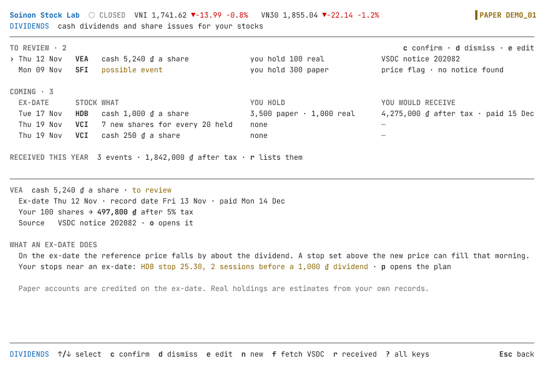
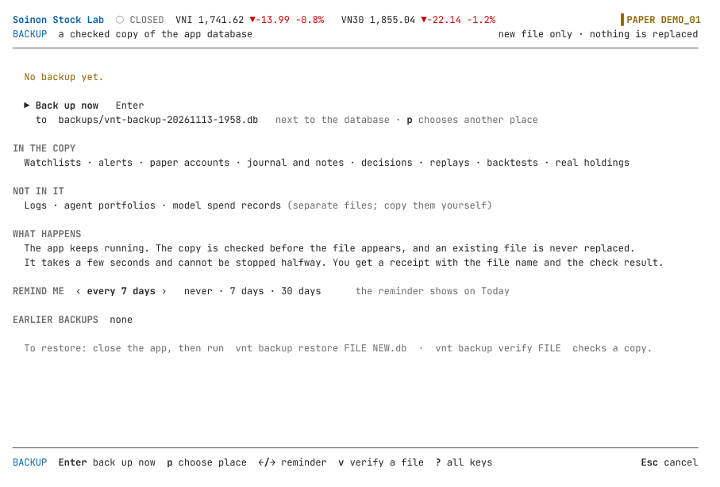
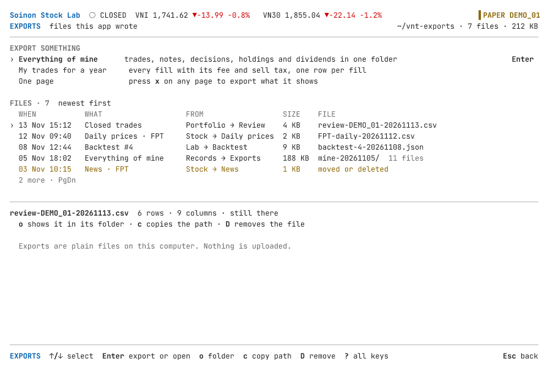
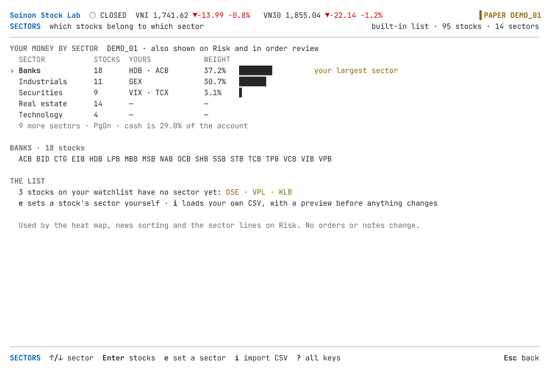
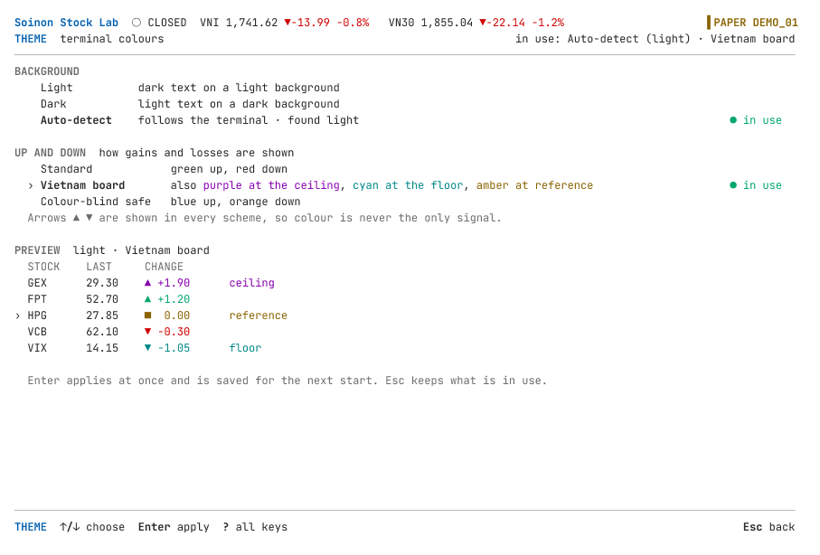
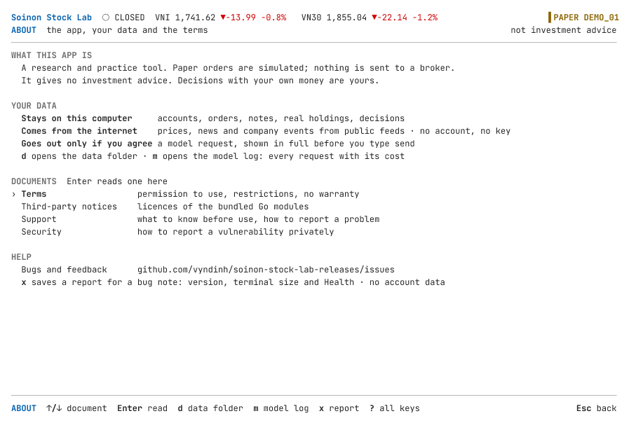

# 8 · Records

**Purpose:** Manage everything private on your computer — read-only tracking of shares you actually own, corporate dividends and ex-dates, verified SQLite database backups, CSV/JSON/HTML exports, feed & calendar diagnostics, industry sector tags, visual themes, and terms/bug reports. **Nothing in Records sends private account data anywhere or places broker orders.**

---

## Use cases & user stories (Benefits)

- **Monitoring real broker stocks privately:** *"I own 3 real stocks at my broker and want `vnt` to show their technical grades, support/resistance, news, and dividend payouts without touching any broker login."* → Keep them in **Real holdings** (completely separate from Paper cash).
- **Preventing surprise ex-dividend stop triggers:** *"Why did my stock drop `-4%` at open on ex-dividend day and hit my stop?"* → Track upcoming dates in **Dividends** so warnings appear ahead of time on Today, Briefing, and Stock charts.
- **Peace-of-mind backups & shareable offline reports:** *"Before updating `vnt`, I want a verified database backup — plus clean standalone HTML reports I can view in any browser."* → Run **Backup** and **Save as page (HTML)**.

---

## 1. Records Home

Records puts local health, backup reminders (`▲ No backup yet`), calendar warnings (`2027 calendar not loaded`), and uncategorized sector reminders in one clean index:


---

## 2. Real holdings (`:portfolio real`)

**Purpose:** Private read-only ledger of real-world shares, cost basis, unrealized P&L against saved daily closes, weights, grades, and upcoming corporate events.


### Safe CSV import with pre-save verification & snapshot rollback
When importing a broker/spreadsheet CSV, `vnt` previews every row *before* writing (`+` new, `*` updated, `!` needs fix like fractional shares), lets you pick *Add and update* vs *Replace*, and takes an automatic **snapshot** beforehand so you can restore anytime:


---

## 3. Dividends & corporate actions

**Purpose:** Track upcoming cash dividends (net of Vietnam's `5%` dividend cash tax) and bonus share issues across both paper and real holdings, and catch unexplained ex-date price drops cleanly:



*(Paper accounts credit dividends automatically on the ex-date; Real holdings display estimated payouts.)*

---

## 4. Backup

**Purpose:** Write a verified, non-destructive copy of your SQLite file (`watchlists, alerts, paper accounts, journal, decisions, replays, backtests, real holdings`) while `vnt` stays open (`~/vnt/backups/`), and schedule friendly 7-day or 30-day reminders:



*(Logs, experimental agent portfolios, and separate model spend files live outside the main SQLite database — back those up separately if used.)*

---

## 5. Exports & Standalone HTML pages

**Purpose:** Export individual views or your entire year/account bundle as portable **CSV**, **JSON**, or **single-file offline HTML pages** under `~/vnt-exports`:



Saving a **Backtest**, **Replay**, or **Trade review** as a static HTML page lets you open interactive-quality charts and tables in any browser cleanly:


---

## 6. Health, Sectors, Theme & About

- **Health:** Runs the same diagnostics as `vnt doctor` — verifying database integrity, exchange calendar coverage, last backup age, live connection & latency to all four public feeds (`VPS`, `Entrade`, `KBS`, `CafeF RSS`), agent status, and terminal geometry:


- **Sectors:** Shows tagged stock counts (`vnt sectors import` loads bundled tags or your CSV) driving **Market → Sector heat map** and **Paper** sector caps:



- **Theme:** Switch between **Light**, **Dark**, or **Auto-detect** terminal background and choose **Standard**, **Vietnam board** (ceiling purple / floor cyan / reference amber), or **Colour-blind safe** palettes:



- **About:** Summarizes local data boundaries, opens Terms / Third-party notices / Support / Security docs, opens your data folder, and exports a clean bug report containing zero private account data:



---

## How to open and use Records (Controls)

Open **Records** via `F3` → `8` or `:records` (`↑` `↓` and `Enter` open rows; `b` backs up immediately).

- **Real holdings (`:portfolio real`):** `Enter` open stock · `i` CSV import (`e` fix invalid row, `A` confirm save) · `e` edit · `D` remove · `p` refresh prices · `b` include in Daily briefing · `h` restore snapshot · `x` export CSV/JSON.
- **Dividends:** `n` add manually · `e` edit · `f` fetch VSDC notices · `r` view received this year.
- **Backup & Restore:** `Enter` back up now · `p` pick folder · `←` `→` reminder schedule · `v` verify backup file. To restore, close `vnt` and run in a terminal:
  ```text
  vnt backup verify FILE
  vnt backup restore FILE NEW.db
  vnt --db NEW.db
  ```
- **Exports, Health, Sectors, Theme, About:** `o` open folder · `c` copy path · `D` delete export · `r` re-check Health · `d` open data folder · `x` export bug report.
