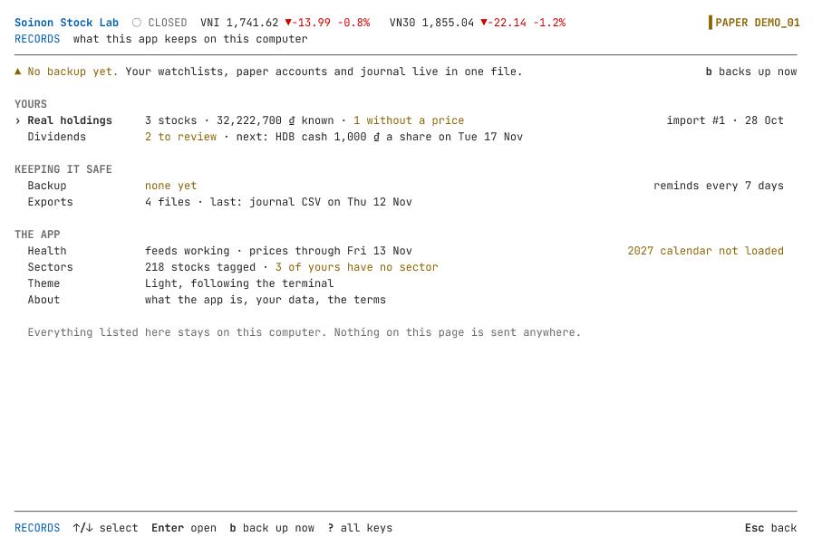
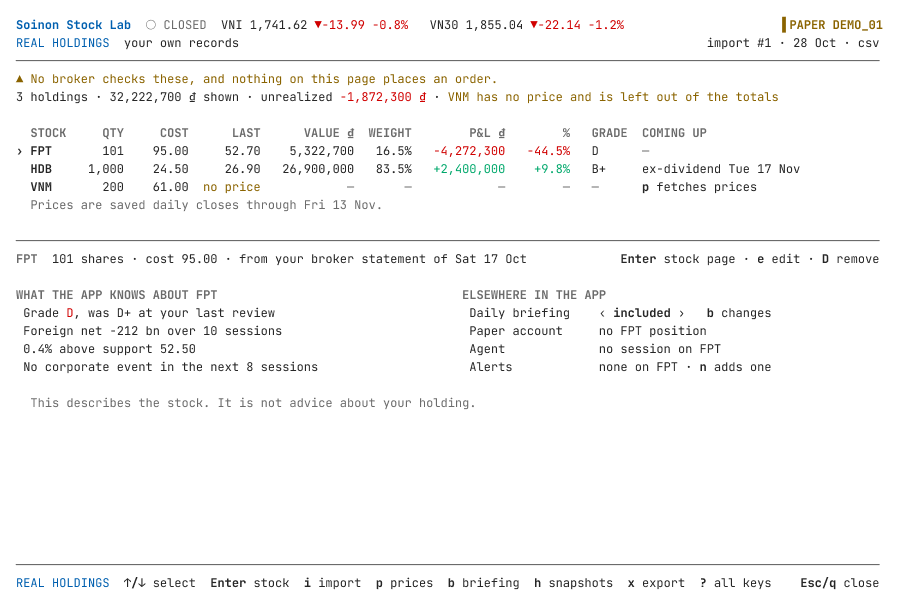
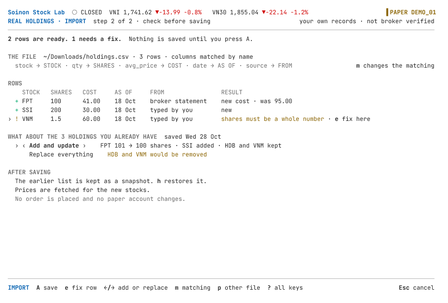
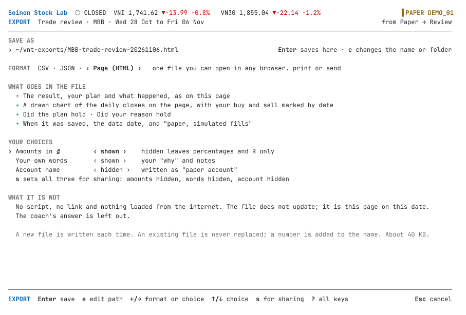
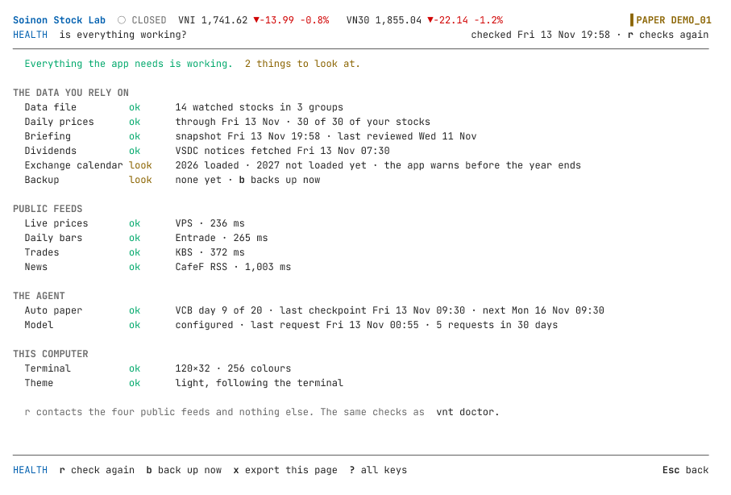

# 8 · Records

**Purpose:** Manage everything stored privately on your computer — real-world holdings records, dividends and corporate actions, verified database backups, CSV/JSON/HTML exports, feed & calendar Health diagnostics, industry sector tags, colour themes, and legal/about info. **Nothing on Records places orders or sends your data anywhere.**

**How to get there:** Press `F3` then `8`, or type `:records`.

## Use cases & user stories

- **Tracking real broker stocks safely alongside research:** *"I hold real shares at a broker and want to see their `vnt` technical grades, support/resistance levels, news, and upcoming dividends — without ever risking an accidental order."* → Import a CSV into **Real holdings** (100% read-only; no broker keys).
- **Never getting surprised by an ex-dividend drop:** *"My stop triggered unexpectedly because the stock paid a cash dividend overnight."* → Track **Dividends** so ex-dates show up on Today, Daily briefing, and Stock charts ahead of time.
- **Sharing a clean report or backing up before an upgrade:** *"I want a verified backup of my watchlists and trade journal, plus an HTML report I can open in Chrome or send to a friend."* → Use **Backup** (`b`) and **Save as page (`x`)**.



Notice the clear reminders at the top (`▲ No backup yet` — press **`b`** anytime to back up!) and quick status beside every row (`2027 calendar not loaded`, `3 stocks without sector`, etc.).

---

## 1. Real holdings (`:portfolio real`)

**Purpose:** Keep a private, read-only tracker of shares you actually own at a real broker — completely separate from Paper accounts so you can watch your real stocks' grades, support/resistance levels, dividends, and news in one place.



### Importing from CSV (`i`) — example
1. Open **Real holdings** and press **`i`**.
2. Enter the path to your broker/spreadsheet CSV, map columns (`stock`, `shares`, `cost`, `currency`, `as-of date`, `source`), and confirm whether cost prices are in **thousand dong** (`95.00`) or **dong** (`95,000`).
3. Inspect the dry-run preview (rows added, updated, and any errors flagged inline like fractional shares), press `e` to fix any row, then press **`A`** to save (`Add and update` keeps other holdings intact; `vnt` creates a snapshot first).



**Keys:** `Enter` open stock · `i` import CSV · `e` edit holding · `D` remove · `p` refresh prices · `b` include/exclude in Daily briefing · `h` snapshots · `x` export CSV/JSON.

---

## 2. Dividends & corporate actions

**Purpose:** Track upcoming **ex-dividend dates**, cash payouts (after 5% dividend tax), and bonus share issues across both your **paper** and **real** holdings — and flag price jumps that might be unrecorded corporate actions.


- **Why ex-dates matter for beginners:** On the **ex-date**, the exchange adjusts the reference price down by roughly the dividend value. A tight stop-loss placed just under yesterday's close can trigger unexpectedly that morning if you didn't check **Dividends** first!
- Paper accounts credit dividend cash and bonus shares automatically on the ex-date; Real holdings show estimates (`f` fetches VSDC notices; `n` adds manually; `e` edits; `r` shows payouts received this year).

---

## 3. Backup

**Purpose:** Create a verified, standalone copy of your entire local database (`watchlists, alerts, paper accounts, journal, decisions, replays, backtests, real holdings`) without interrupting your session. Existing backups are **never** overwritten.


Press **`Enter`** to write a checked backup to `~/vnt/backups/` (`p` chooses another folder; `v` verifies a backup file; `←` `→` toggles the Today reminder between `never`, `every 7 days`, or `every 30 days`).

To restore from backup, close `vnt` first and run in your terminal:
```text
vnt backup verify FILE
vnt backup restore FILE NEW.db
vnt --db NEW.db
```
*(Logs, experimental agent portfolios, and separate model spend files live outside the main SQLite database — copy those manually if needed.)*

---

## 4. Exports & Saving as a standalone HTML page

**Purpose:** Export your trades, notes, or full data out of `vnt` as portable **CSV**, **JSON**, or self-contained **HTML pages** you can open in any web browser (`~/vnt-exports`).


On chart and report pages (such as **Backtest**, **Replay**, or **Trade review**), pressing **`x`** lets you save a clean **single-file HTML report**:



Files stay 100% offline on disk (`o` reveals the file in your file manager, `c` copies its path, `D` deletes it).

---

## 5. Health (`vnt doctor`)

**Purpose:** One-stop diagnostics checking your SQLite database, exchange calendar coverage, last backup age, live connection & latency to all four public market feeds (`VPS`, `Entrade`, `KBS`, `CafeF RSS`), agent status, and terminal capabilities.



Each row marks **`ok`** or **`look`** with the exact fix (`r` re-tests feeds, `x` exports diagnostics).

---

## 6. Sectors & Theme & About

- **Sectors:** Shows how many stocks carry industry sector tags (`vnt sectors import` loads bundled tags or your custom CSV) — powering the Market **Sector heat map (`H`)** and Paper sector concentration checks.


- **Theme:** Pick **Light**, **Dark**, or **Auto-detect** terminal background plus **Standard**, **Vietnam board** (purple ceiling / cyan floor / amber reference), or **Colour-blind safe** colours (`Enter` applies immediately and remembers across restarts).


- **About:** Summarizes what data stays local vs public feeds, lets you read `TERMS.md`, `THIRD_PARTY_NOTICES.md`, `SUPPORT.md`, and `SECURITY.md`, opens your data folder (`d`), and exports a sanitized bug-report summary (`x`) containing zero account details.


