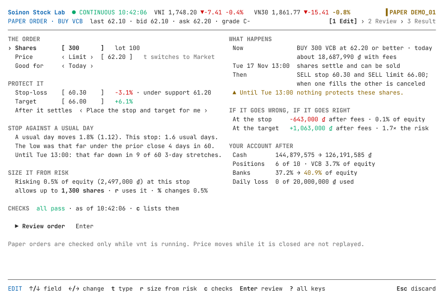
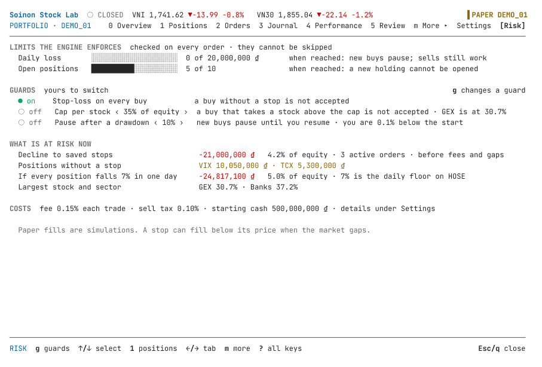

# Risk management & position sizing (Beginner guide)

Predicting where a stock goes tomorrow is uncertain. **Controlling how much you can lose when a trade goes wrong is 100% under your control before you ever click Buy.** This guide explains the **risk-first math behind `vnt`'s Paper order ticket, `ATR14` check, and hard account guards** so one bad call never wipes out weeks of careful progress.

*(To place or review simulated orders inside the TUI, see [5 · Paper](paper.md).)*

---

## 1. Use cases & benefits for beginners

- **Surviving inevitable losing streaks:** *"Even a good strategy loses 4–5 times in a row. How do I size trades so a normal slump barely dents my account?"* → Risk **`0.5%` to `1.0%` of equity (`1R`)** per trade instead of guessing round VND amounts.
- **Equalizing risk across volatile vs calm stocks:** *"Stock A moves `±4%` a day while Stock B moves `±1.2%`. Should I buy the same VND amount of both?"* → Position sizing from your stop distance + **`ATR14`** shrinks share count automatically on wild stocks and keeps real risk steady.
- **Avoiding Vietnam market traps before entry:** *"Why did my stop not protect me after buying yesterday?"* → Learn how **`T+2 13:00` settlement**, **floor-lock gaps**, and **ex-dividend drops** affect every Vietnam trade.

---

## 2. Position sizing: size from your stop, never from a hunch

Beginners usually start with *"How much cash do I have?"* or *"Let me put `50,000,000 ₫` into this."* Experienced traders ask **how much equity they are willing to lose if wrong**:

$$\text{Max shares} = \frac{\text{Account equity} \times \text{Risk \%}}{\text{Entry price} - \text{Stop price}}$$

*(Rounded down to Vietnam's **100-share lot**.)*

### Worked example from `vnt` (`300 VCB`)

Look at how `vnt` checks every number automatically before you submit:
1. **Your account & risk budget:** Suppose total equity is `499,400,000 ₫` and your chosen risk limit is **`0.5%`** = **`2,497,000 ₫` (`1R`)**.
2. **Your invalidation (`Stop-loss`):** Chart support sits at `61.20` (`61,200 ₫`), so you set your stop safely underneath at **`60.30`** with entry limit **`62.20`**. Risk per share is `62.20 − 60.30 = 1.90 kVND` (`1,900 ₫`).
3. **Result (`SIZE IT FROM RISK`):** `2,497,000 ÷ 1,900 ≈ 1,314 shares` → **`1,300` shares max** (`13` lots). Buying just `300` shares risks only `-643,000 ₫` (`~0.1%` of equity including fees/tax), keeping plenty of headroom for other positions.
4. **Reward-to-risk ratio:** Target **`66.00`** offers `+3.80 kVND` upside against `1.90 kVND` risk (`1.7×` net after estimated fees/tax).

---

## 3. Why `0.5%`–`1%` risk survives losing streaks (Expectancy math)

### Drawdown from losing streaks
Losses hurt asymmetrically: recovering from `-10%` requires `+11.1%`; recovering from **`-50%` requires `+100%`**. Compare risking **`0.5%`** vs **`5%`** per trade across **8 consecutive losses**:

| Risk per trade (`1R`) | Remaining equity after 5 losses | Remaining equity after 8 losses | Return needed just to get back to even |
|---|---|---|---|
| **`0.5%`** *(conservative)* | `97.5%` (`-2.5%`) | `96.1%` (`-3.9%`) | `+4.1%` |
| **`1.0%`** *(standard)* | `95.1%` (`-4.9%`) | `92.3%` (`-7.7%`) | `+8.3%` |
| **`2.0%`** *(aggressive)* | `90.4%` (`-9.6%`) | `85.1%` (`-14.9%`) | `+17.5%` |
| **`5.0%`** *(dangerous)* | `77.4%` (`-22.6%`) | **`66.3%` (`-33.7%`)** | **`+50.8%`** |

### Expectancy: why win rate alone lies
Expectancy combines **how often you win** with **how big wins are vs losses** (measured in `R` multiples):

$$\text{Expectancy} = (\text{Win Rate} \times \text{Avg Win } R) - (\text{Loss Rate} \times \text{Avg Loss } R)$$

- **High win-rate trap (`70%` wins):** Winning `70%` of trades at `+0.4 R` while letting the `30%` losers bleed `-2.0 R` gives `(0.70 × 0.4) − (0.30 × 2.0) = -0.32 R` — **slowly losing money overall**.
- **Healthy trend plan (`45%` wins):** Winning `45%` of trades at **`+2.2 R`** while cutting the `55%` losers cleanly at **`-1.0 R`** gives `(0.45 × 2.2) − (0.55 × 1.0) = +0.44 R` per trade over time!

---

## 4. `ATR14` stop placement ("Stop against a usual day")

If your stop sits too close (`0.5%` away on a stock averaging `±2.5%` daily swings), random morning noise triggers your stop before the move even starts. Look at **`STOP AGAINST A USUAL DAY`** in `vnt`:
- **`< 0.8× ATR14`:** Dangerously tight — frequently swept by ordinary intraday noise.
- **`1.0×` to `2.0× ATR14`:** Healthy breathing room, especially when tucked beneath structural **Support** (`LEVELS`).
- Never widen a stop *after* entering just to avoid taking a loss — reduce share quantity before buying instead!

---

## 5. Vietnam-specific risk hazards every trader must respect

1. **`T+2` at `13:00 ICT` settlement lock:** Shares bought today **cannot be sold** until **`13:00` two trading sessions later** — even if price plunges right past your stop the next morning. Because of that lock, avoid oversized buys before risky earnings, policy announcements, or stretched spikes.
2. **Floor locks (`-7%` HOSE / `-10%` HNX / `-15%` UPCoM) & overnight gaps:** A protective stop is a trigger, **not a price guarantee**. If bad news causes a gap down or locks the bid queue at daily floor (`▾`), a stop order queues and fills only when buyers return — potentially much lower than your stop line.
3. **Ex-dividend (`ex-date`) reference drops:** On ex-dividend morning, exchanges adjust the reference price downward for cash/stock dividends. Check **Today (`COMING UP`)** and **Records → Dividends** so an expected mechanical price drop doesn't trip an unprepared stop.
4. **App must be open for paper stops/targets:** In `vnt` Paper trading, resting limit/stop orders evaluate live quotes **only while `vnt` is running**.

---

## 6. Deterministic Risk Guards built into `vnt`

Inside **Paper → Risk**, every manual trade **and every AI agent trade** must pass non-bypassable checks written directly in Go code before an order can enter:
- **Hard Engine Limits:** **Daily loss cap** (blocks new buys once realized/open daily loss hits limit) and **Max open positions** (prevents over-diversified clutter).
- **Optional Guards you can enforce:** **Stop-loss required on every buy**, **Single-stock concentration cap**, and **Auto-pause after drawdown**.
- **Live book stress gauge (`To stops`):** Paper Overview continuously totals the exact dong loss if every position dropped to its saved stop right now — letting you check total portfolio heat in one glance.
