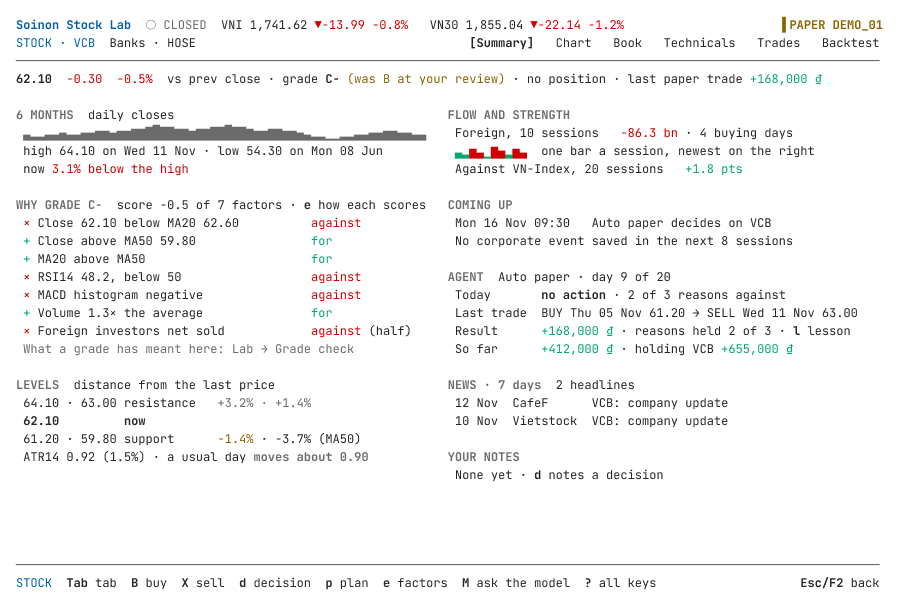
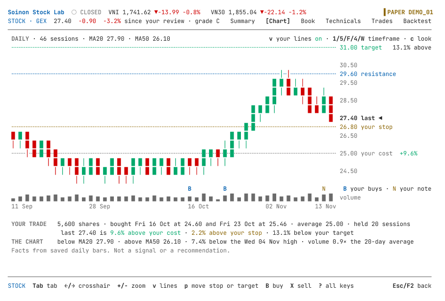
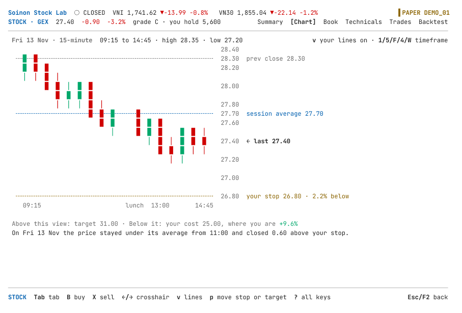
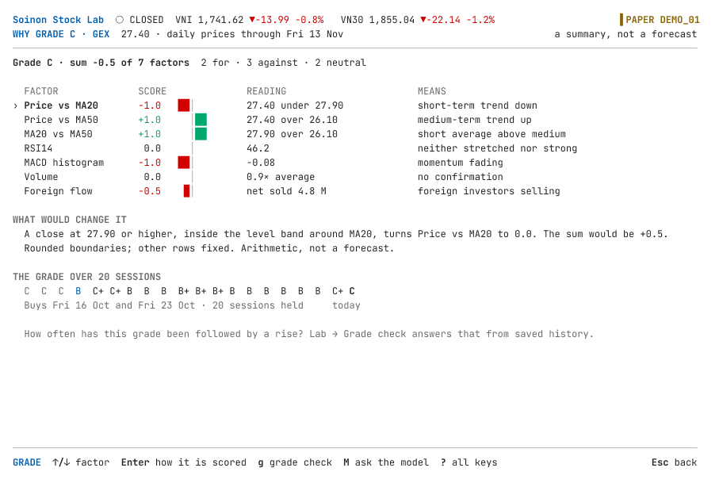
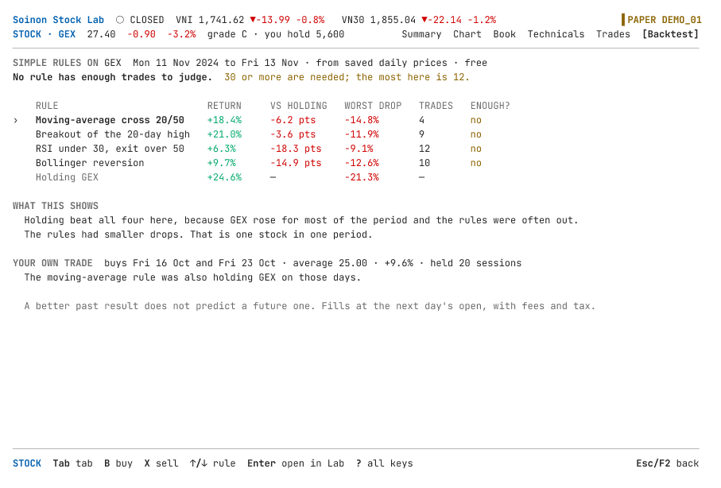
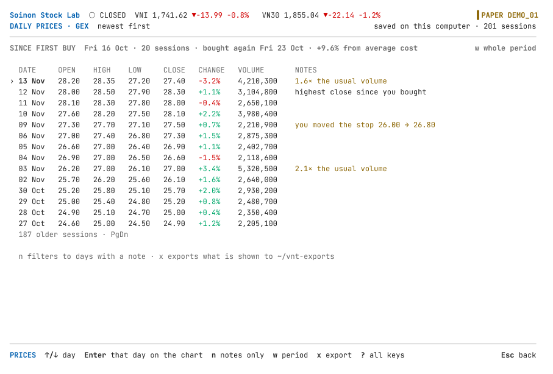

# 3 · Stock

**Purpose:** Understand one stock from every angle — its overall technical grade and why, its price history and levels, its interactive chart (with your own cost, stop, target, saved levels, measure tool, and lower indicator panes), live order book depth, recent trade prints, and local 4-rule backtest preview.

**How to get there:** Press **`Enter`** or **`F2`** on any stock from Today, the Market board, Find, or Paper. Or press **`F3`**, type the stock code (like `VCB` or `GEX`), and press **`Enter`**. Press `Esc` or `F2` to go back.

Stock has six tabs across the top bar — move between them with `Tab` / `Shift+Tab` (`vnt` remembers your last open tab).

> Want to learn the chart theory behind candlesticks, moving averages, RSI, MACD, ATR, and support/resistance? See [Reading charts & technical analysis](chart-reading.md).

## Use cases & user stories

- **30-second health check before buying:** *"Before placing an order on `VCB`, I want to know its overall trend, nearby support/resistance, how big a normal daily swing (`ATR14`) is, and whether foreigners are buying or selling."* → Open **Summary** (`1`st tab) — everything sits on one page.
- **Placing & adjusting a stop without getting shaken out:** *"My `GEX` buy is up `+9.6%` and I want to trail my stop-loss up to lock profits, without putting it so close that one normal session knocks me out."* → Press `p` directly on **Chart** (`2`nd tab) and read the **ATR usual day** check before pressing `Enter`.
- **Remembering why a price mattered:** *"I spotted a key gap edge at `28.00` last week and want a visible reminder line on both daily and intraday charts — plus an alert if price reaches it."* → Move the crosshair there and press `y` (**Your level**), then `n` to turn it into an alert.

---

## 1. Summary

**Purpose:** Everything important about one stock on a single calm page — price, grade, 6-month trend, why the grade stands where it does, key levels, foreign flow, upcoming corporate/agent events, recent news, and your notes.

### How to read the blocks (example: `VCB 62.10`)
- **Top header:** Last price (`62.10` = 62,100 ₫), day change (`-0.30`, `-0.5%`), current grade (`C-`), whether the grade shifted since your last briefing review (`was B at your review`), plus your active paper position or last closed paper trade (`+168,000 ₫`).
- **`6 MONTHS`:** A compact close-price sparkline, the 6-month high (`64.10`) and low (`54.30`) with exact dates, and how far today's price sits below the peak (`3.1% below`).
- **`WHY GRADE`:** All 7 daily scoring factors marked `+` (`for`), `×` (`against`), or neutral, giving the total score (`-0.5 of 7 factors`). Press **`e`** for the full rule math or `Lab → Grade check`.
- **`LEVELS` & `ATR14`:** Nearest resistance above (`63.00` at `+1.4%`, `64.10` at `+3.2%`), nearest support below (`61.20` at `-1.4%`, `MA50 59.80` at `-3.7%`), and **ATR14** (`0.92`, meaning a typical session moves about `0.90`).
- **`FLOW AND STRENGTH`:** Foreign net buying/selling over the last 10 sessions (bars show green buying days vs red selling days, newest on the right) and the stock's 20-session performance **against VN-Index** (`+1.8 pts` stronger than the index).
- **`COMING UP`, `AGENT`, `NEWS`, `YOUR NOTES`:** Next scheduled Auto paper run or ex-dividend event, your agent's latest action/lesson on this stock, cached 7-day headlines, and your decision notes (`d` adds a decision note).

---

## 2. Chart

**Purpose:** Read daily (`4`), weekly (`W`), or intraday (`1`/`5`/`F`) candlesticks alongside your own trade lines, measure price swings, save custom price levels, inspect corporate events and limit days, and move your paper stop or target safely.

### Reading the Chart screen (example: `GEX`)
- **Right price axis (`last ◀`):** Bold black `27.40 last ◀` marks the latest price. Coloured dashed horizontal lines label `target` (`31.00`, `13.1% above`), `resistance` (`29.60`), `your stop` (`26.80`), and `your cost` (`25.00`, `+9.6%` profit). If a line sits outside the visible chart height, `vnt` names it below the plot (`Above view:` / `Below view:`) instead of squashing the candles.
- **Marker row above volume:** `B` marks days you bought shares, `S` marks sells, `N` marks decision notes, `E` marks ex-dividend dates, and `▲`/`▾` mark ceiling/floor limit closes (`stock-chart-lower-pane.png` below).
- **`YOUR TRADE` & `THE CHART`:** Summarizes your shares, fills, distance to cost/stop/target, and plain descriptive chart facts (`below MA20 27.90 · above MA50 26.10 · 7.4% below the Wed 04 Nov high · volume 0.9×`). Never a buy/sell recommendation.

### Intraday view (`1`, `5`, `F` for 1m / 5m / 15m)

Switch from daily (`4`) to `15m` (`F`), `5m` (`5`), or `1m` (`1`) to inspect exact session movement, **`session average` (VWAP)**, yesterday's close (`prev close`), and a clean **`lunch`** gap between `11:30` and `13:00`:

*(Notice how distant `target 31.00` and `cost 25.00` move into the compact summary line below so intraday candles keep maximum height.)*

### Crosshair mode (`←` `→` or `PgUp` `PgDn`)

Press **`←`** or **`→`** to drop a vertical dashed crosshair onto any candle (`PgUp` / `PgDn` jump 5 bars at a time).

- The top readout gives exact **Date, Open, High, Low, Close, % Change, Volume, and Volume vs average** for that bar.
- **`ON THIS DAY`** reminds you what *you* did on that date (`you bought 2,800 at 25.46`) alongside `MA20`, `MA50`, and `RSI14` on that bar.
- **`SINCE THEN`** tells you how many sessions passed to today (`15 sessions · +7.6%`).
- Press **`Enter`** while in crosshair mode to jump straight to that exact date in **Daily prices**. Press `Esc` to exit crosshair.

### Measure tool (`m` from crosshair)

In crosshair mode, press **`m`** to anchor a start bar, then move `←` `→` to measure any swing cleanly without saving anything.

`BETWEEN` shows sessions elapsed (`8 sessions`), % return (`+17.0%`), point change (`+4.34`), highest/lowest closes, up sessions (`6 of 8`), and **`SAME DAYS`** compares the move against **VN-Index** (`+0.8% → GEX did 16.2 points better`). Press `m` again to clear.

### Your saved price levels (`y` from crosshair)

Press **`y`** in crosshair mode (or **`↑` `↓`** to step by exact exchange ticks; `PgUp`/`PgDn` step 1%) to mark up to **8 personal price lines per stock**, add a short note (up to 60 characters, e.g. `"gap from 04 Nov"`), and press **`Enter`** to save.

Saved levels persist across daily and intraday charts, show up in `Summary → LEVELS`, can prefill a price alert (`n`), and serve as snap targets (`s`) when moving a stop (`D` removes a saved level after confirmation).

### Lower panes (`'`) & event marks

Press **`'`** on the daily Chart to rotate the lower pane through: **Volume** → **RSI14** → **MACD histogram** → **Relative strength (`vs VN-Index`)**.

Here `GEX` is plotted directly against `VN-Index` (`GEX +3.4% · VN-Index -2.1% · 5.5 points better`), while **`EVENTS`** below explains `E 09 Oct ex-dividend` and `▲ 03 Nov closed at the ceiling (+6.9%)`.

### Moving your stop or target (`p`)

If you hold a paper position (or have a plan), press **`p`** directly on the Chart to adjust your **stop-loss** or **target** (`t` switches to target) with live risk math.

- Use `↑` `↓` to step by one valid tick (`0.05`), `PgUp`/`PgDn` by `1%`, or **`s`** to snap under the nearest support or saved level.
- `vnt` warns you immediately if the stop is tighter than **a usual day (`ATR14`)** (`▲ this stop is 0.5 of one under the last price · breached on 23 of the last 60 sessions`).
- Nothing changes in your paper account until you press **`Enter`**. Paired bracket orders update atomically (never cancel-and-recreate). An agent-owned position cannot be moved here.

### Complete Chart tab key list

| Key | Does |
|---|---|
| `1` `5` `F` `4` `W` | Switch bars: 1-minute, 5-minute, 15-minute, daily (`4`), weekly (`W`) |
| `←` `→` (`PgUp` `PgDn`) | Enter/move crosshair (`5` bars with `PgUp`/`PgDn`) |
| `+` `-` / `[` `]` / `0` | Zoom in/out · pan earlier/later · jump back to latest bars |
| `c` | Cycle chart style: thin candles → braille candles → block candles → line |
| `'` | Cycle lower pane: Volume → RSI14 → MACD → vs VN-Index |
| `v` | Toggle your position & plan lines (`your lines on/off`) |
| `p` | Move stop-loss or target (`t` toggles between stop and target, `s` snaps to support) |
| `m` | In crosshair: measure sessions, return, and index comparison between two bars |
| `y` | In crosshair: save/edit a custom price level (up to 8 per stock) |
| `n` | In crosshair: prefill a price alert at that level |
| `Enter` | In crosshair: inspect that bar in Daily prices |
| `C` | Practise this stock blindly in **Lab → Chart study** |
| `B` / `X` | Open Paper Buy / Sell order ticket |
| `Esc` | Exit tool / clear crosshair, then return |

---

## 3. Book

**Purpose:** Inspect live **best bids and asks** with queue sizes when supplied by the feed, plus daily reference/ceiling/floor limits, volume, your position, and key levels.

When the feed provides no order depth (or off hours), Book states this honestly instead of fabricating levels. Never assumes volume exists beyond visible rows.

---

## 4. Technicals (`e` Why this grade, `M` Ask the model)

**Purpose:** Examine all 7 daily scoring factors in a numeric scorecard, check what is **not** inside the score (`CONTEXT`), inspect multi-timeframe direction, and compute exact price thresholds that would flip the grade.

- **`FOR AND AGAINST`:** Press `↑` `↓` to select any of the 7 factors (`Price vs MA20`, `Price vs MA50`, `MA20 vs MA50`, `RSI14`, `MACD histogram`, `Volume`, `Foreign flow`) and read its exact rule at the bottom of the table.
- **`CONTEXT · not in the score`:** Displays **ADX14** trend strength, 5-day **On-balance volume (OBV)** direction, any **1–3 bar candlestick signals** (`Doji`, `Hammer`, `Engulfing`, `Morning Star`, etc.) found on the latest bars, **ATR14**, and 7-day news sentiment.

### Why this grade (`e`)

Press **`e`** on Technicals (or Summary) to open the full numeric explanation:

- **`WHAT WOULD CHANGE IT`** calculates the exact closing price needed to flip the selected factor (`A close at 27.90 or higher turns Price vs MA20 to 0.0, raising sum to +0.5`) — pure arithmetic, not a forecast.
- **`THE GRADE OVER 20 SESSIONS`** tracks how the stock's letter grade evolved over the last 20 trading days (computed strictly without lookahead).
- Press **`g`** from here to open **Lab → Grade check** and test whether higher grades actually preceded higher returns in your saved database.

### Ask the model (`M`, optional paid model)

Press **`M`** on Technicals or Why this grade (after confirming the exact cost) to ask your configured model for a plain-language explanation grounded strictly in those 7 numbers:

Saved answers reopen anytime from `Agent → Model log` for free and separate verified numeric **Facts** (`●`) from model **Interpretation** (`c` rates helpfulness, `r` asks again).

---

## 5. Trades

**Purpose:** Read recent individual matched prints from the KBS feed (timestamp, price, share volume, and whether the buyer or seller initiated the trade) plus an aggressive buy/sell volume summary.

- If only partial intraday volume is captured by the feed, `Trades` states the exact share/percentage covered so you don't treat a subset of prints as the whole session.
- Press `f` to toggle **large prints only**, and `r` to reload recent prints.

---

## 6. Backtest

**Purpose:** Run a quick, local preview of four fixed trading rules on this stock's saved daily bars without creating saved clutter in Lab.

It previews **Moving-average cross 20/50**, **Breakout of 20-day high**, **RSI under 30 / exit over 70**, and **Bollinger reversion** side-by-side against simply holding the stock (`↑` `↓` picks a rule; `Enter` carries it into **Lab → Backtest** if you want full charts, equity curves, and watchlist-wide runs).

---

## Daily prices (`:history FPT` or `Enter` on Chart crosshair)

**Purpose:** Inspect the exact raw daily OHLCV bars stored on your computer, newest first, alongside your own paper buys (`B`), sells (`S`), stop moves, decision notes, and unusual volume days.

| Key | Does |
|---|---|
| `↑` `↓` | Scroll daily sessions |
| `Enter` | Jump to that exact date on `Stock → Chart` |
| `n` | Filter to rows that have a note, buy, sell, or event |
| `w` | Switch the window summary period at the top |
| `x` | Export the table as CSV to `~/vnt-exports` (matches `vnt history --csv`) |

> **How daily bars are saved:** Opening a stock's daily Chart (`4`) saves completed bars. Today's bar is marked complete only after the market closes (`14:45` ICT). Daily briefing (`f`) and Chart study's history library also refresh saved bars cleanly.
