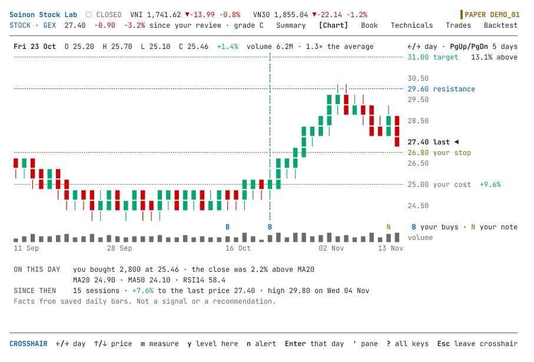
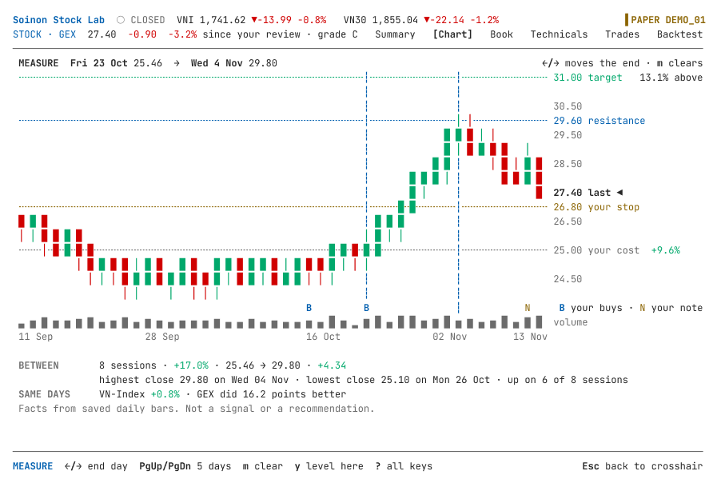
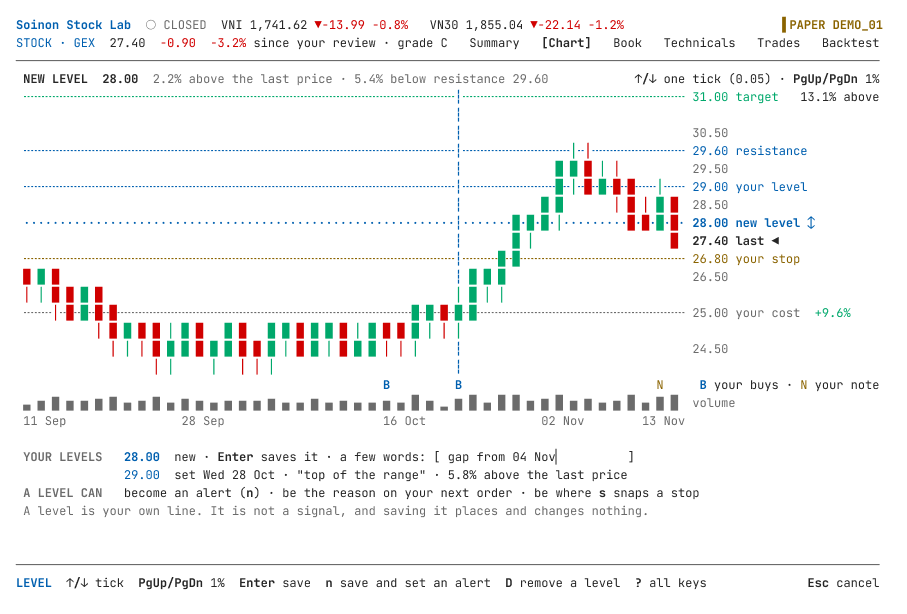
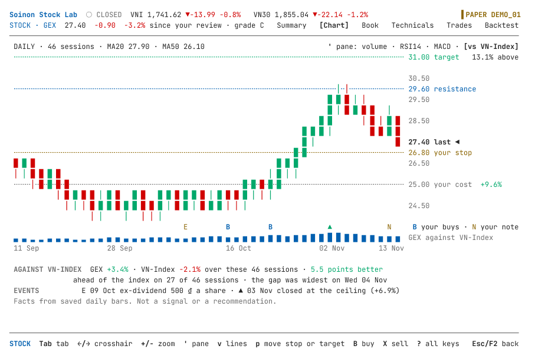
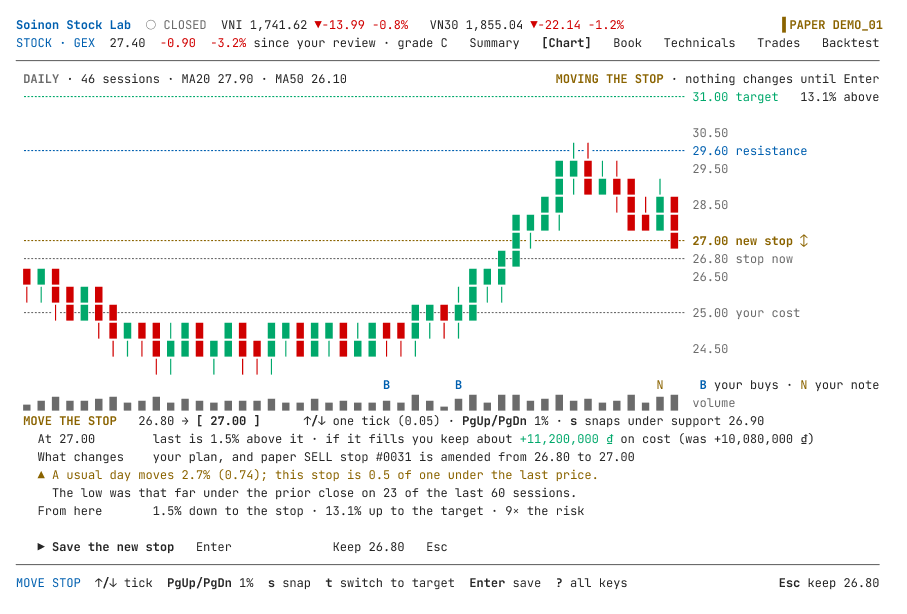
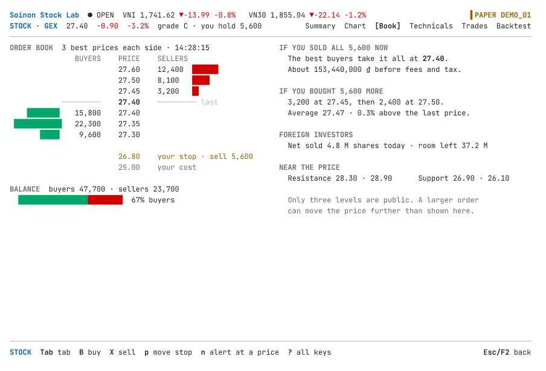
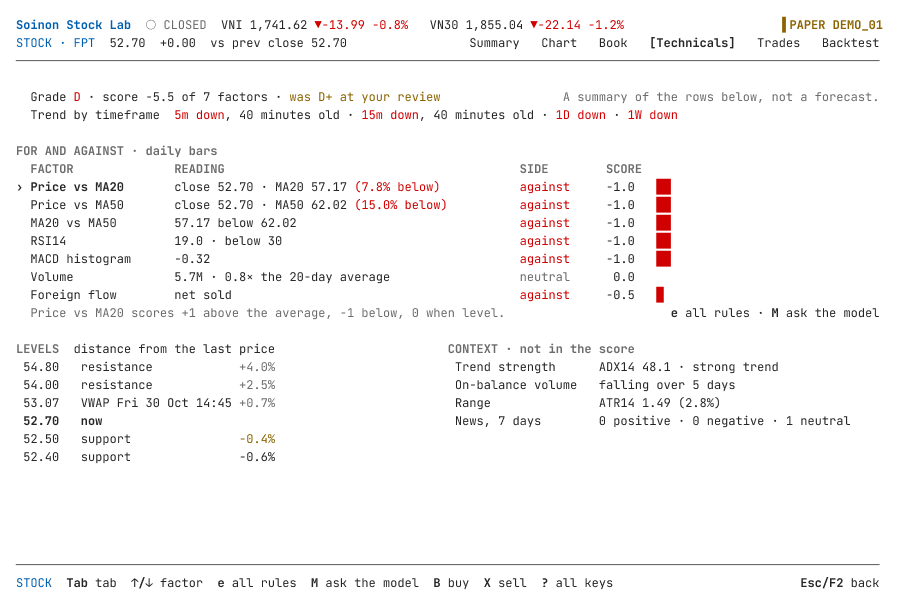
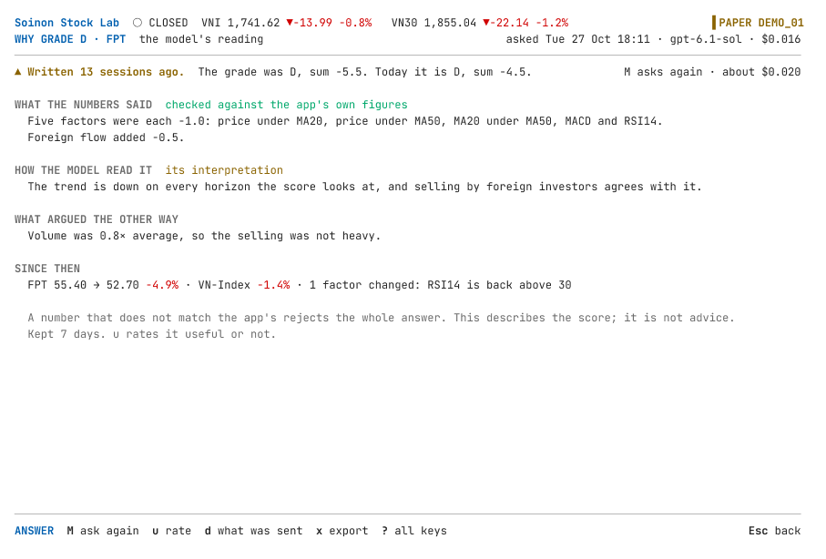
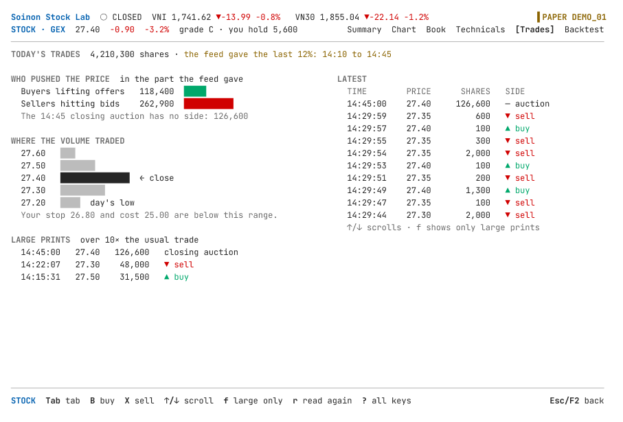

# 3 · Stock

**Purpose:** Inspect any single stock deeply before you make a decision — checking its technical grade and *exact* flip thresholds, reading daily/weekly/intraday candlestick charts beside your own position and saved levels, inspecting live order-book depth and matched trades, and previewing how four classic rules performed on its history.

> Want to learn the chart concepts first? Read [Reading charts & technical analysis](chart-reading.md).

---

## Use cases & user stories (Benefits)

- **30-second stock health check before buying:** *"Before buying `VCB`, I want one clean screen showing its 6-month trend, all 7 technical factors, support/resistance, normal daily swing (`ATR14`), foreign flow, and recent news."* → **Summary** gathers all of that on a single page.
- **Trailing a stop without getting tripped by routine volatility:** *"My `GEX` buy is up `+9.6%`. I want to raise my stop directly on the chart while checking whether my new stop is tighter than an average day's noise."* → Use **Move stop** directly on **Chart**, checking the live **ATR usual-day** comparison before confirming.
- **Measuring swings & marking personal levels:** *"I want to measure how much `GEX` gained vs `VN-Index` over an 8-day swing and save a dashed line at a gap level so I can turn it into an alert later."* → Use Chart **Crosshair**, **Measure**, and **Your levels**.
- **Understanding why a grade is `C` or `D`:** *"Instead of a black-box score, show me what each factor read, what exact closing price would change the grade, and whether `A` stocks beat `D` stocks in history."* → Inspect **Technicals** and **Why this grade**.

---

## 1. Summary

**Purpose:** Put everything essential about one stock on one calm page — price, grade history change, 6-month closes, factor summary, levels & volatility (`ATR14`), foreign flow & strength vs `VN-Index`, upcoming events, agent activity, news, and your personal notes.

### Example walkthrough: reading `VCB 62.10`
- **Header:** Last price `62.10` (62,100 ₫), down `-0.5%`, grade `C-` *(note: amber text warns `was B at your review`)*, plus your last closed trade result (`+168,000 ₫`).
- **`6 MONTHS`:** Daily sparkline showing the 6-month high (`64.10 on Wed 11 Nov`), low (`54.30 on Mon 08 Jun`), and distance off peak (`3.1% below`).
- **`WHY GRADE`:** All 7 daily checks (`+` for, `×` against), summing to `-0.5 of 7`.
- **`LEVELS`:** Nearest ceilings (`63.00` at `+1.4%`, `64.10` at `+3.2%`), floors (`61.20` at `-1.4%`, `MA50 59.80` at `-3.7%`), plus **`ATR14 0.92 (1.5%) · a usual day moves about 0.90`** — telling you any stop closer than `0.90` can easily be hit by normal daily noise.
- **`FLOW AND STRENGTH`:** Ten-day foreign bars (`-86.3 bn` net, `4 buying days`) beside 20-session performance **`Against VN-Index: +1.8 pts`** (stronger than the market).
- **`COMING UP`, `AGENT`, `NEWS`, `YOUR NOTES`:** Scheduled Auto paper checks or dividends, your agent's latest `VCB` lesson, cached 7-day headlines, and decision notes.

---

## 2. Chart

**Purpose:** Study candlesticks across daily, weekly, and intraday views alongside your cost, protective stop, profit target, fills (`B`/`S`), decision notes (`N`), corporate events (`E`), ceiling/floor closes (`▴`/`▾`), and personal price lines.

### Reading the Chart (`GEX` example)
- **Right price axis (`last ◀`):** Bold **`27.40 last ◀`** anchors current price. Dashed horizontal lines mark `31.00 target (+13.1%)`, `29.60 resistance`, `26.80 your stop`, and `25.00 your cost (+9.6%)`. Lines sitting outside the chart's visible height never squash the candles — they appear neatly under the plot (`Above view` / `Below view`).
- **Volume & marker row:** `B` marks days you bought shares, `N` marks decision notes, `E` marks ex-dividend dates, and `▲`/`▾` mark ceiling/floor closes.
- **`YOUR TRADE` & `THE CHART`:** Plain-English summary of your share average, fills, distance to cost/stop/target, and factual chart state (`below MA20 27.90 · above MA50 26.10 · volume 0.9×`).

### Intraday view (`1m`, `5m`, `15m`)
Switch to intraday candles to inspect session action beside **yesterday's close (`prev close`)**, **`session average` (`VWAP`)**, and a clean **`lunch` break** gap between `11:30` and `13:00`:

### Crosshair inspection
Inspect any historical bar to read exact **Open, High, Low, Close, % Change, Volume**, what *you* traded on that bar (`ON THIS DAY`), and how price moved afterwards (`SINCE THEN: 15 sessions · +7.6%`):

### Measuring swings (`Measure`)
Anchor one date and move across any swing to read **sessions elapsed**, **% return**, **highest/lowest close**, **up-day count**, and **`SAME DAYS` performance against VN-Index** (`+17.0%` vs index `+0.8%` = `16.2 points better`) — without saving clutter:

### Personal price levels (`Your levels`)
Mark up to **8 personal lines per stock** (snapped to valid exchange ticks) with short notes like `"gap from 04 Nov"` or `"top of the range"`. Saved levels persist on both daily and intraday charts, show up in Summary, can prefill price alerts directly, and act as quick snap points when moving stops:

### Indicator lower panes & Event marks
Rotate the bottom panel through **Volume**, **RSI14**, **MACD histogram**, and **Relative strength (`vs VN-Index`)**, while **`EVENTS`** below explains `E` ex-dividends and `▲`/`▾` ceiling/floor closes:

### Adjusting a protective stop or target directly on Chart (`Move the stop`)
Adjust your **stop** or **target** visually against candlesticks and support lines, with an automatic **`ATR14` usual-day check** (`▲ this stop is 0.5 of one under the last price · breached 23 of last 60 sessions`) before anything commits — paired bracket stops and targets update atomically:

---

## 3. Book

**Purpose:** Inspect live best bid/ask depth queues when supplied by the public feed, plus daily reference/ceiling/floor limits, share volume, your holding, and support/resistance. When a feed supplies no depth levels, Book says so honestly instead of guessing.

---

## 4. Technicals, Why this grade & Model answer

**Purpose:** Show every scoring factor (`FOR AND AGAINST`), exact reading, score bar, multi-timeframe trend (`5m`, `15m`, `1D`, `1W`), levels ladder, and non-scored **`CONTEXT`** (**ADX14**, **OBV**, **1–3 bar candlestick signals**, **ATR14**, **7-day news sentiment**).

### Why this grade (`All rules`)
Drills down into the exact rule math behind every factor, calculates **`WHAT WOULD CHANGE IT`** (the exact closing price needed to flip a factor — arithmetic, not a forecast), and prints **`THE GRADE OVER 20 SESSIONS`** chronologically:

### Optional Model explanation (`Ask the model`, paid per request)
With an API key configured and explicit cost confirmation, asks a language model to explain the 7 numbers in plain words — separating verified numeric **Facts (`●`)** from **Interpretation** and storing answers offline for later free reading:

---

## 5. Trades

**Purpose:** View recent individual matched trade prints from KBS (timestamp, price, size, buyer- vs seller-initiated) alongside aggressive buy/sell volume totals and partial-day coverage percentages.

---

## 6. Backtest preview

**Purpose:** Preview immediately on open how four simple fixed strategies (`MA cross 20/50`, `Bollinger reversion`, `20-day breakout`, `RSI 30/70`) would have performed on this stock's saved daily bars beside Buy-and-Hold — fetching nothing and saving no clutter.

---

## Daily prices (`:history CODE`)

**Purpose:** Browse every saved daily OHLCV bar on your computer (newest first) alongside window performance summaries and a **`NOTES`** column highlighting your paper buys (`B`), sells (`S`), stop moves, decision notes, and high-volume days.

*(Opening the daily chart `4` saves completed daily bars locally; today's bar finalizes only after `14:45` ICT.)*

---

## How to open and use Stock (Controls)

Open any stock by pressing `Enter` or `F2` on a row anywhere in `vnt`, or open **Go to** (`F3`), type the stock code (e.g. `VCB`), and press `Enter`. Move across the 6 tabs with `Tab` / `Shift+Tab` (`Esc` or `F2` goes back).

### Global Stock keys (most tabs)
| Key | Action |
|---|---|
| `B` / `X` | Open Paper BUY / SELL order ticket |
| `p` | Plan or move your stop-loss / target |
| `n` | Create a new price/indicator alert |
| `e` | Open full **Why this grade** rules & 20-session history (from Summary / Technicals) |
| `g` | Jump to **Lab → Grade check** (from Summary / Why grade) |
| `d` | Note a briefing decision (from Summary) |
| `M` | Ask configured AI model to explain the score (shows `$` cost first; on Summary / Technicals) |

### Chart tab controls
| Key | Action |
|---|---|
| `1` `5` `F` `4` `W` | Switch timeframe: `1m`, `5m`, `15m`, daily (`4`), weekly (`W`) |
| `←` `→` (`PgUp`/`PgDn`) | Enter / step crosshair (`5` bars with `PgUp`/`PgDn`) |
| `+` `-` / `[` `]` / `0` | Zoom in/out · pan earlier/later · reset to latest bars |
| `c` | Cycle chart style: thin candles → braille candles → block candles → line |
| `'` | Cycle lower pane: Volume → RSI14 → MACD → vs VN-Index |
| `v` | Toggle your trade/plan lines on/off |
| `p` | Move stop-loss or target (`t` toggles stop/target, `s` snaps to support/level, `Enter` saves) |
| `m` | In crosshair: measure swing & index comparison between two bars |
| `y` | In crosshair: save/edit personal price level (`D` removes) |
| `n` | In crosshair: prefill an alert at that price |
| `Enter` | In crosshair: jump to that date in **Daily prices** (`:history`) |
| `C` | Practise this stock blindly in **Lab → Chart study** |
| `Esc` | Exit tool / clear crosshair, then return |

### Trades, Backtest & Daily prices controls
- **Trades:** `f` filter large prints only · `r` refresh.
- **Backtest:** `↑` `↓` choose rule · `Enter` open full analysis in **Lab → Backtest**.
- **Daily prices (`:history FPT`):** `Enter` open date on Chart · `n` filter rows with notes/trades · `w` change window summary · `x` export CSV to `~/vnt-exports`.
