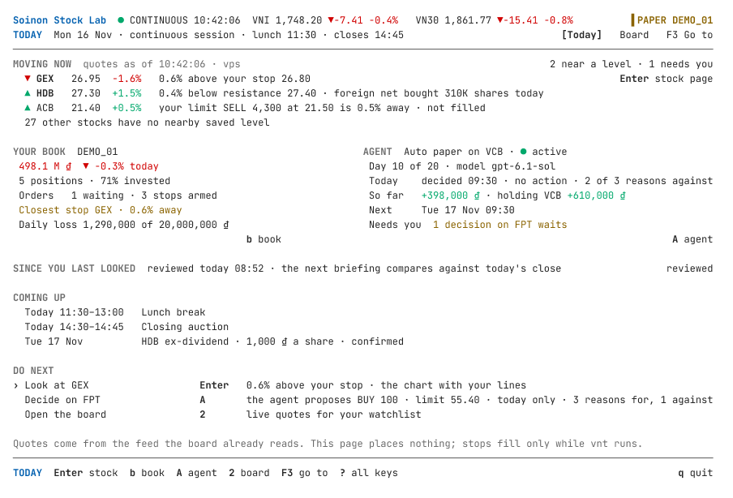

# 1 · Today

**Purpose:** Your calm daily starting point. Today answers four questions in one glance without opening five different screens:
1. Did any watched or held stock move near a key price level, stop, or order?
2. How does your active paper account stand right now?
3. Did your automated agent act or propose anything that needs your review?
4. What exchange session milestones or corporate dividends are coming up next?

**How to get there:** `vnt` opens on Today by default. From anywhere else, press `F3` then `1`, `:today`, or `1` from the Market board. *(To launch directly on the Market board instead, run `vnt --board`.)*

## Use cases & user stories

- **Morning pre-check (Beginner):** *"As a beginner holding 3–5 paper stocks, I want an instant check before trading starts so I know which holding is closest to my stop and whether any stock goes ex-dividend soon."* → Look at **`MOVING NOW`**, **`Closest stop`**, and **`COMING UP`** right away without digging through menus.
- **Quick co-pilot handoff (`Agent`):** *"As someone testing an Auto paper or approval agent, I want one banner telling me if the agent needs my decision so nothing executes behind my back."* → Watch **`Needs you`** and press **`A`** straight from **`DO NEXT`**.
- **One-key book summary:** *"At lunch break I want to check how much cash is free and how close my account is to its daily loss limit."* → **`YOUR BOOK`** answers in 4 lines (`b` opens full book exposure).

## How to read each section (with the example above)

### 1. `MOVING NOW` — stocks near something important
Instead of dumping your whole 30-stock watchlist, Today highlights only stocks close to an action trigger and tells you *why*:
- **`▼ GEX 26.95 -1.6% · 0.6% above your stop 26.80`** — A warning! GEX dropped close to your protective stop at `26.80` (26,800 ₫). Pressing `Enter` opens GEX's chart with your stop line drawn on it.
- **`▲ HDB 27.30 +1.5% · 0.4% below resistance 27.40 · foreign net bought 310K shares today`** — Price is testing a known ceiling (resistance) backed by foreign buying.
- **`▲ ACB 21.40 +0.5% · your limit SELL 4,300 at 21.50 is 0.5% away · not filled`** — Your resting sell order is nearly reached.
- Under those rows, Today quietly summarizes the rest (`27 other stocks have no nearby saved level`), keeping noise out of the way.

### 2. `YOUR BOOK` & `AGENT` — portfolio & assistant snapshot
- **`YOUR BOOK DEMO_01`:** Shows live total equity (`498.1 M ₫`, `-0.3% today`), how much capital is invested (`5 positions · 71% invested`), waiting orders and armed stop orders, the **Closest stop** (`GEX · 0.6% away`), and how much of your hard **Daily loss** limit (`1,290,000 of 20,000,000 ₫`) has been used today. Press **`b`** to open the full book view in the Daily briefing.
- **`AGENT`:** If Auto paper is running (here Day 10 of 20 on `VCB`), shows what it decided at `09:30`, session P&L, next checkpoint time, and **`Needs you: 1 decision on FPT waits`**. Press **`A`** to inspect and approve or decline it.

### 3. `SINCE YOU LAST LOOKED` & `COMING UP`
- **`SINCE YOU LAST LOOKED`:** Shows when you last marked the [Daily briefing](market.md#daily-briefing) reviewed (`today 08:52`) so you know what your comparison baseline is.
- **`COMING UP`:** Exchange schedule reminders for today (`11:30-13:00 Lunch break`, `14:30-14:45 Closing auction`) plus upcoming saved **ex-dividend dates** (`Tue 17 Nov HDB ex-dividend · 1,000 ₫ a share`). Seeing ex-dates early helps prevent surprise stop fills when the reference price adjusts down on the ex-date.

### 4. `DO NEXT` — plain-English next steps
A prioritized menu of up to four concrete actions (`↑` `↓` and `Enter`, or press the shortcut directly):
- `Enter` → Inspect `GEX` (closest to stop)
- `A` → Review the agent's proposed `BUY 100 FPT` order
- `2` → Open the live Market board

> **Safety reminder:** Today places **zero orders**. Simulated stops and price alerts are only checked while `vnt` is running.

## Example beginner morning routine (2 minutes)

1. Open `vnt` at 09:35 after the opening auction settles into `● CONTINUOUS`.
2. Check **`MOVING NOW`** to see if any held stock is threatening its stop-loss or testing resistance. Press `Enter` on `GEX` to view its Chart.
3. Glance at **`COMING UP`** for any upcoming ex-dividend dates on stocks you hold.
4. Press `v` (or open `:brief`) once a day to review what changed since yesterday's close.

## Keys on Today

| Key | Does |
|---|---|
| `↑` `↓` | Select a stock in `MOVING NOW` or a step in `DO NEXT` |
| `Enter` | Open the selected stock page (or run the selected `DO NEXT` step) |
| `F2` | Jump straight to the stock closest to its stop |
| `b` | Open your whole paper book summary in Daily briefing |
| `v` | Review daily changes (`:brief`) |
| `p` | Act on a stop plan step when `DO NEXT` shows one |
| `a` | Open a saved research brief (if one exists) |
| `A` | Open Agent Home / Decisions |
| `r` | Refresh the screen from current data |
| `2` or `Esc` | Switch to the live Market board |
| `F3` | Open Go to menu |
| `?` | Open Help |
| `q` | Quit `vnt` |
